<h3><strong>Why Climb Kilimanjaro?</strong></h3>

The idea of climbing Mount Kilimanjaro began to take shape for me in the summer of 2015. Following a hike I did to Machu Picchu in 2014, I was thirsty for more adventures. For the longest time, I thought you needed mountaineering skills to climb Kilimanjaro successfully. And to be honest, growing up in Rwanda, Kilimanjaro was a myth. Consequently, I felt that going on such an adventure was bringing me closer to my ancestors, and most importantly, taking on this challenge for me would be a way to mark my right of passage to adulthood.

Before I get in the nitty gritty part of this article, you can save or pin this article and come back later to it…

I successfully climbed my summit on the 21st of June 2016. Below, I am going to share with you the planning and preparation that helped me successfully climb Mount Kilimanjaro. Most importantly, I highly recommend that you follow a rigorous plan and training to contribute to the success of your endeavour. I’ll talk a bit more about that later on.

<h2>How to plan your Mount Kilimanjaro Climb</h2>

Congratulations! On taking on the challenge to climb Kilimanjaro. Now before planning your adventure, you must take a few critical decisions. This will help you plan your journey appropriately:

<ul>
<li>Reviewing and choosing a trekking agency/climbing operator</li>
<li>Selecting your route according to the number of days/nights you’re dedicating to the climb</li>
<li>Research available dates for making your trek</li>
<li>Checking and reviewing your physical condition</li>
</ul>

<h2>How long does it take to climb Mount Kilimanjaro?</h2>

There are seven routes that lead to the Uhuru peak (summit) and some overlap each other at different parts. Depending on the route you choose, it can take anywhere from five to nine days from the base to the summit and back. 

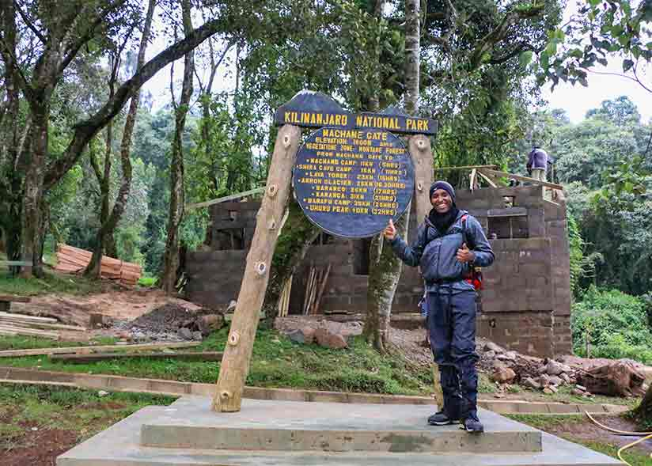
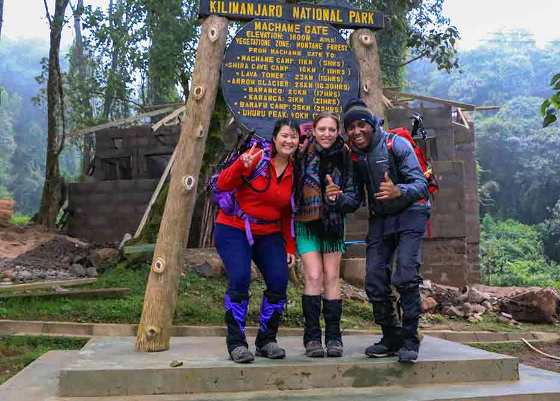
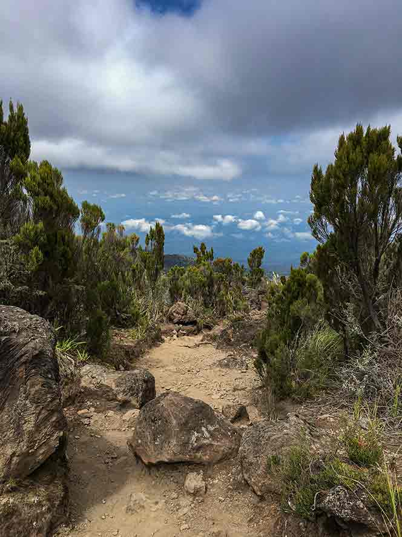
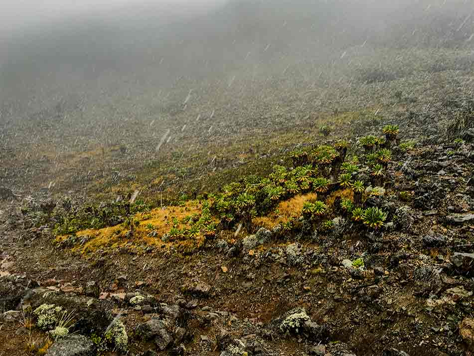

<h2>Kilimanjaro routes, which is the best?</h2>

There are seven main routes to the summit which vary in length and difficulty;

<ul>
<li>

<strong> Lemosho route:</strong> The Lemosho is the most beautiful Kilimanjaro route.

</li>
<li>

<strong>Machame route:</strong> The Machame is the most popular Kilimanjaro route, also known as the “Coca Cola.”

</li>
<li>

<strong>Marangu route:</strong> The Marangu route only offers hut accommodation.

</li>
<li>

<strong>Northern circuit:</strong> The Rongai is the only Kilimanjaro route that approaches from the North.

</li>
<li>

<strong>Rongai route:</strong> The Rongai is the only Kilimanjaro route that approaches from the North.

</li>
<li>

<strong>Shira route:</strong> The Shira route approaches from the Western side of Kilimanjaro.

</li>
<li>

<strong>Umbwe route:</strong> The Umbwe is the shortest, steepest and hardest Kilimanjaro route.

</li>
</ul> 

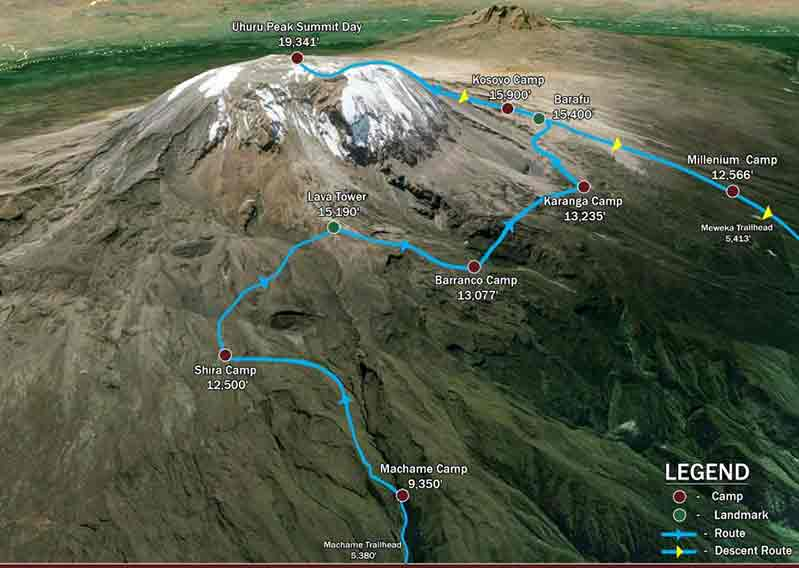

Machame Route · Map source: Zorilla Safaris

Choosing the ‘best’ route for climbing Kilimanjaro is personal and depends on many factors. Each route has its pros and cons and should be thoroughly examined before starting to plan your trek to Mount Kilimanjaro. Additionally, I have outlined a few factors below that will help you choose the most suitable route for you:

<ol>
<li>Acclimatisation profile of the route and the success rates</li>
<li>The beauty and variety of terrain and scenery</li>
<li>Time spent on the mountain</li>
<li>The total cost of the climb</li>
<li>What about difficulty????</li>
</ol>

 *<em>For my journey, I took the Machame route one of the popular routes on a 7-day trek (6 days up &amp; 1 day down). I went mid-June which is slightly still in early in the season but just after the raining season. </em>

The Machame route is known as the Whiskey route and heads up the mountain on the southwestern side. The route has sweeping views of the Shira plateau. Furthermore, the hike takes you past stunning natural features such as the volcanic section known as Lava tower, the Barranco Wall and the Mawenzi peak, to name a few. In conclusion, when climbing Kilimanjaro, you hike through five different climate zones: rainforest, grassland, moorland, alpine desert, and the arctic summit at the Uhuru Peak. 

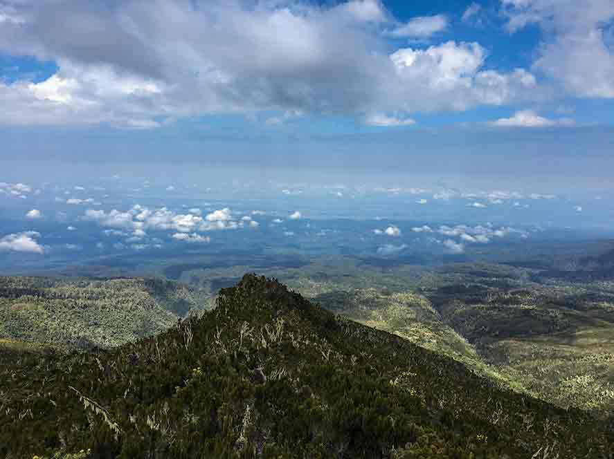
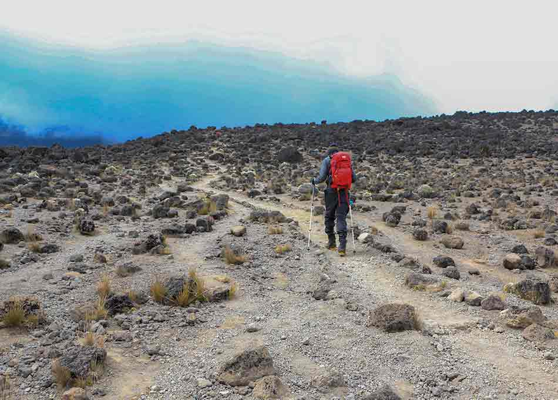
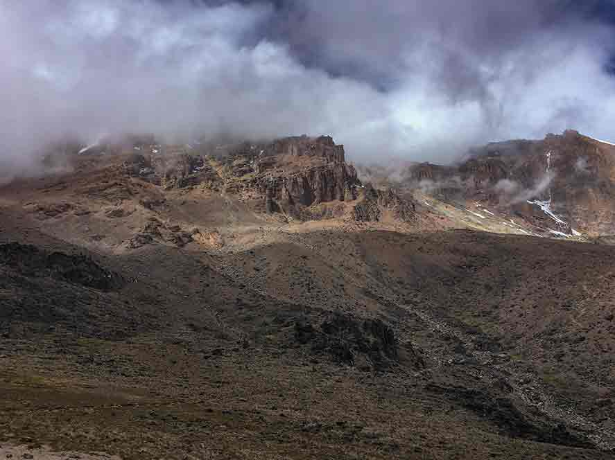
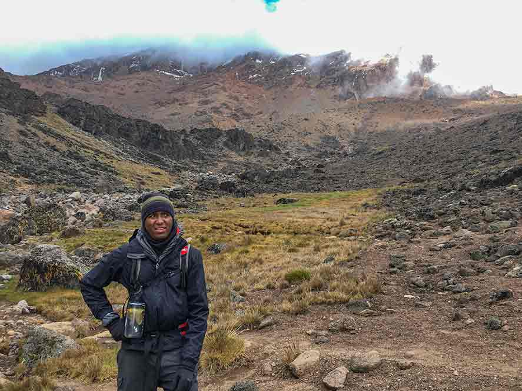

<h2>What’s the cost of Climbing Kilimanjaro?</h2>

The average cost to climb Mount Kilimanjaro located in national park ranges from US $1500 to US $5000. For a 6-day hike, the national park fee is fixed at US $900. Furthermore, rates will vary on different factors:

<ul>
<li>the choice of your operator and amenities offered your package</li>
<li>the size of the group that you will be joining on your trek </li>
<li>the length of your trek and the route you select</li>
</ul>

 <em>* My trek was planned on a nine-day schedule (with two additional days for acclimatisation) with a total cost of </em><em>US $</em><em>2350.</em>

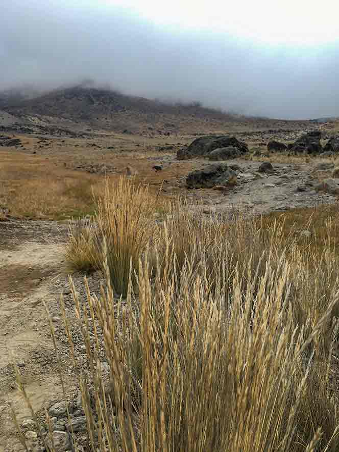
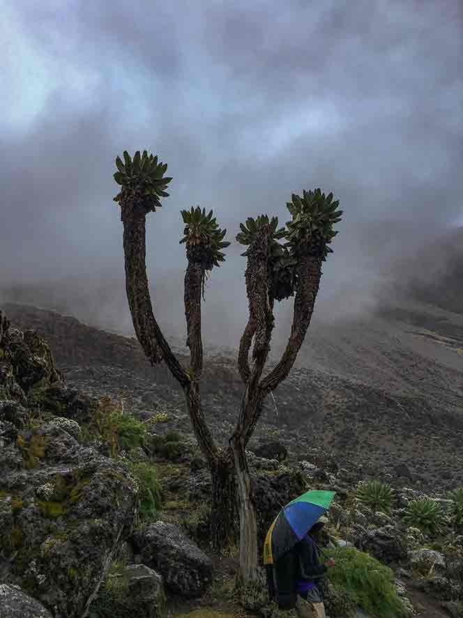
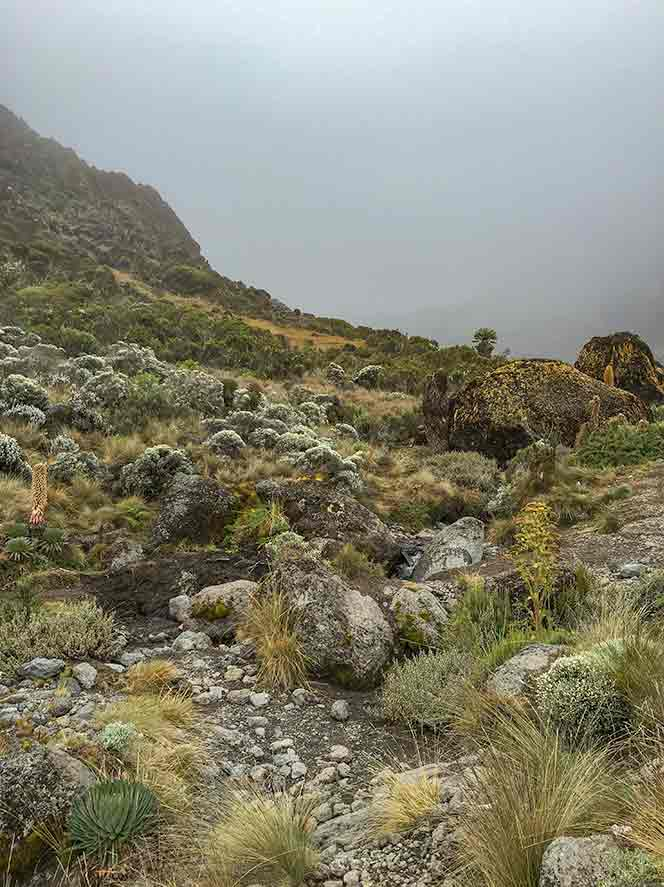
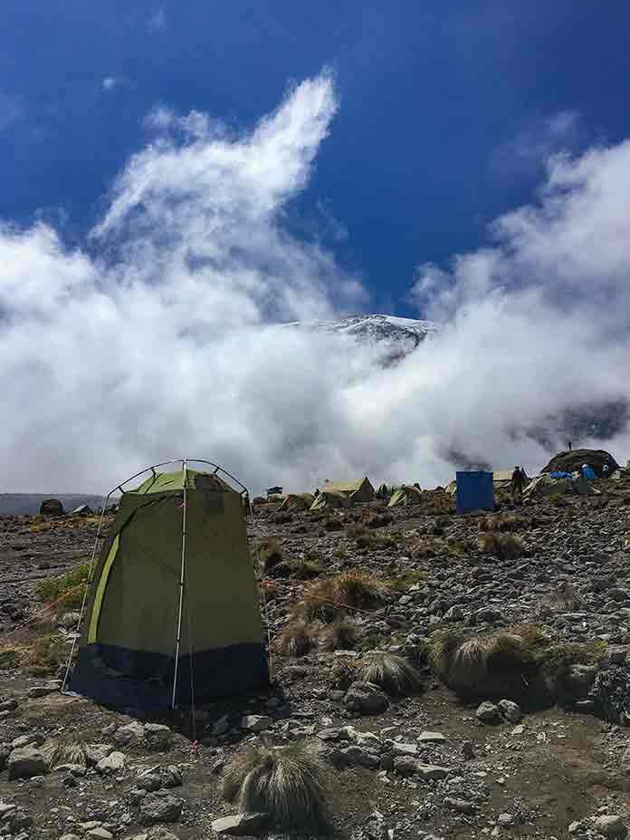

<h2>Selecting your trekking agency/climb operator</h2>

It is essential to carefully select a suitable company/trekking operator for your trek to the summit. Operators offer numerous packages that come with porters, guides, high-quality food and equipment (tents, oxygen bottles). To help you make a selection from the different operators, I have classified them into three categories; low budget, value for money and luxury operators.

<ul>
<li>Low budget (US $1500 -US $1900): With the park entrance fee being at a fixed price of US $900, there is very little room for a decent wage for the porters &amp; guides. To break even, some operators take on large groups of twenty people or more which lowers their cost. As well as, provide a higher client/guide ratio (1 guide for 3 hikers – e.g. of a six-day hike at (US$1500 – US $1900).  </li>
<li>Value for money (US $2000 – US $3300): These operators keep the cost to a minimum but without compromising safety, quality equipment and a decent selection. The porters and guides are paid a fair and higher wage. The guide and client ratio is much higher compared to the low budget operators.</li>
<li>Luxury operators (US $3400 – and higher): They provide a high-end experience by offering amenities such as glamorous tents, portable showers at camp, wine, oxygen tanks, guides to carry day backpacks and more.</li>
</ul>

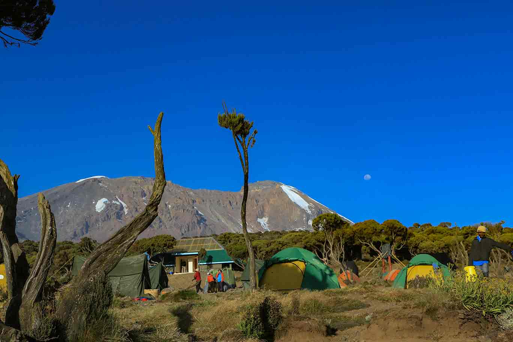
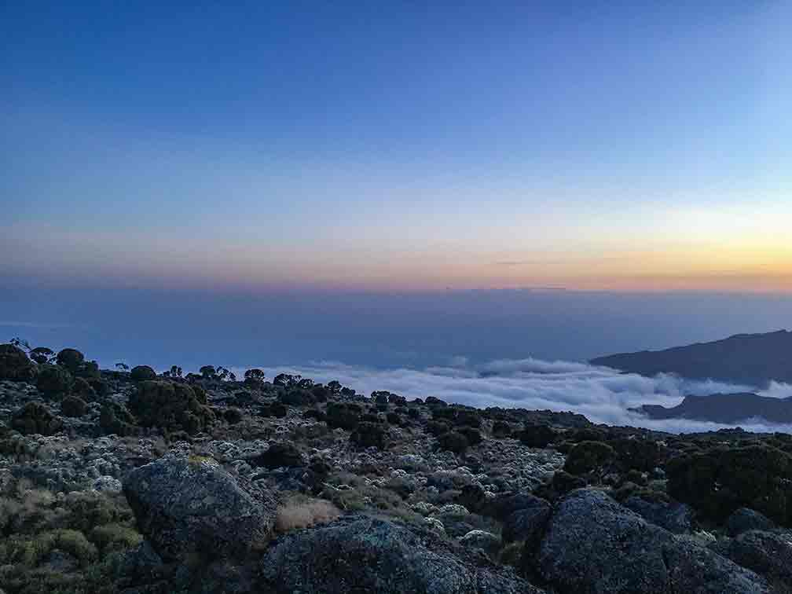
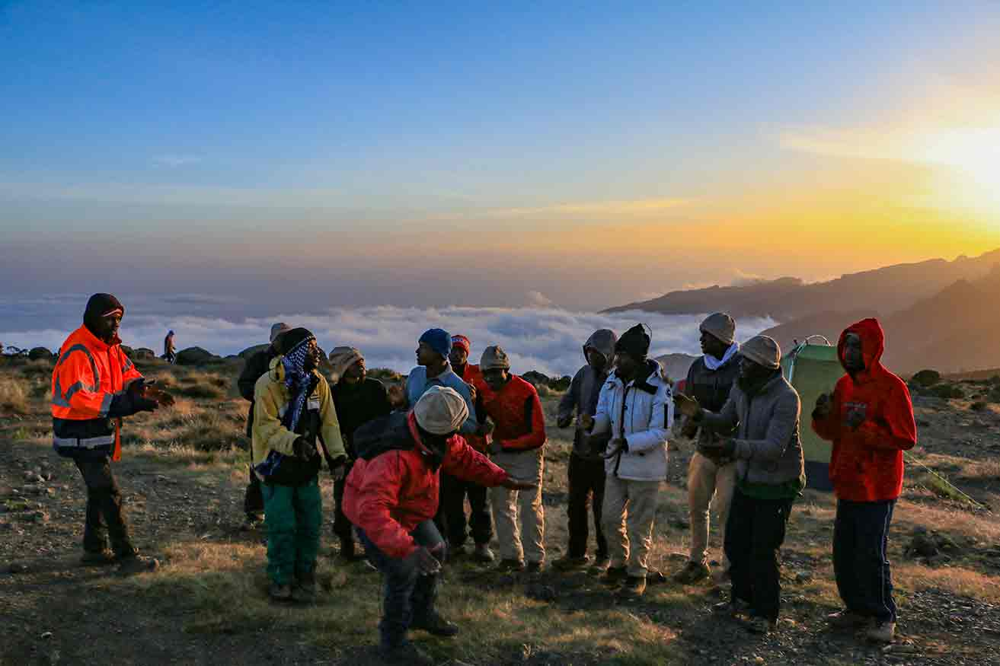

<em>* For my seven-day trek, I was part of a three-member trekking team. We were provided three guides, along with nine porters ( kitchen staff, porters for our tents and those carrying our camp equipment). I chose a mid-level operator who provided me with a great team of porters, guides and staff. Their  package included comfortable amenities (tents,  oxygen level checkup on arrival and food at the camp was excellent).</em>

<em>Notice:   </em>

<em>The choice of your trekking company is critical, and please be aware of sales agents that sell budget package tours and add their commission on top. Hence, due diligence is required when planning your Mount Kilimanjaro expedition.</em> 

<h2>With your planning complete, it’s time to start preparing for the challenge. What you’ll need for the trip ?</h2>
<ul>
<li>Organise your visa</li>
<li>Organise your vaccinations</li>
<li>Book your flights</li>
<li>Buy or rent the necessary equipment</li>
<li>Prepare physically for trekking to Kilimanjaro</li>
</ul>

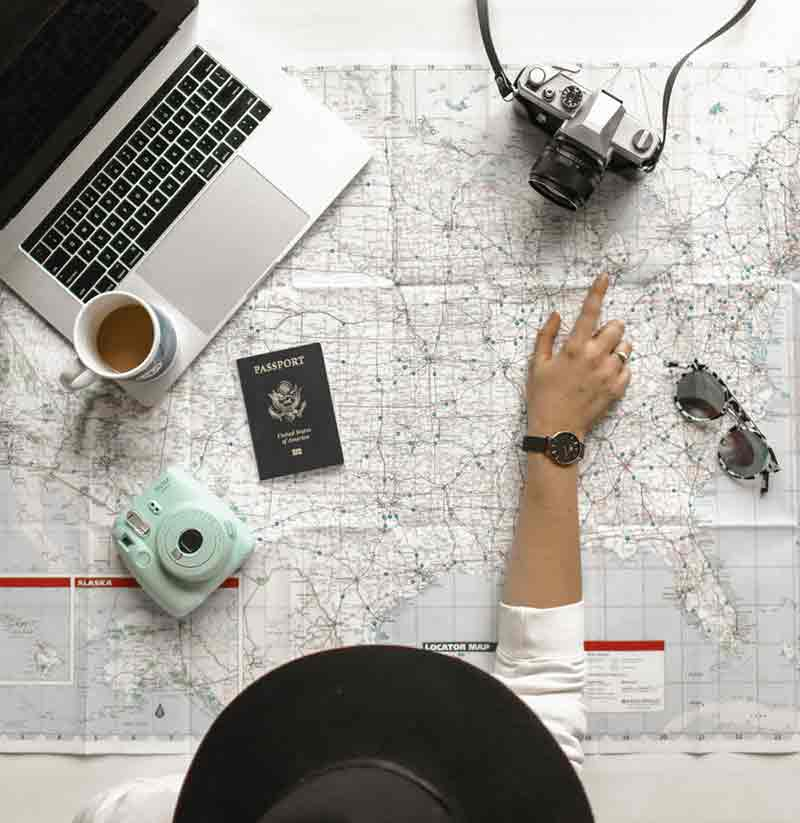

<h2>Organising your visa</h2>

To enter Tanzania, you will need a passport that’s valid for at least six months. If your country of residence does have a Tanzanian embassy, verify if they are part of the e-visa program on arrival or visit their <strong><a href="https://eservices.immigration.go.tz/visa" rel="noopener noreferrer">website</a></strong> to find out how to obtain your visa.

<h2>Organising your vaccinations:</h2>

 All travellers entering Tanzania are required to have a valid yellow fever certificate. There are several other <strong><a href="http://wwwnc.cdc.gov/travel/destinations/tanzania.htm#vaccines" rel="noopener noreferrer">vaccinations recommended</a></strong> and some of them need to be started months in advance. Depending on your travel plans, you may also want to take anti-malaria medication. Do consult with your doctor before taking any prescription.

<em>* What exactly you</em><em>’ll </em><em> ultimately </em><em>need </em><em>depends on the length of your stay and other places you may want to visit besides Kilimanjaro, e.g. Zanzibar or going on a safari.</em>

<h2>Booking your flights to Mount Kilimanjaro</h2>

When looking to book your flight to Kilimanjaro, I recommend flying into <strong>Kilimanjaro Airport (JRO)</strong> close to Moshi town. It is served by major international airlines such as; Ethiopian Airlines, Kenya Airways, KLM, Qatar Airways, and Turkish Airlines. Most trekking agencies may also organise your <a href="https://www.mountkilimanjaroguide.com/kilimanjaro-flights.html" rel="noopener noreferrer">Kilimanjaro flight</a> for you. 

<em>* Mount Kilimanjaro is located close to Moshi and many trekking agencies are based here. Another base from where you can plan your holiday and hike is Arusha, “the safari capital” of Tanzania. You can combine your stay with safari experiences to Ngorongoro crater, the Serengeti National Park and much more</em>

<h2>Organising the necessary equipment</h2>

When booking with a quality operator, you will be provided with great camping equipment which will be included in the price. Since you may not want to invest in equipment that you may only use once, many Kilimanjaro tour operators also offer gears for rent.

Clothing and equipment you can rent include sleeping bags, insulation pads and down jackets. Additionally, you will also need very good quality of thermal underwear and upper layers of clothing. I would recommend other clothing items such as gloves, balaclavas, high mountain sunglasses, sunscreen (for the lips, too!), a day-backpack, rain protection for everything, water bottles/camelback and more.

Most importantly, you need high-quality trekking boots and they need to be well broken in! The climb will be challenging enough and you do not want to add to the equation uncomfortable boots!

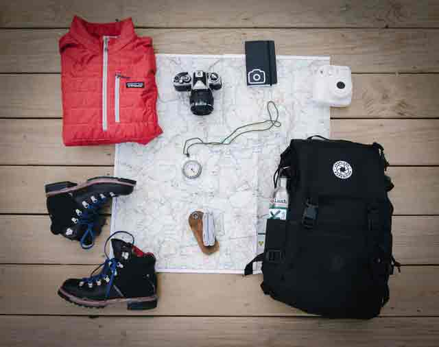
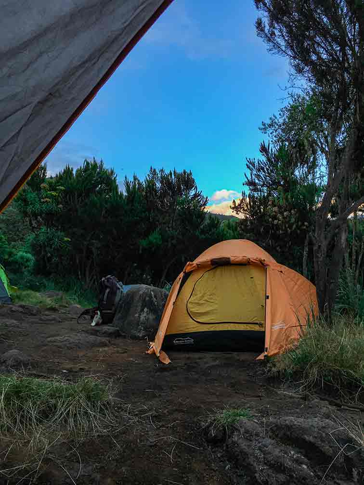

<h2>Getting yourself into shape </h2>

Although climbing Kilimanjaro may not require specialised mountaineering experience (except for the Umbwe route), long-distance trekking and hiking experience sure helps! It is not a climb but a hike to the summit. This may sound easy, but it is not! I recommend you go through appropriate physical preparation to prepare yourself to climb Mount Kilimanjaro successfully. The more you can do in the time leading up to your Kilimanjaro climb, the better. 

It also helps if you are used to camping out and roughing it because you will undoubtedly have to rough it when you climb Kilimanjaro.

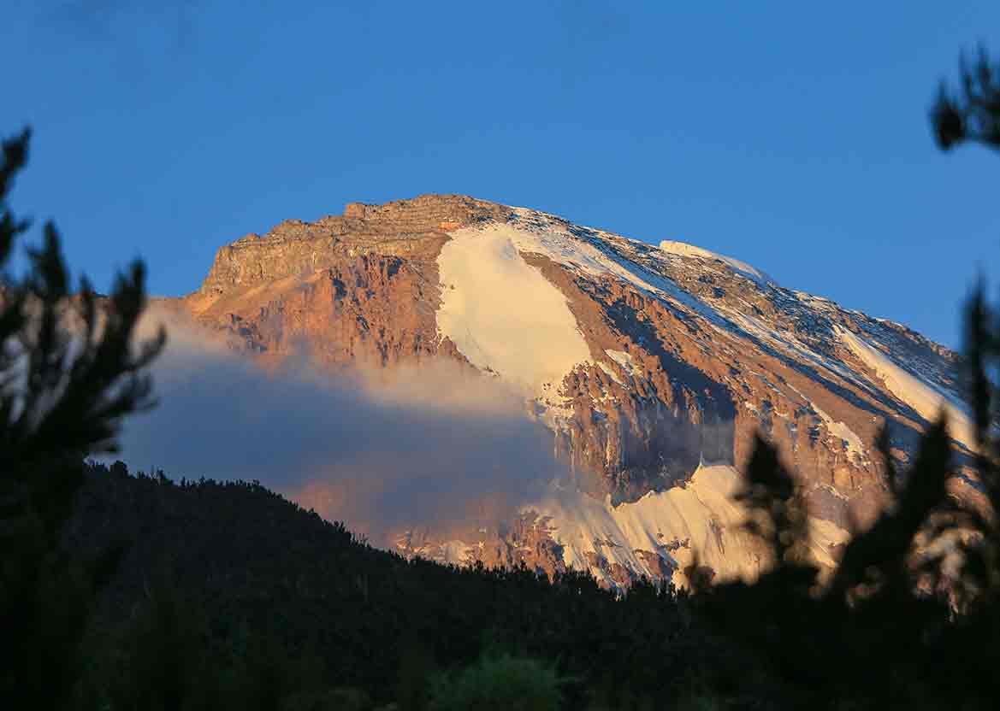

<h2>Conclusion</h2>

For me, climbing Kilimanjaro was an incredible and rewarding experience. From it, I learned a lot about myself,  about persevering through hard times and taking small steps towards achieving my goals. Till today, I still use these lessons in my daily life.

Thank you for reading through, feel free to reach out if you would like to trek to Kilimanjaro and need help in planning towards climb and want some help with your itinerary, get in touch with me at <em><strong><a href="mailto:hello@jupiterkonnections.com">hello@jupiterkonnections.com</a></strong></em>   

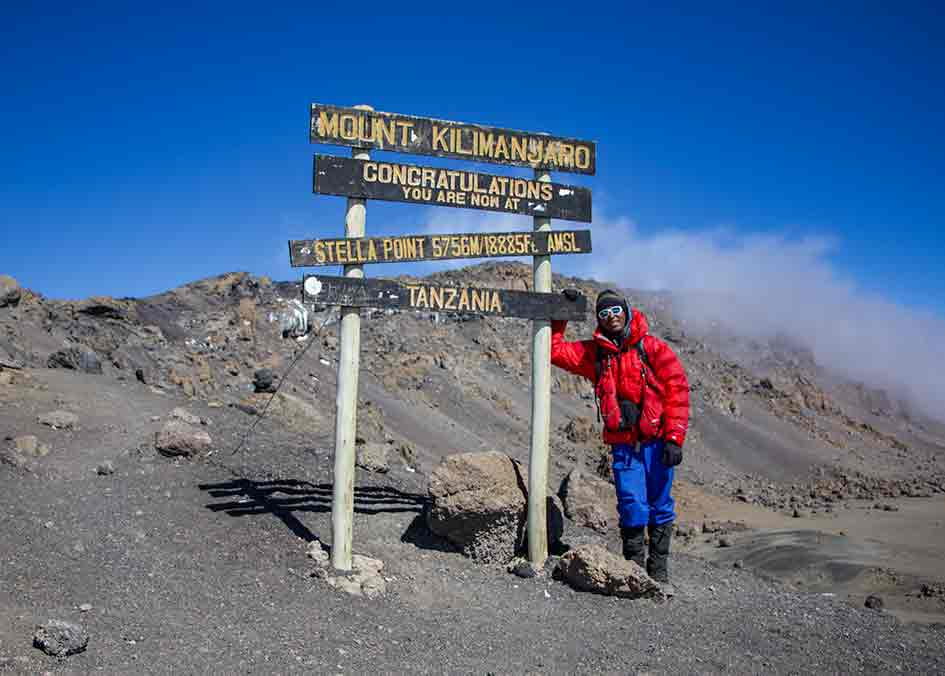
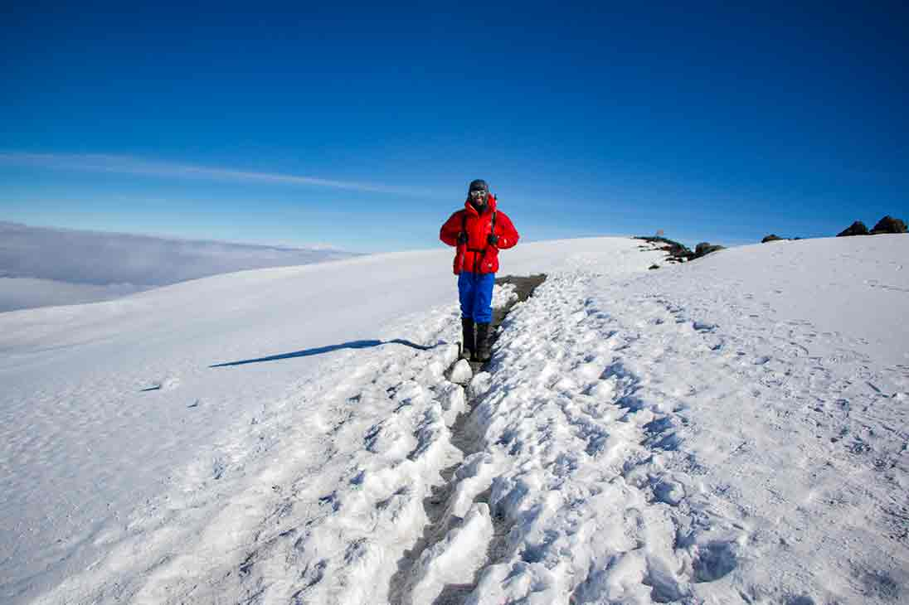
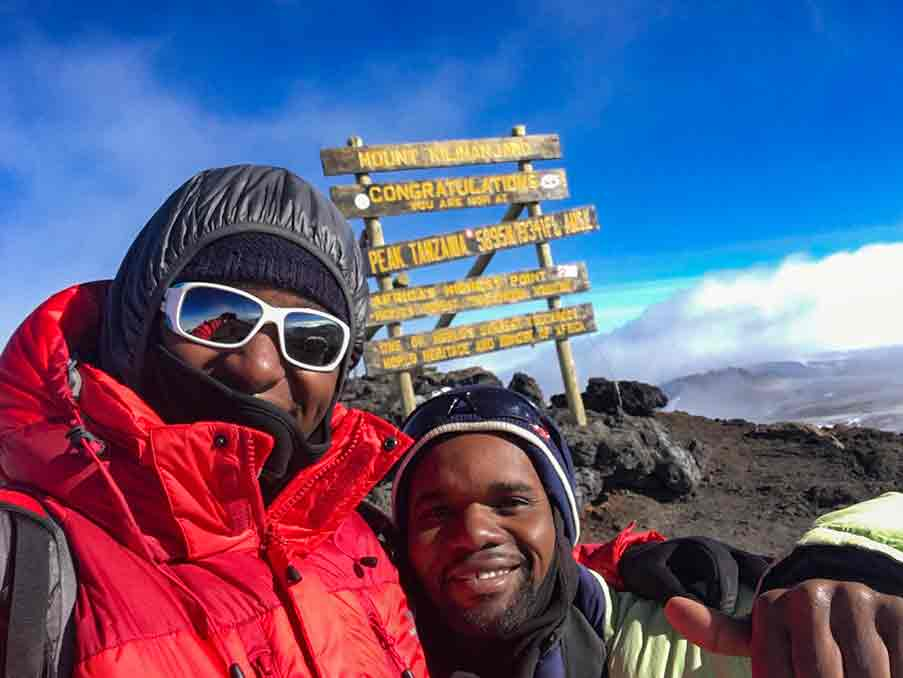
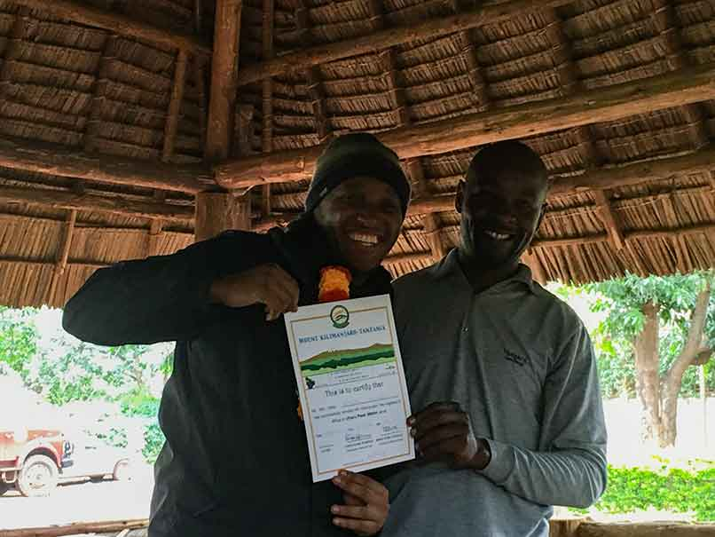

<h2>Continue the journey</h2>

Read my <a href="/kilimanjaro-full-moon-climb/">Kilimanjaro full moon climb story</a> for more from the mountain, then follow the journey to the coast with my <a href="/travel-to-zanzibar/">seven-day Zanzibar itinerary</a>. Browse the full <a href="/destinations/tanzania/">Tanzania collection</a> for the island guide and both climbing articles.

