<h2>Introduction</h2>

During my nearly two years in India, I had the chance to deeply explore the country’s culture. There’s no better way to experience this than by diving into its vibrant festivals. Each festival offered a unique glimpse into the heart of India, making my stay incredibly memorable. These celebrations are more than just events—they are profound expressions of India’s festive heritage and its diverse cultural tapestry.  Originally, my trip to India was meant to be short, just three months. However, fate had different plans. My stay extended, and I found myself arriving in September 2018, right at the beginning of the festival season. This timing allowed me to fully immerse myself in the festive traditions of India. Although some experiences were planned, many were serendipitous discoveries that added richness to my journey.

<h2>Dussehra</h2>

One of the first festivals from India I experienced was Dussehra. Celebrating the victory of good over evil, this festival marked the start of the season for me. The atmosphere was electric, with vibrant parades and community gatherings. These events were far more colorful and elaborate than I had ever imagined. Everyone came together to celebrate, creating a contagious energy in the air.  A particularly striking moment during Dussehra was the burning of a giant effigy of Ravana. This evening ritual symbolizes the destruction of evil. It was a powerful sight that left a lasting impression on me. Witnessing the community unite for this symbolic act reinforced the themes of unity and moral victory that Dussehra represents. Indeed, it was a true reflection of India’s festive heritage.

<em><strong>Travel Tip:</strong></em> If you’re planning to experience Dussehra, I highly recommend arriving early to secure a good spot to witness the effigy burning. Also, be prepared for large crowds and plan your transportation accordingly.

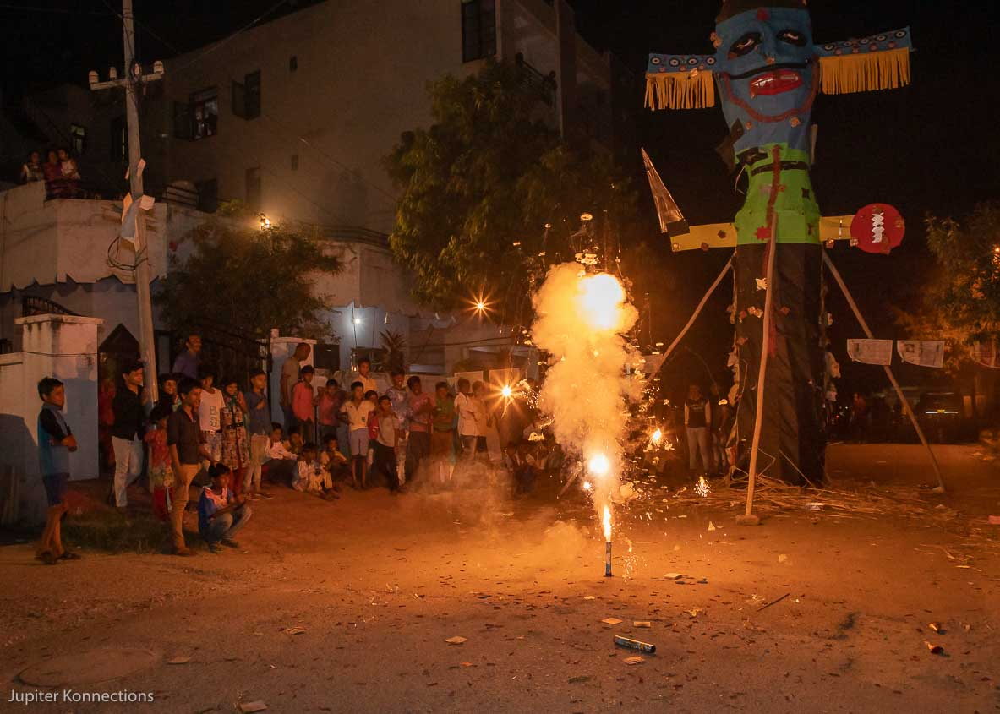
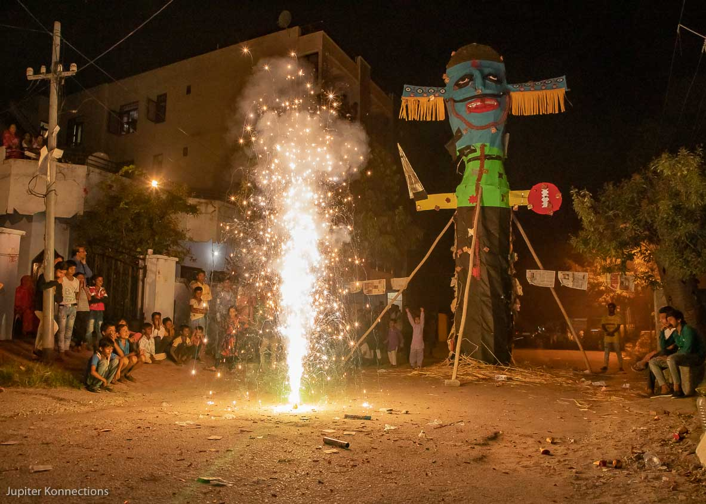
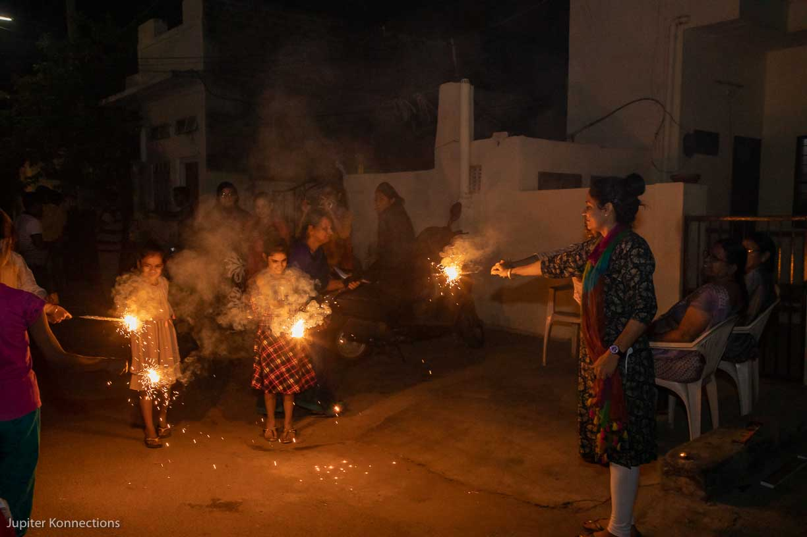
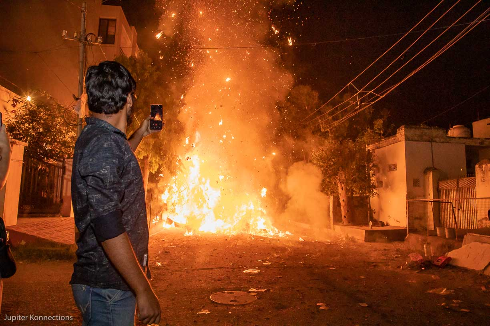

<h2>Pushkar Fair</h2>

After settling in Jaipur for a couple of months, I felt drawn to the Pushkar Fair. Pushkar is a small holy town about 150 km away, sacred in Hinduism. People from all over come to participate in one of the most vibrant festivals from India. Farmers, artisans, dancers, and spiritual seekers all gather in this mystical town. The result is a lively mix of culture and tradition, showcasing the festive traditions of India.

Upon arriving, the energy of the place struck me immediately. The air was filled with music and the scent of incense. Colorful decorations adorned every corner. The evening pujas, with their celebrations and prayers, created a magical atmosphere. During the day, I enjoyed the cultural dances and the colorful display of camels and performers. Getting to the market where livestock are exchanged, from buffalos to camels is a sight to behold. This reminded me of the essential role these animals play in local life and in Rajasthan’s festive heritage.

<em><strong>Travel Tip:</strong></em> If you’re visiting Pushkar during the fair, don’t miss the camel races and be sure to engage with the locals—they’re often eager to share their stories and traditions with you.

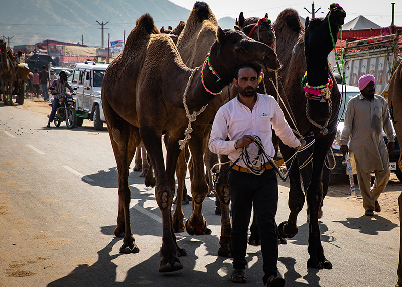
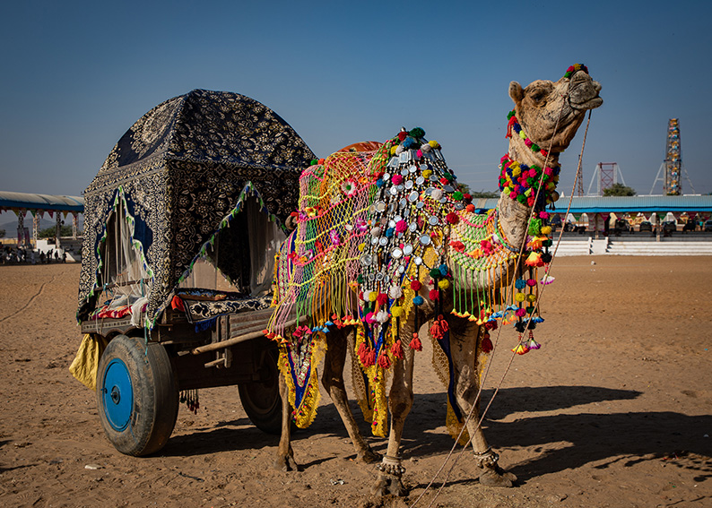
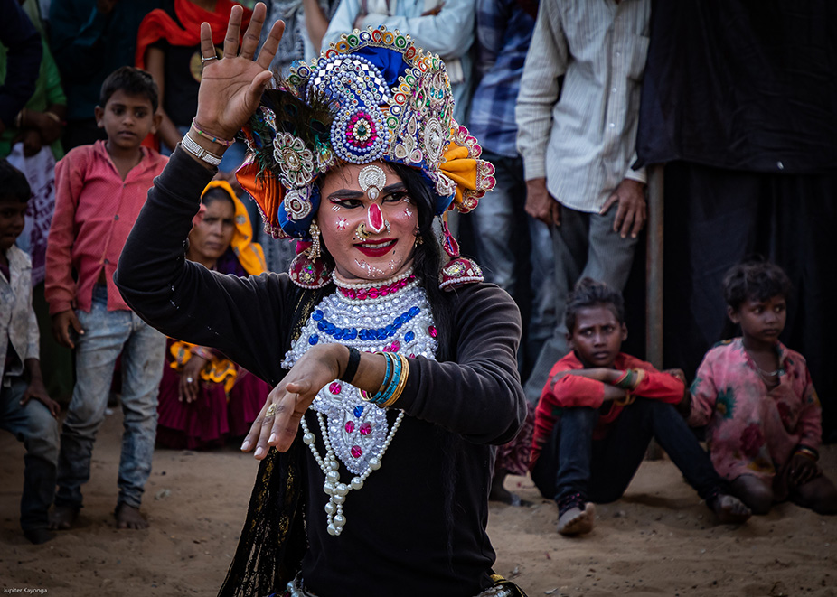
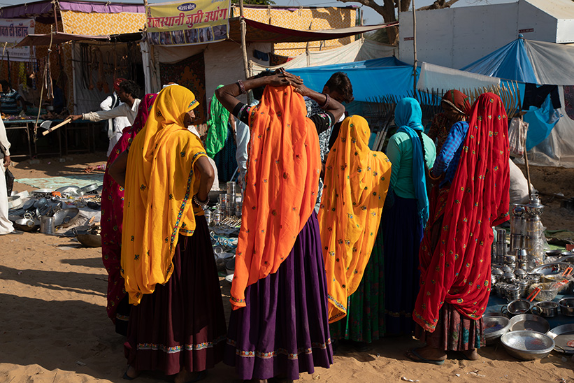

<h2>Diwali</h2>

Celebrating Diwali in India was an experience like no other. Although I had witnessed Diwali celebrations in Dubai for 10 years, celebrating it in India, especially while traveling between Jaipur and Udaipur, was something else entirely. The streets were ablaze with lights, and the air was thick with the sounds of firecrackers—Diwali in India felt more alive and intense than anything I had experienced before.

One of the most memorable moments during Diwali was seeing kids running through narrow streets, throwing crackers during the day, and families coming together in the evening to visit temples with offerings. However, the cold November evenings in Rajasthan, combined with the smoke from crackers, vehicle fumes, and farmers burning cow dung, created a challenging environment with hazardous air quality. Despite this, the sense of community and shared joy made it a heartwarming experience.

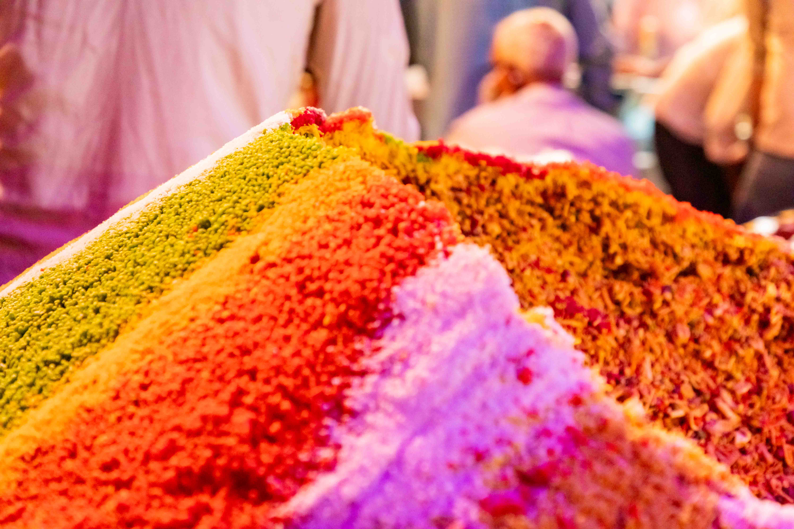
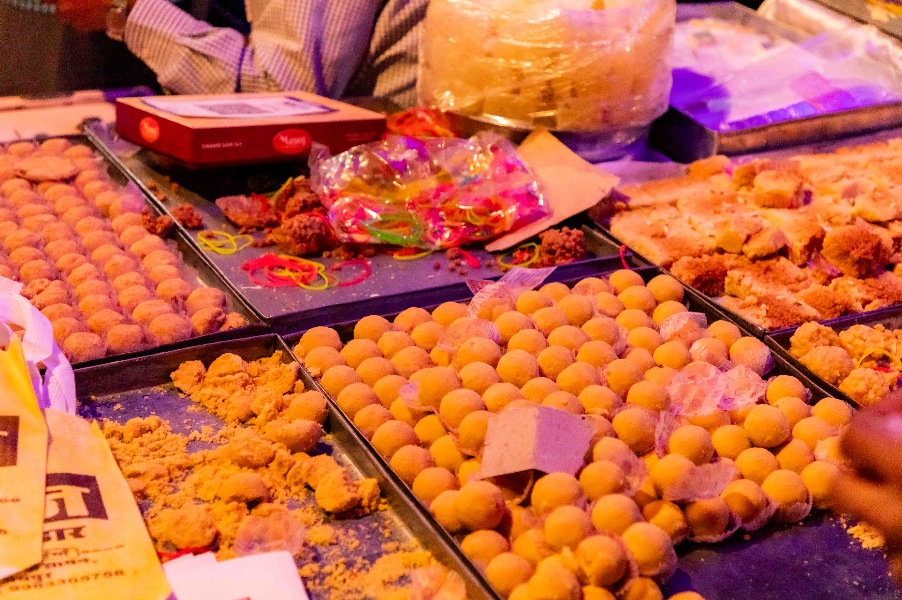
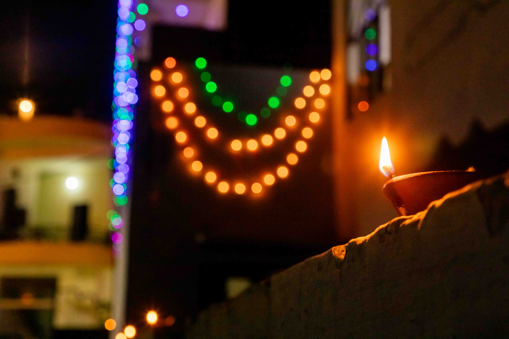
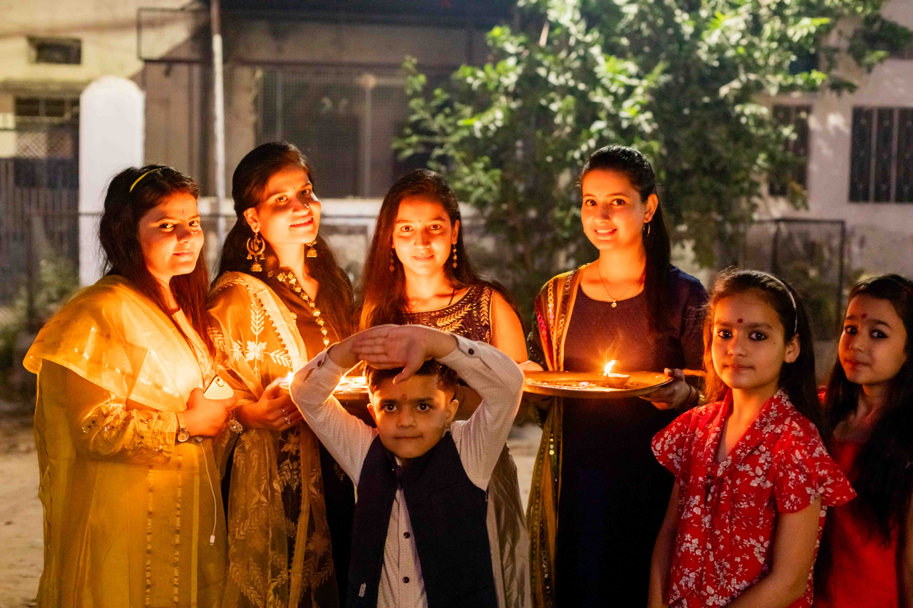

<h2>Kite Festival  in Jaipur</h2>

By the time the Kite Festival in Jaipur came around, I had been living in the city for six months. This festival is one of the most exciting festivals from India. It brings families and kids together on rooftops for friendly kite competitions. The sky becomes a colorful spectacle, filled with kites soaring and battling for dominance. The competitive spirit is infectious, and everyone aims to outmanoeuvre their rivals—a true showcase of India’s festive heritage.

Although I tried kite flying, it required skill in reading the wind and manipulating the thread. The thread, often sharp, is used to cut other kites, which can lead to cuts on fingers. Despite these challenges, the thrill of keeping my kite in the air was undeniable. The festival taught me the importance of patience and precision, qualities valued in many aspects of Indian culture.

<em><strong>Travel Tip:</strong></em> If you plan to participate in this vibrant festival from India, I suggest wearing gloves to protect your hands from the sharp kite strings and being aware of your surroundings, especially near roads and open spaces.

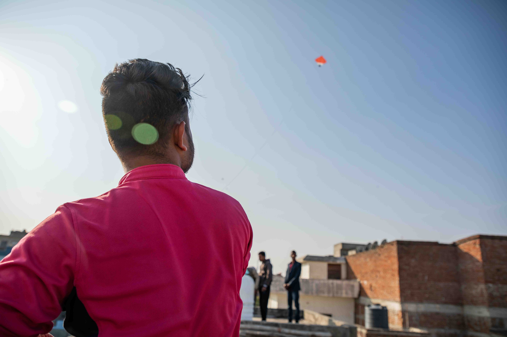
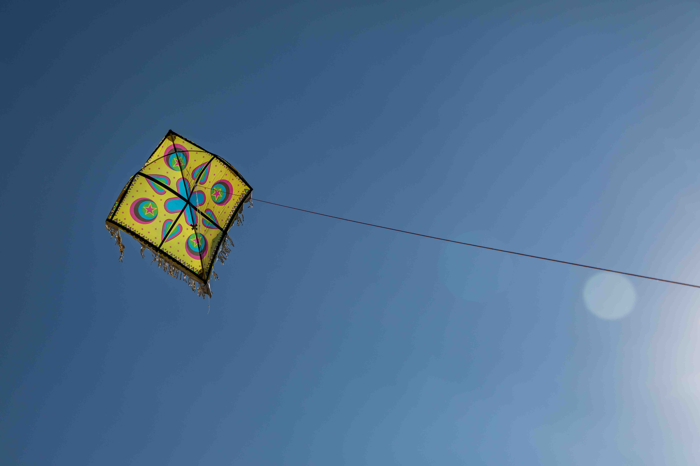
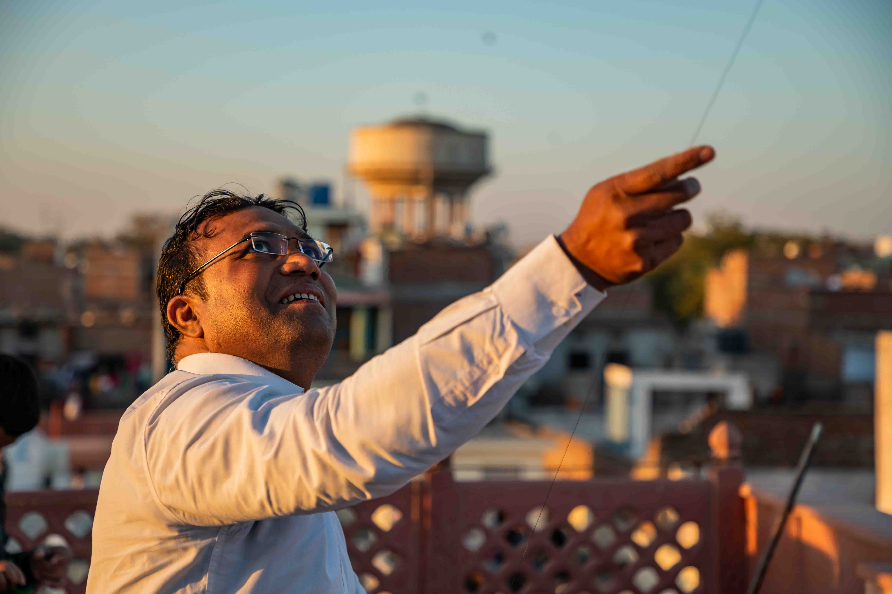
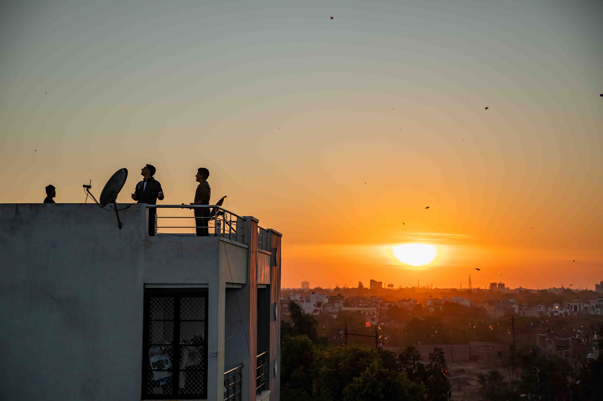

<h2>Kumbh Mela at Prayagraj </h2>

Attending Kumbh Mela was one of the most awe-inspiring experiences of my time in India. This massive event is held every four, six, or twelve years. The scale of Kumbh Mela is truly overwhelming, with millions of people gathering over two and a half months. I attended in Prayagraj in early <strong><a href="https://www.youtube.com/watch?v=NtX9BF1Sl80&amp;pp=ygUKa3VtYmggbWVsYQ%3D%3D">February 2019</a></strong>, and the sheer number of people was astounding. The main event, the holy bath—a baptism-like ceremony during the full moon—was extraordinary.

Walking through the camps, I saw people from all walks of life on their spiritual journey. Engaging with Naga Sadhus and observing the morning procession to the Sangam (where the Yamuna and Ganga rivers meet) was deeply humbling. This experience made me realize the profound spiritual roots that anchor Indian culture. If you plan to attend this festival, be sure to book your accommodations early. It’s also wise to hire a local guide to help navigate the event.

<em><strong>Travel Tip:</strong></em> If you’re planning to attend Kumbh Mela, a key festival from India, book your accommodations well in advance and be prepared for large crowds. Consider hiring a local guide to help you navigate the event and ensure you don’t miss the key rituals.

Read the full journal and photo essay: <a href="/kumbh-mela/">Kumbh Mela: A spiritual journey in India</a>.

<h2>Holi</h2>

Holi stands out as another highlight of my time in Jaipur. Known for its vibrant colors and exuberant celebrations, it is one of the most joyful festivals from India. As I was consulting for a local company and guiding a photography tour, I focused on capturing the essence of Holi through photography. To protect my camera gear from the coloured powders, I took special precautions, sealing it carefully. This allowed me to fully immerse myself in the celebration without worrying about my equipment.

As Holi approached, I had become well-known in my community. This familiarity made the celebrations even more enjoyable. Moving through different parts of the neighborhood, I witnessed the joy of children throwing firecrackers and colored powder. Everyone came together to celebrate, creating an atmosphere of unity and joy. Holi reminded me of the importance of community and shared happiness—it truly is a celebration of life. If you plan to participate, wear old clothes and protect your skin with natural oils. Remember to respect local customs and join in the fun responsibly.

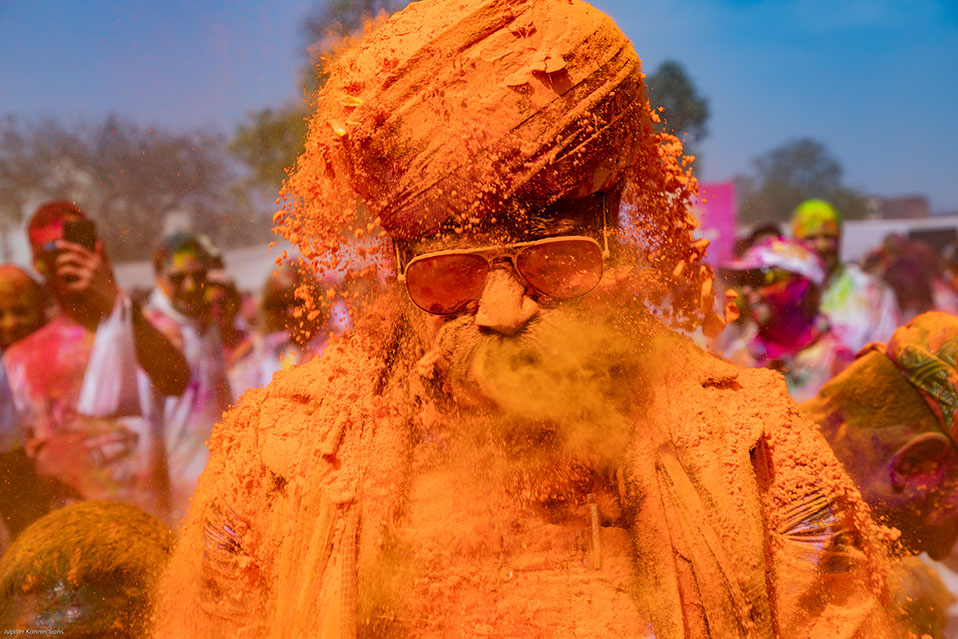
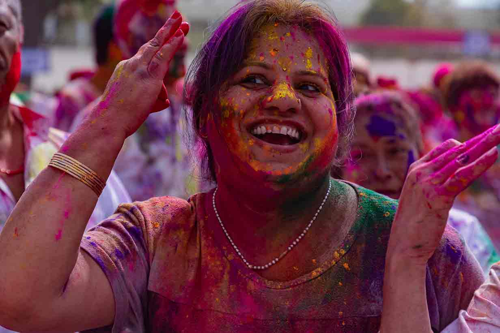
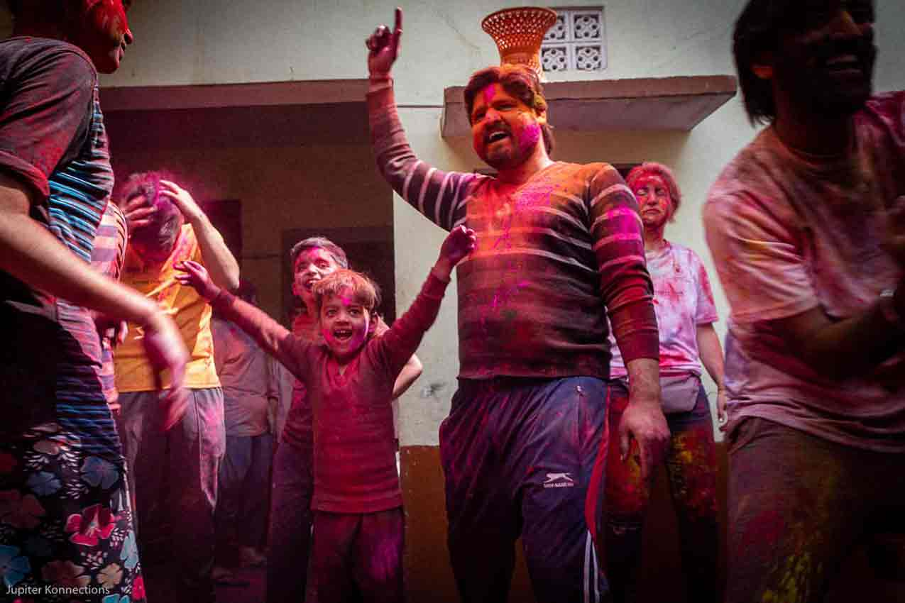
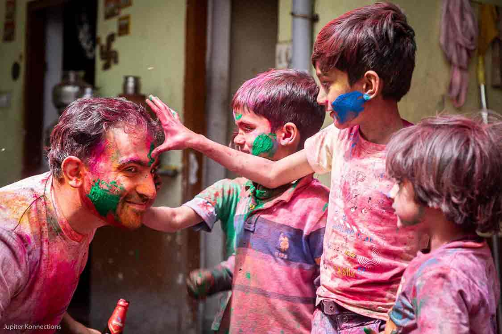

<h2>Gangaur</h2>

Gangaur, another colourful festival in Rajasthan, revolves around the worship of Goddess Gauri (Parvati), the consort of Shiva. Celebrated during the Hindu month of Chaitra (March–April), it symbolizes spring, harvest, marital fidelity, conjugal bliss, and childbearing. The festival is deeply rooted in local culture, with women playing a central role in the celebrations—one of the many enriching Indian cultural celebrations I witnessed during my stay.

The vivid processions, featuring elephants and beautifully adorned women marching through the streets of Jaipur, left a lasting impression on me. The celebration of Gangaur reinforced my appreciation for the rich and complex culture of India. Watching the women perform rituals with such devotion was a moving experience, and the entire festival felt like a tribute to the strength and resilience of women in Indian society.

Gangaur offers a great opportunity to witness traditional Indian festivals up close. If you’re in Jaipur during this festival, try to attend a local celebration to fully appreciate the rituals and community spirit.

<h2>Reflection and Conclusion</h2>

Looking back on my nearly two years in Rajasthan, it’s hard to pick a single festival that was the most impactful. However, if I had to choose, Kumbh Mela stands out for its sheer scale and the deep spiritual energy that permeated the event. It was a moment of deep personal reflection and connection with something greater than myself—an experience that perfectly encapsulates India&#8217;s festive heritage.

These festivals from India collectively gave me a profound understanding of Indian culture. Despite the challenges, including language barriers, I was able to immerse myself fully, thanks in large part to the support of the family I lived with. This helped me integrate quickly and appreciate the diversity and richness of Indian cultural celebrations. Each festival was a learning experience, offering new perspectives on life, community, and spirituality.

I highly recommend experiencing these traditional Indian festivals to other travelers, especially starting in Rajasthan. The state is rich in history, with its forts, palaces, and havelis, and the cultural nuances of its festivals offer an excellent introduction to Indian culture. My advice is to approach these experiences with an open heart and mind, ready to embrace the unexpected.

As an avid traveler, my time in India has enriched my tapestry of experiences. I often say that living in India feels like living seven lives at once. For anyone exploring India, understanding where they want to go is crucial, as the country is vast.

<h2>Continue exploring India</h2>
Read my <a href="/rajasthan-travel/">Rajasthan travel story</a>, discover <a href="/10-things-to-do-in-jaipur/">10 things to do in Jaipur</a>, or explore <a href="/kumbh-mela/">Kumbh Mela</a>.

