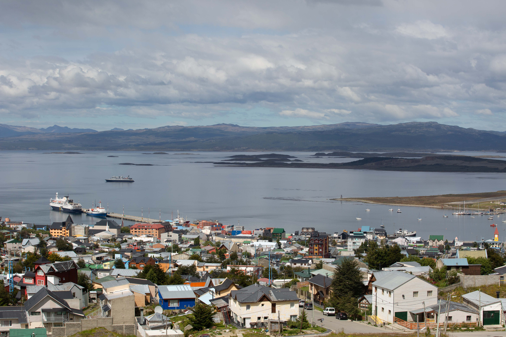
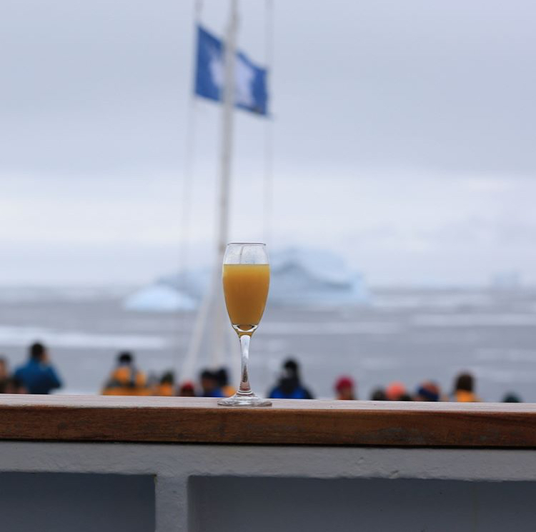
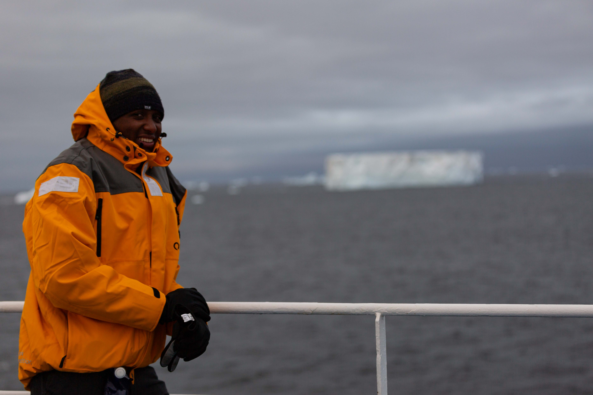
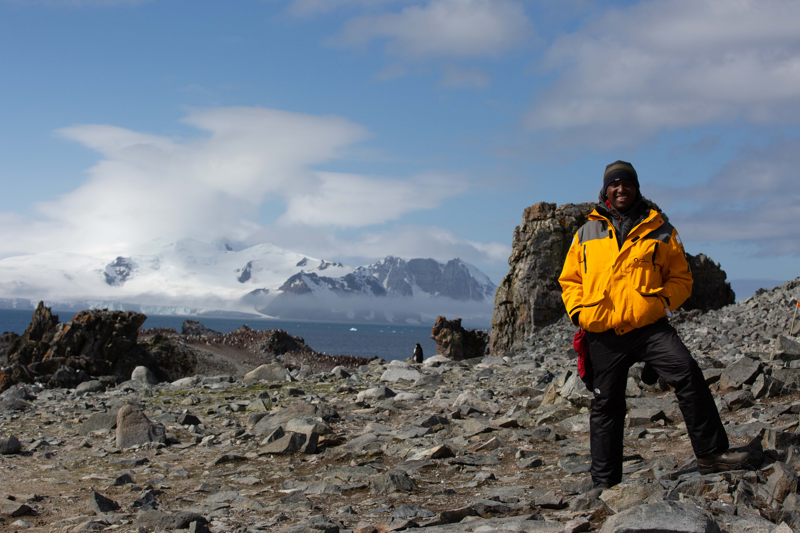
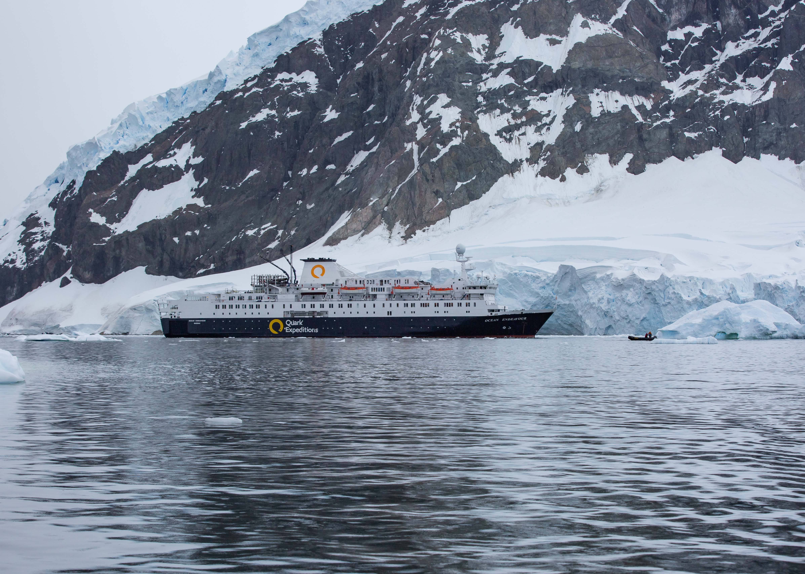
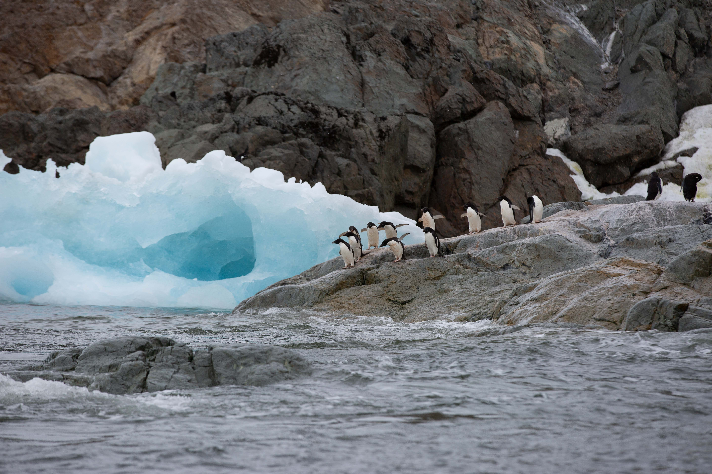
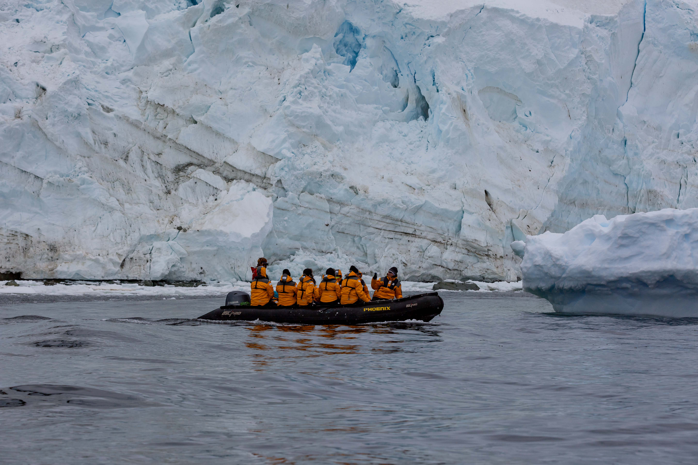
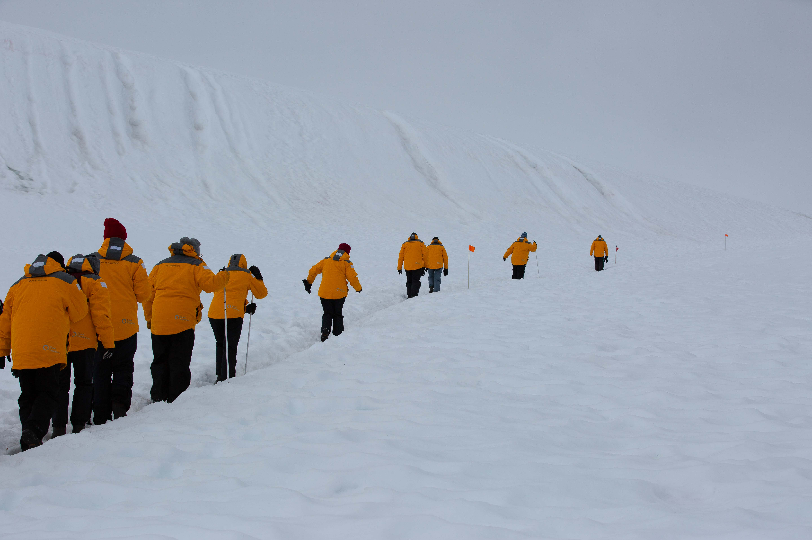
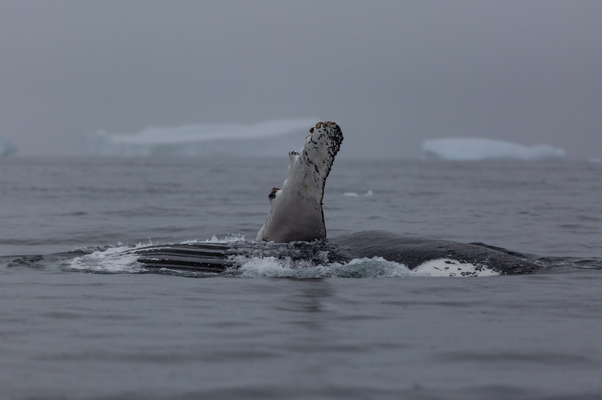
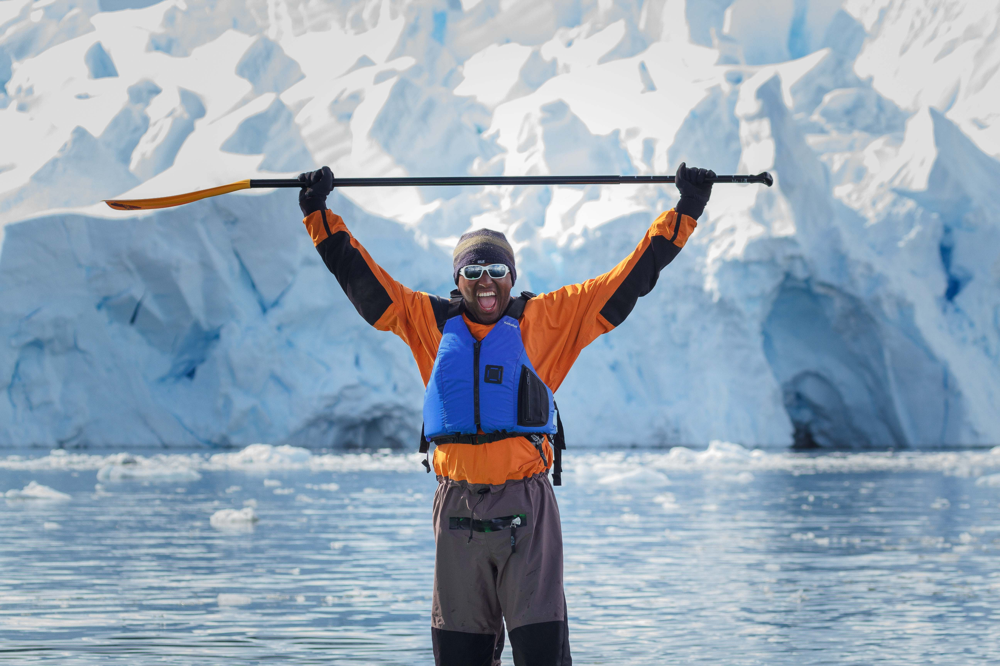

<em>By Jupiter Kayonga. Originally published as a guest article on Quark Expeditions on 2 September 2021. Restored from the <a href="https://web.archive.org/web/20260312105619/https://www.quarkexpeditions.com/blog/from-rwanda-to-antarctica">archived publication</a>, with photographs from my expedition. Expedition names and package dates have been corrected using my original booking confirmation.</em>

For someone who grew up in Rwanda, East Africa, the notion of visiting Antarctica morphed into a fantasy that intensified each time I contemplated the far-off, ice-covered continent on the world map that hung in my childhood home. That dream became within my grasp when I started travelling for work and began to consume documentaries on expeditions to the 7th Continent by modern-day travellers.

In late 2015, I started researching and planning how to go to Antarctica.

The whole process felt like going to another planet, beginning with researching, planning and booking an expedition. Additionally, planning for a trip more than 12 months away and excitedly acquiring the right gear puts you in a heightened state of mind.

My expedition was <strong>Crossing the Circle: From Buenos Aires</strong>, aboard <em>Ocean Endeavour</em>. I booked through Intrepid Travel, in partnership with Quark Expeditions, for 20 January–2 February 2017. From Buenos Aires, we continued to Ushuaia, Argentina, to board the polar ship. My account of the ten-day voyage follows our route across the Drake Passage to the Antarctic Peninsula, across the Antarctic Circle and back to Ushuaia.

<em>Departing from Ushuaia, Argentina.</em> <em>Credit: Jupiter Konnections</em>

Our journey began upon arrival in Buenos Aires. First, we were further briefed on our trip and then I got acquainted with my shipmates, who represented nations from around the world. The following day, we departed by plane for Ushuaia. Flying into the fishing town nestled at the bottom of the continent was magical. Walking the main street of &#8220;<em>la ciudad del fin del mundo</em>&#8221; (the city at the end of the earth), you&#8217;re surrounded by snow-capped mountains and the Beagle Channel within view. Heading down by the port, we got a glimpse of the polar ship that would shortly become our home at sea.

At 16.00 hours (4 pm), we embarked and were warmly greeted by the Quark Expeditions team. There was a heady excitement as we explored the ship, connected with new faces (passengers and crew), all of us full of anticipation. Finally, at 1800 hours (6 pm), we set sail. The blare of the ship&#8217;s horn announced our departure from civilization.

There we were, leaving the world behind and sailing into the sunset. Antarctica, here we come! I recall standing at the bow of the ship watching the sunset over the Magellan Strait. Our first evening came to an end with an introductory dinner with our team (expedition and hospitality staff) who would be taking care of us throughout our polar voyage.

<em>Crossing the Antarctic Circle.</em> <em>Credit: Jupiter Konnections</em>

The first three days of sailing felt like being on a school trip. We had the opportunity to attend presentations on polar history, marine biology and other subjects by a variety of respected polar experts. We gained insight into what we were going to experience during our expedition. There was plenty of opportunity to wander on the deck and watch Albatross glide with grace over our ship.

What marvelous sights! I would sit there watching an albatross gliding on the sea surface, using its wingtip to mark a trail on the wave edge like a surfer surfing beneath a wave pipe. Subsequently, the albatross would soar up, execute a few circles in patterns like it had a specific direction to go and dive down again. All this would happen without a single flap from its wings; I was simply blown away.

Life onboard was thrilling. There was constant motion. The occasional sway of the ship created by the swells made me feel like I was in a salsa class. Awakening each morning intent on spotting my first iceberg of the day was exciting.

<em>Halfmoon Bay, Antarctica</em> <em>Credit: Jupiter Konnections</em>

I had seen ice and snow in my first winter in Europe. Still, nothing could prepare me for the sight of massive, sculpted Icebergs. Razor-sharp, pointed like the edges of a sword, sometimes towering twice the size of our vessel, these behemoths made me feel so small and insignificant.

I recall standing on the deck contemplating my feelings of finally being in Antarctica. The natural dynamic of the mountain and marine environment made it almost unreal. The cold air, the harsh winds, the frozen sea. A sense of disbelief would occasionally set in: “Was I really here in Antarctica?” The cold and harsh blow of the wind would penetrate my thoughts and bring me back to my senses.

<em>Meeting the Adélie Penguins </em> <em>Credit: Jupiter Konnections</em>

On subsequent days, we sailed from one channel to another, one fjord to another, one island to another. From our first encounter with a rookery of penguins on Andersen Island to posting a letter in Port Lockroy and watching penguins slide down a hill in Danco Island. Nothing would match though our encounter and interaction with a rookery of Gentoo chicks on Aitcho Island. Simply mind-blowing.

<em>Zodiac cruising and shore landings</em> <em>Credit: Jupiter Konnections</em>

Another aspect I enjoyed was going to the expert-led presentations and learning about the <a href="https://www.quarkexpeditions.com/blog/shackleton-s-legacy-antarctic-exploration-a-century-after-endurance-2">history of Antarctica</a>. The information we received daily cemented the whole experience. With experts from each field sharing excellent details, going on <a href="https://www.quarkexpeditions.com/adventure-options/zodiac-cruising">day trips on Zodiacs</a> was the icing on the cake for me during this trip. I enjoyed the photography tips, the history of Antarctica, and the presentations on penguins.

Speaking of adventure, I would recommend two of my favourite activities. The Polar Plunge and <a href="https://www.quarkexpeditions.com/adventure-options/stand-up-paddleboarding">Stand-up paddleboarding</a>. Let&#8217;s talk about the <a href="https://www.quarkexpeditions.com/adventure-options/polar-plunge">Polar Plunge</a>. One of the biggest challenges during my trip: jumping into the freezing cold ocean. It really did take my breath away! I also loved Stand-up Paddleboarding. Gliding on the calm waters while listening to the crackling sounds of Ice shelves was unreal.

<cite><em>SUP&#8217;ing in Antarctica </em></cite> <cite><em>Credit: Jupiter Konnections</em></cite>

Traveling to the Antarctic was one of those dreams that did come true. From the first day to the last, the team took care of us and ensured the experience left a lasting impression.

I would like to send my sincere thank you and I look forward to exploring more of this beautiful continent.

See you soon for more adventure,  Jupiter Kayonga (<a href="https://www.instagram.com/jupiterkonnections/">@jupiterkonnections</a>)

<aside class="article-related" aria-label="The wider South America journey">
Before and after Antarctica

This expedition was part of a longer journey through <a href="/destinations/argentina/">Iguazú, Buenos Aires and Ushuaia in Argentina</a>, followed by <a href="/destinations/chile/">Santiago, Valparaíso and Atacama in Chile</a>.
</aside>

<h2>Continue the journey</h2>
<aside class="article-related" aria-label="Related Antarctica story">
More from Antarctica
<h3><a href="/travel-to-antarctica/">Travel to Antarctica: An Unforgettable Journey of Discovery →</a></h3>
Explore the full expedition story, with more photographs, wildlife encounters and moments from the journey.
</aside>
