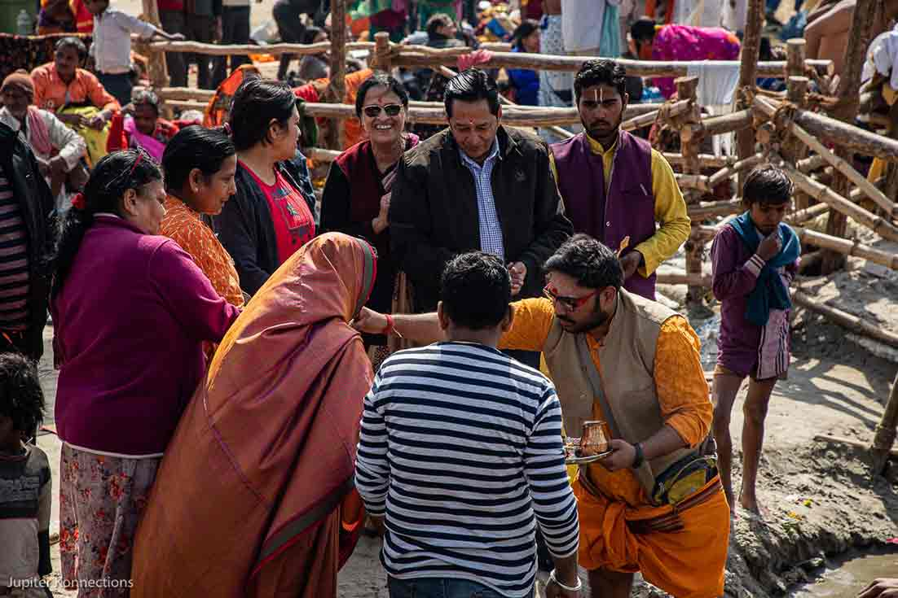
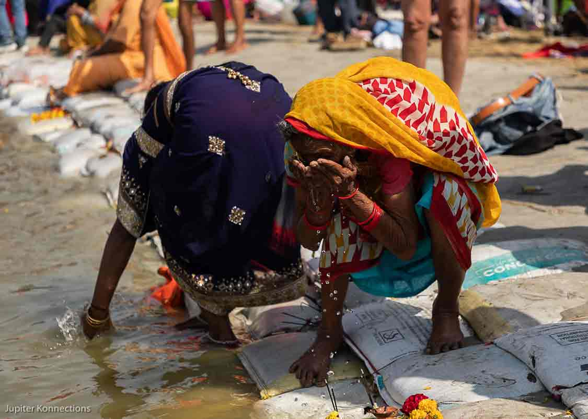
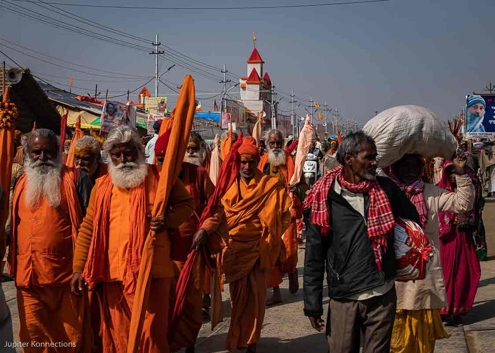
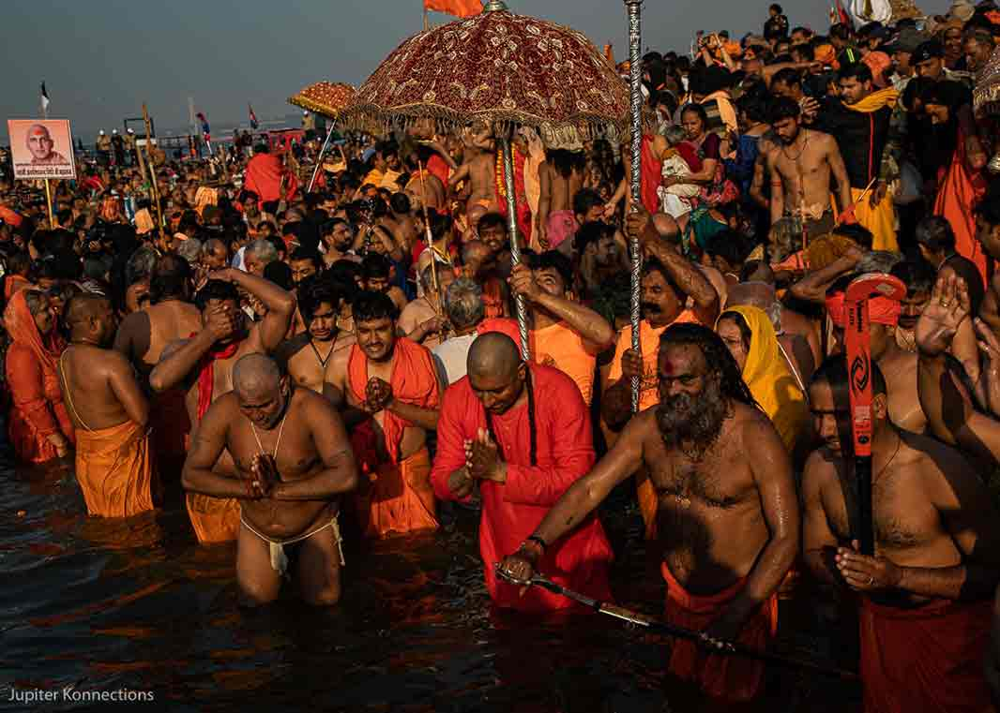

Arriving late into the night, I get dropped off under the bridge that crosses the two banks of the Ganges river in <strong><em><a href="https://en.wikipedia.org/wiki/Allahabad">Prayagraj</a></em></strong>. It is cold, a low haze hangs in the air, filled with dust, smoke and, the brightness of the white led light illuminating what felt like a sea of tents. Here I was at my first Kumbh Mela, an event known as the &#8220;largest religious gathering in the world.&#8221;

As I made my way to locate my camp amongst the many campsites along the river banks, I felt lost. Not only were the majority of the signs in Hindi, which I could not read, but the few people I came across did not know where my camp was.

With fatigue and the cold kicking in I got lost a few times. Therefore I decided it was best wise to try and call my camp owner who with the little english he spoke guided me to my campsite. There, I met fellow German videographer Maciej with whom I was going to share the tent for the next three nights.

The next day, I started out exploring the various section of the <em><strong><a href="https://en.wikipedia.org/wiki/Kumbh_Mela">Kumbh Mela</a></strong></em> venue. I made my way around the campsite, seeing pilgrims praying and engaging with each other on this important. During the day, I made it to the confluence. Now, this where the major part of ceremonies will be held. It is considered a sacred site where three holy rivers go through the city and where ceremonials baths are held.

Navigating my way around; tents, camps, &#8220;akhara,&#8221; and the waves of pilgrims departing and arriving is overwhelming. An entire generation of family members and people from all walks of life making the journey. I was moved by witnessing a group of older pilgrims partaking in the holy baths and offering rituals on the Ganges.

Upon further exploration, I came across a group of devotees sitting around a naked man. He was covered in ash like paste all over his body with long dreadlocks. At the same time, he lectured to a gathering he received at his &#8220;Akhara,&#8221; a makeshift monastery. I found out they were called &#8220;Naga Sadhus.&#8221; Mostly composed of holy men and a few women, they follow a path of spiritual discipline renouncing to the worldly life.

As I listened in to their preaching, I could not help to wonder about their teaching and their lifestyle. Here, I was, far away from my birthplace, witnessing and experiencing a completely different culture, different from what I was thought growing up in Africa. Christianity, God, Faith, and spirituality from a different perspective.

&#8221; What is faith? What is enlightenment, and how does one reach it? What is the difference between, Christianity, Hinduism ?, What is right and What is wrong ?&#8221;

The Nagas were electric, after smoking what seemed to be cannabis, the lined up in groups and departed towards the <strong><em><a href="https://en.wikipedia.org/wiki/Triveni_Sangam">Sangam.</a></em></strong> Without hesitating, I joined the procession with other followers.

Joining the procession · Kumbh Mela, Prayagraj

It was a surreal moment. Jostling each other, and chanting prayers as we made our way to the Sangam. I observed hundreds if not thousands of devotees behind the fences just made think of how blessed I was to participate in a major spiritual journey of the Indian culture.

The energy was electrifying.

Arriving at <em><strong><a href="https://en.wikipedia.org/wiki/Triveni_Sangam">Sangam</a></strong></em>, the Sadhus armed with tridents and swords charged down to the waters to bathe along with a mass of followers.

It dawned on me; that this right here was unbelievably one of the most powerful moments of my spiritual journey. Witnessing faith, and spirituality on another level and lots of unanswered questions.

Kumbh Mela 2019 · Photographs by Jupiter Konnections

Kumbh Mela was one part of a longer journey through India’s celebrations. Read <a href="/festivals-from-india-my-journey-in-traditions-and-celebrations/">my experiences of festivals from India</a> for the wider story.

<h2>Continue the journey</h2>

Discover more <a href="/destinations/india/">stories and photographs from India</a>, including <a href="/portfolio/faces-of-india/">Faces of India</a> and <a href="/portfolio/experiencing-holi/">Experiencing Holi</a>.

