<h2>A journey back in time</h2>

Across Cuba, I kept returning to the Almendrones: old American cars whose colours and distinctive shapes became part of my photographic record of the island. Behind the chrome and familiar silhouettes, I was drawn to the care and ingenuity that keep them on the road.

<h2>Face to face</h2>

Parked along narrow streets, each car has its own expression: a grille, a pair of headlights, a colour you remember long after turning the corner.

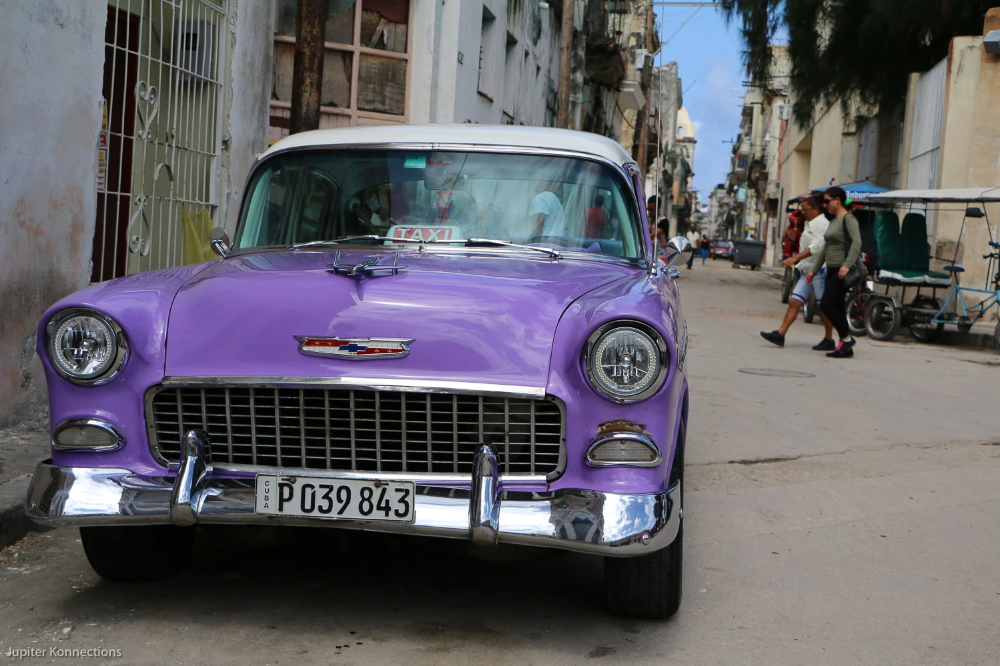
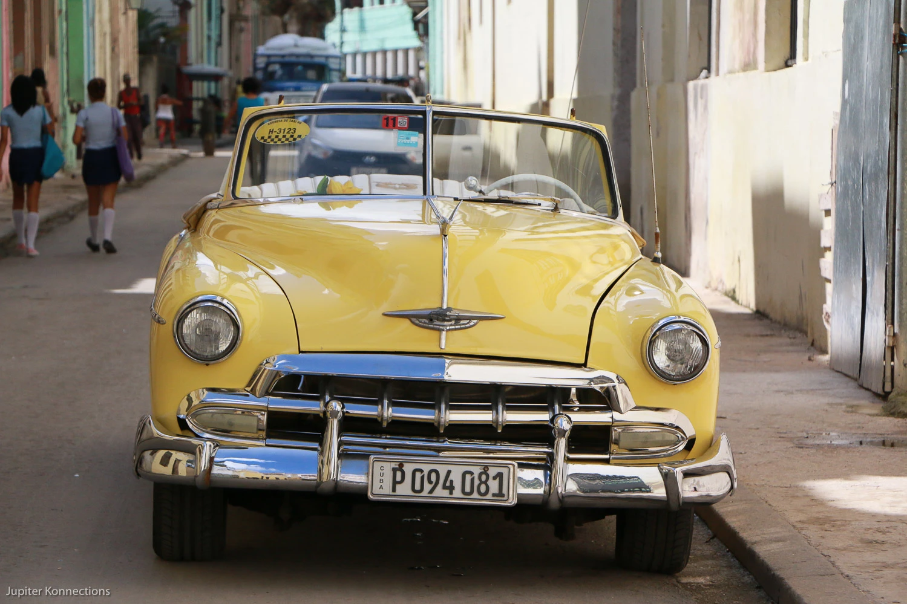
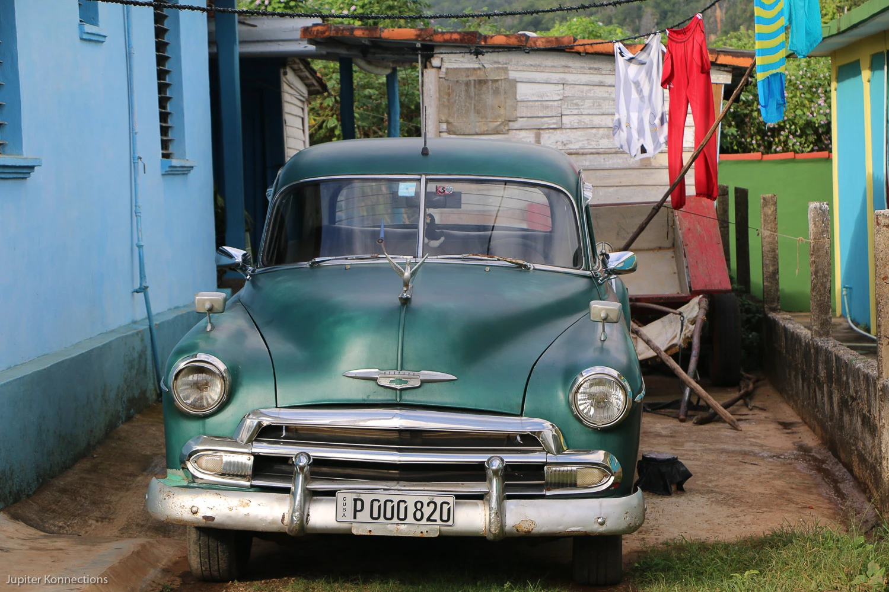
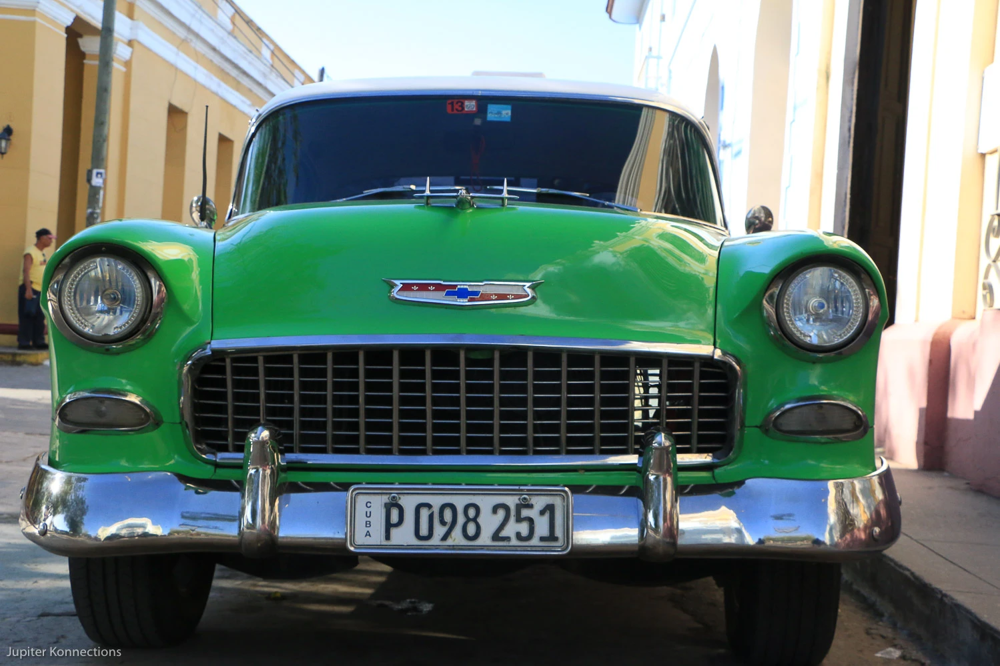

<h2>Colour on the streets</h2>

Some wait in the shade. Others pass through the frame. Together, they bring another layer of colour to the streets.

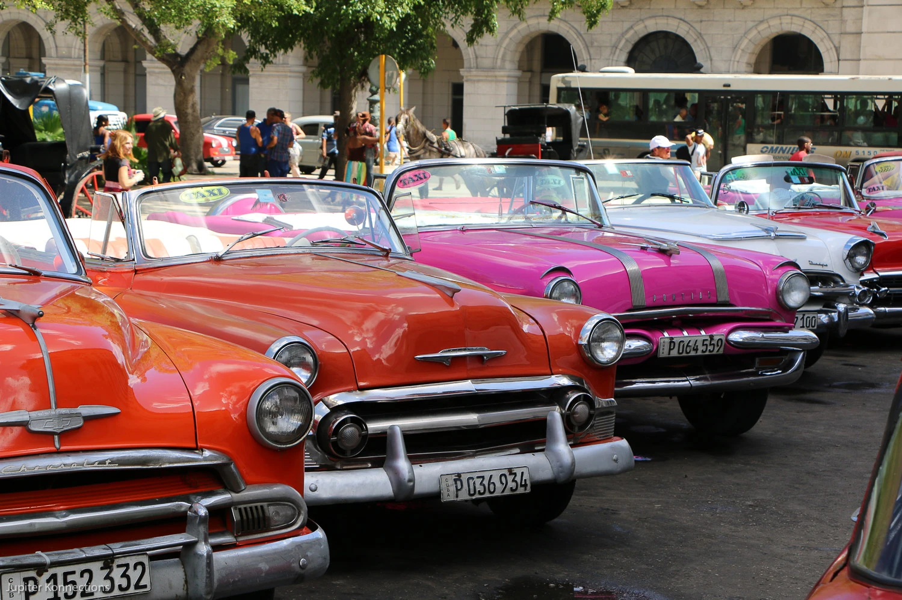
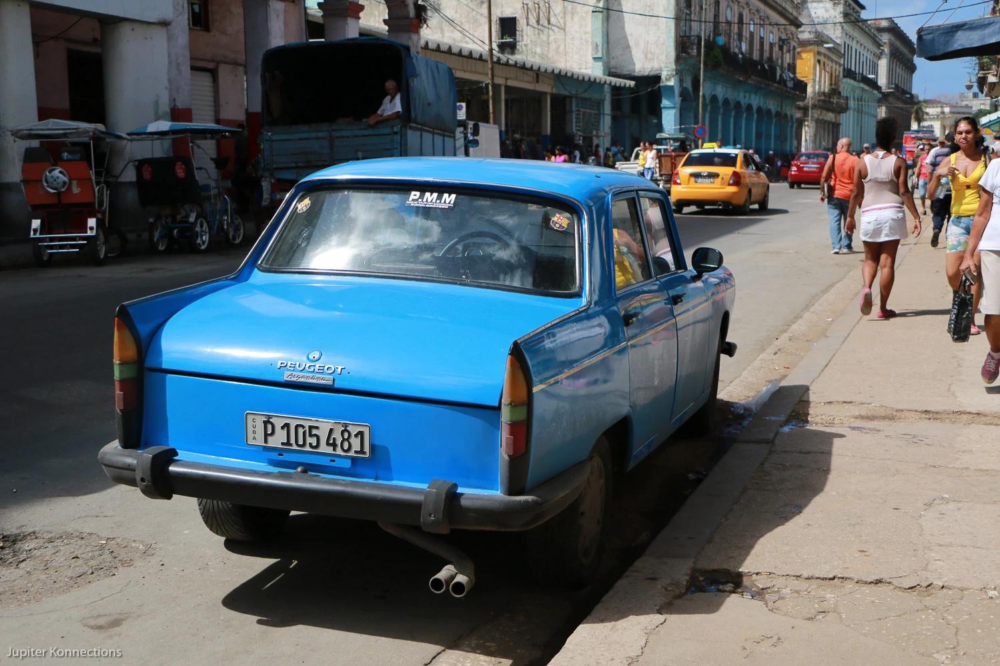
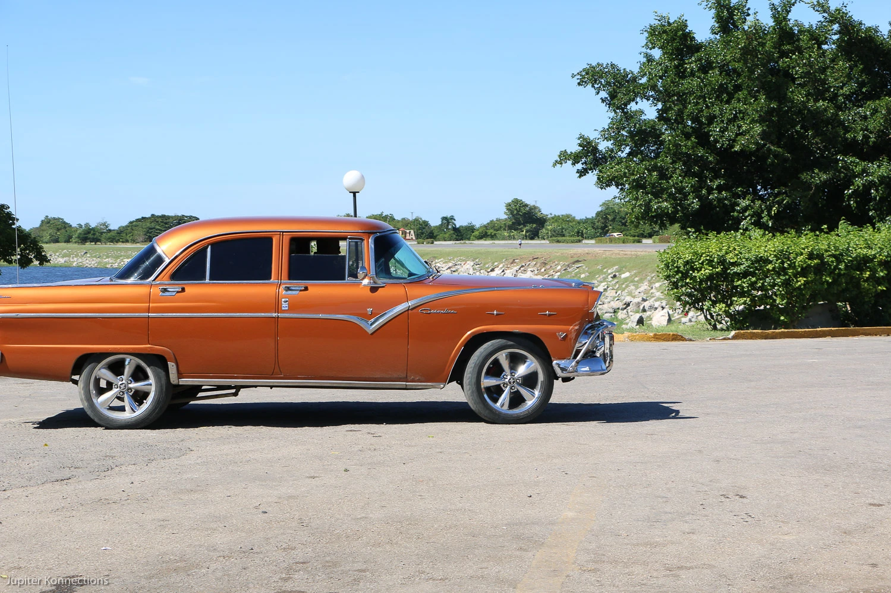
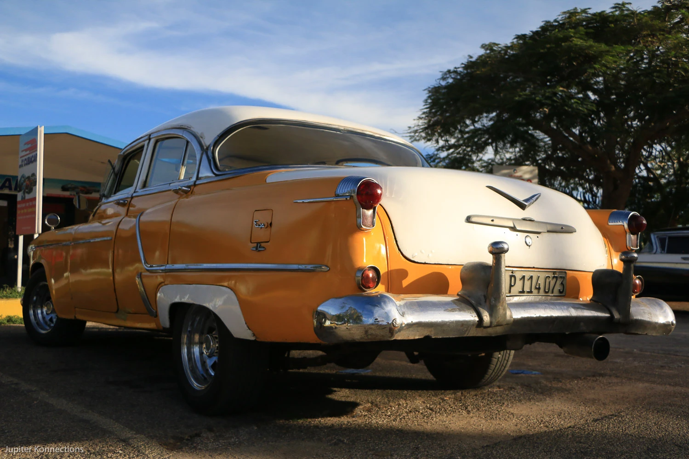

<h2>Chrome, curves and character</h2>

Closer in, the street gives way to smaller details: sculpted fins, bright metal and the lines of two-tone paint.

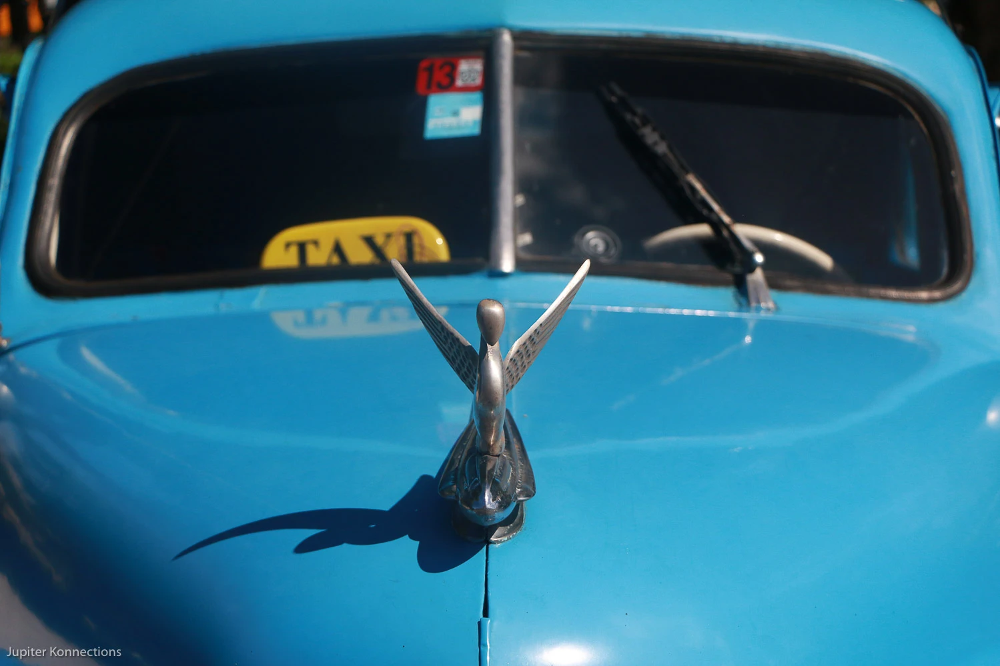
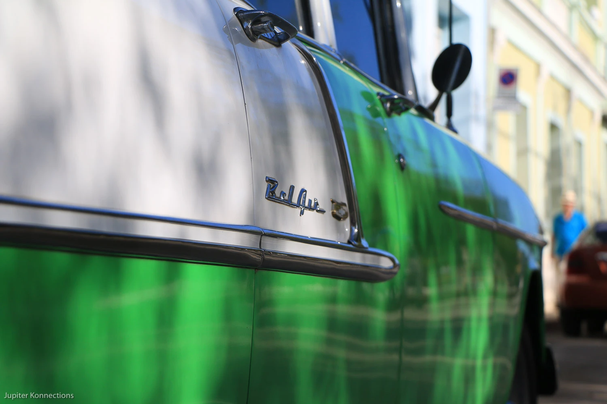

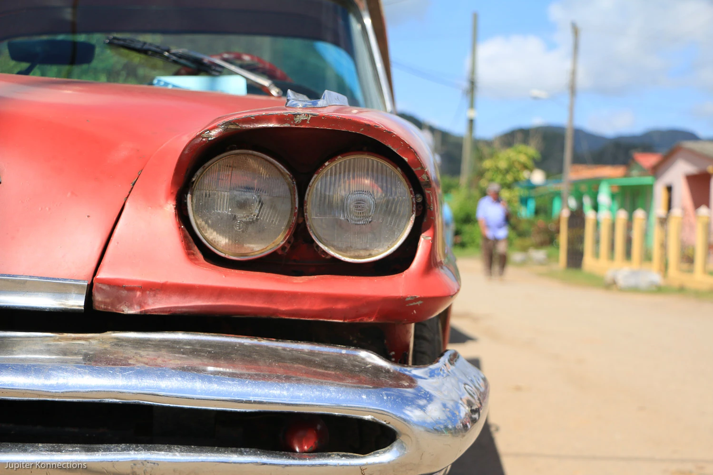

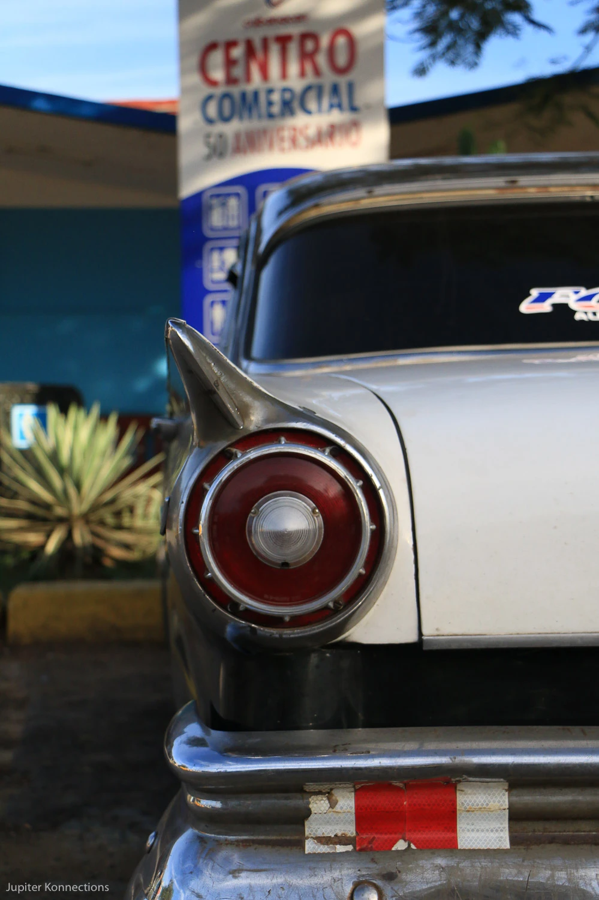
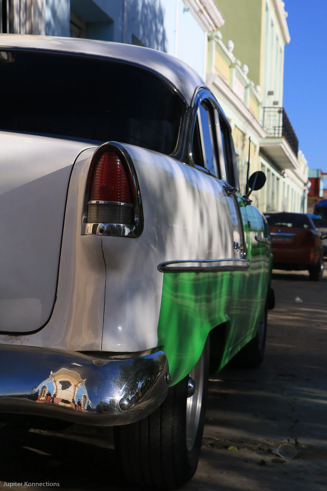

Almendrones · Cuba · Photographs by Jupiter Konnections

<h2>Continue exploring Cuba</h2>

Discover the people behind my journey in <a href="/todo-bien-en-habana/">Todo Bien en Habana!</a>, explore sport and everyday life in <a href="/portfolio/cuban-sports/">Cuban Passion</a>, or browse <a href="/destinations/cuba/">all stories and photography from Cuba</a>.

