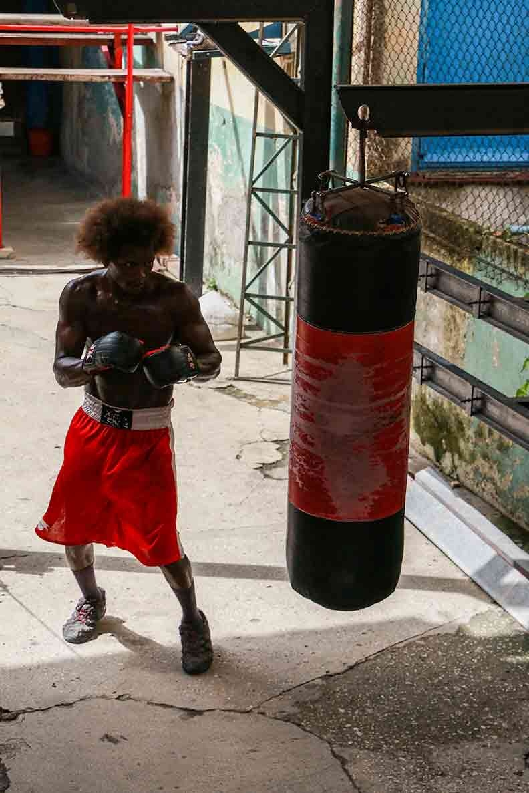
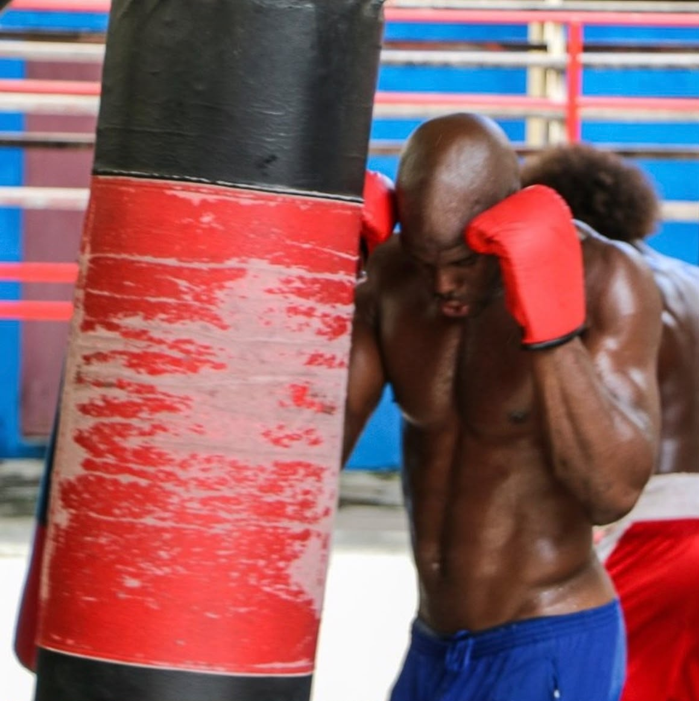
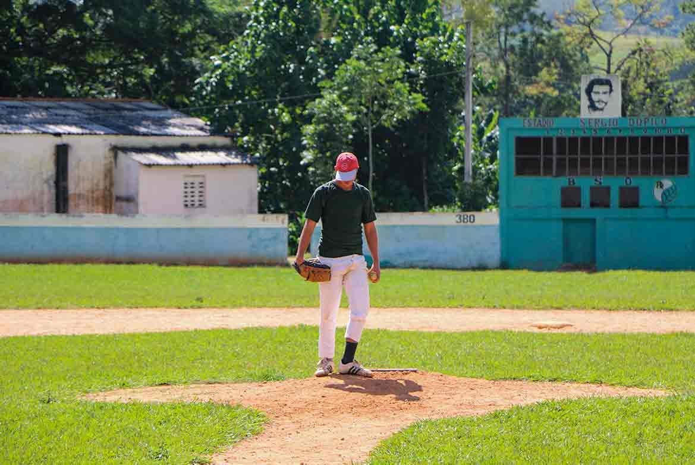
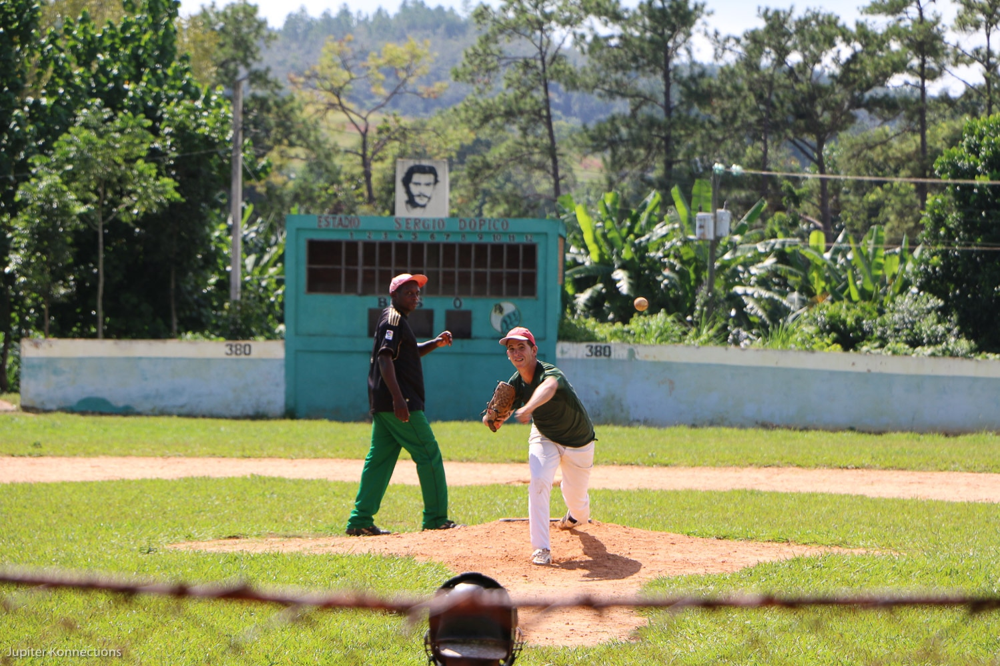
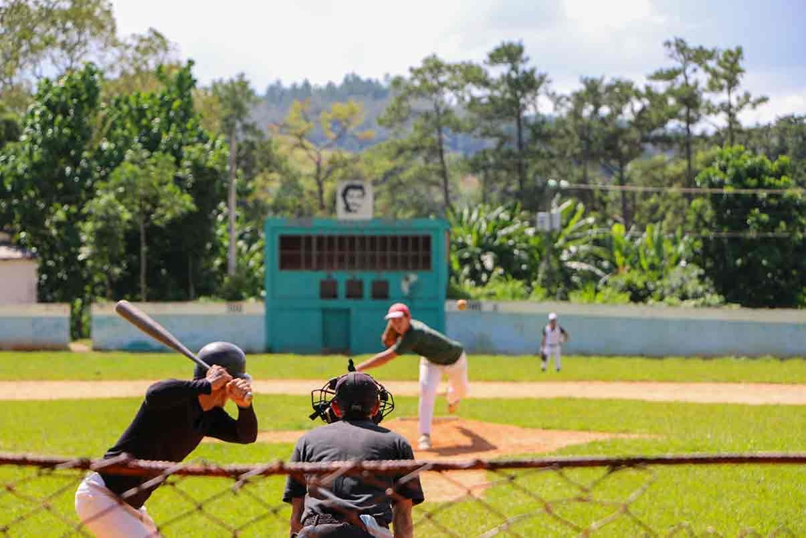

On my first visit to Cuba, I followed two of the island’s sporting passions, from a boxing gym in Old Havana to a baseball field in Viñales. These photographs are part of the people and moments I encountered along the way.

<h2>Boxing in Havana</h2>

While wandering through Old Havana, I came across the gimnasio de boxeo Rafael Trejo. I was fortunate to watch a training session with local amateur and professional boxers.

Rafael Trejo boxing gym · Havana

After the session, I spoke with some of the boxers. Through those conversations, I came to understand what the sport meant in their daily lives: a place to step away from hardship, train towards a professional career and imagine a better future for their families.

<h2>Baseball in Viñales</h2>

After Havana, I spent a few days in Viñales. At the local stadium, set against the surrounding countryside, I attended my first baseball game. We arrived between innings, and I began photographing the moments around the mound and home plate.

At the ballpark · Viñales

<h2>Continue exploring Cuba</h2>

Follow the classic cars in <a href="/portfolio/almendrones/">Almendrones</a>, read the encounter behind <a href="/todo-bien-en-habana/">Todo bien en Habana!</a>, or explore <a href="/destinations/cuba/">the Cuba collection</a>.

