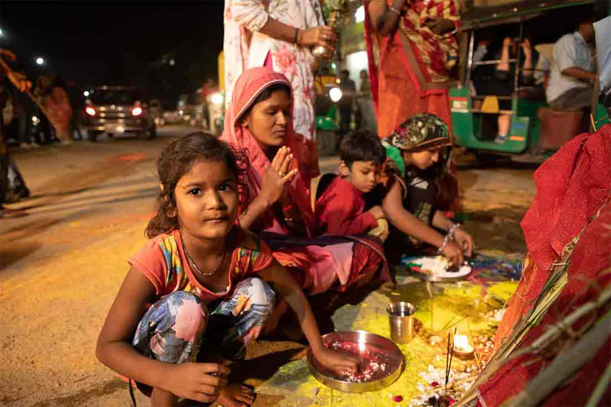
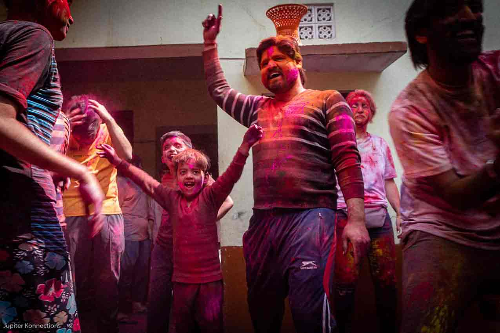
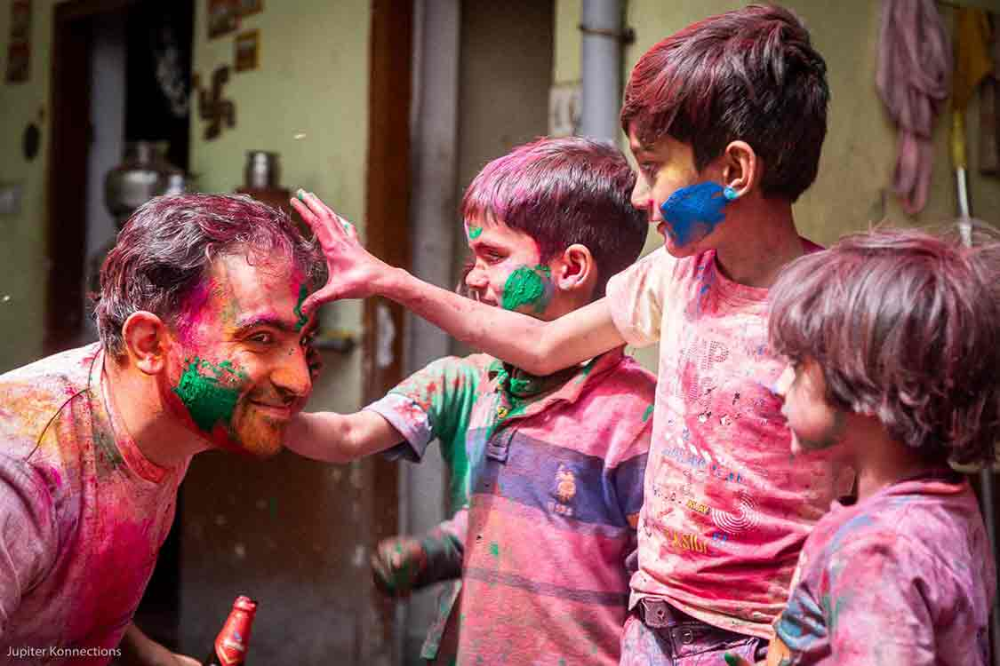
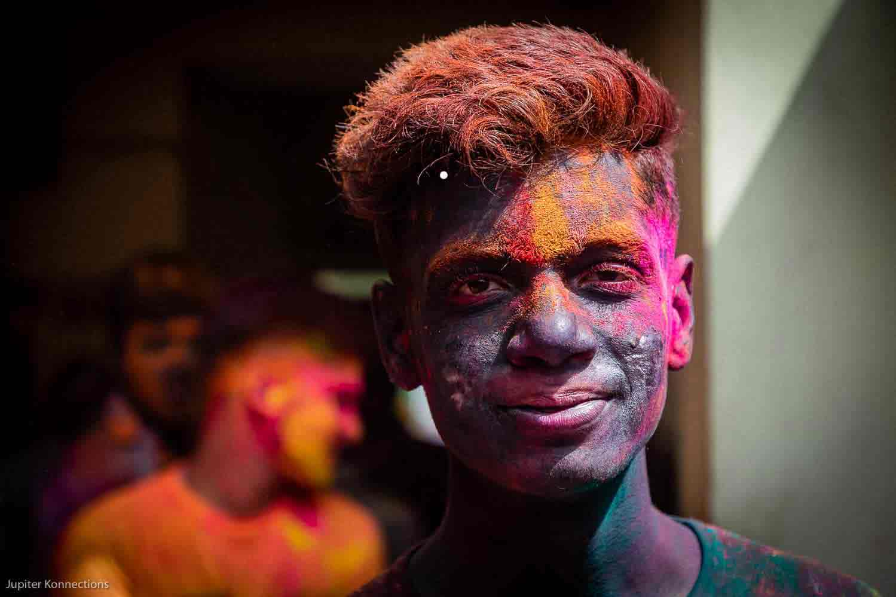
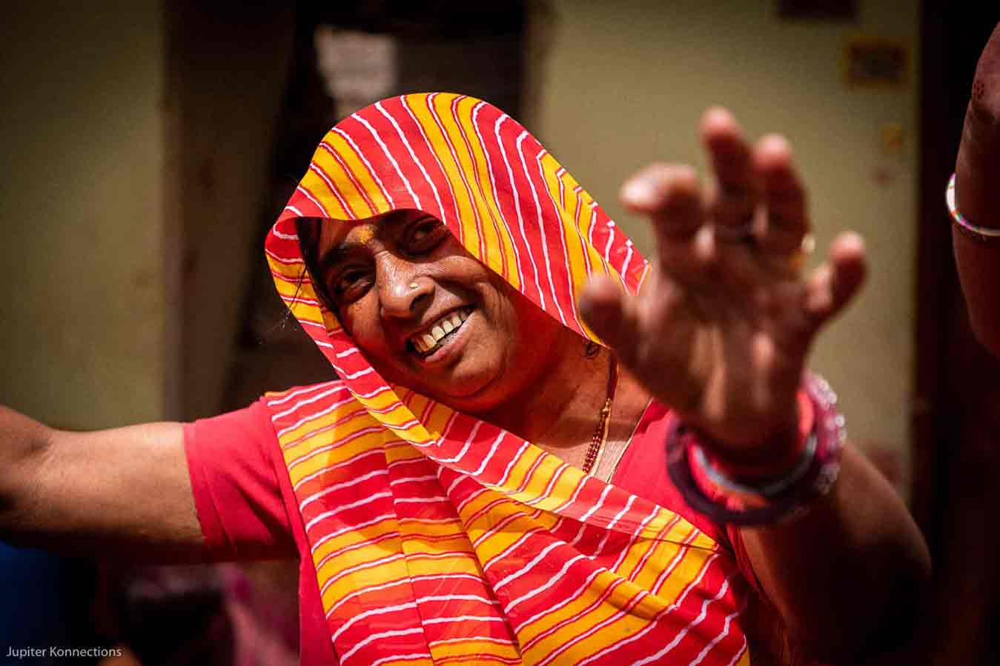
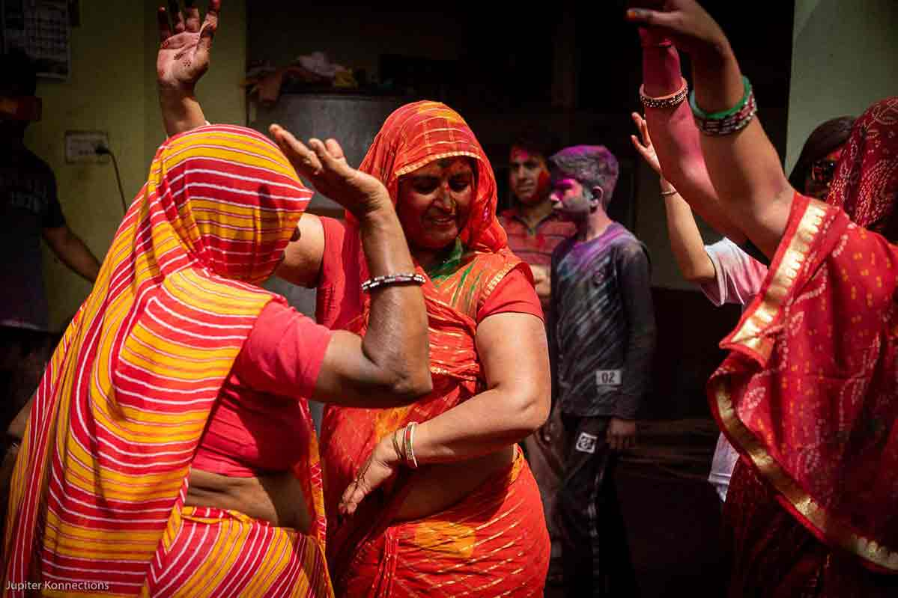
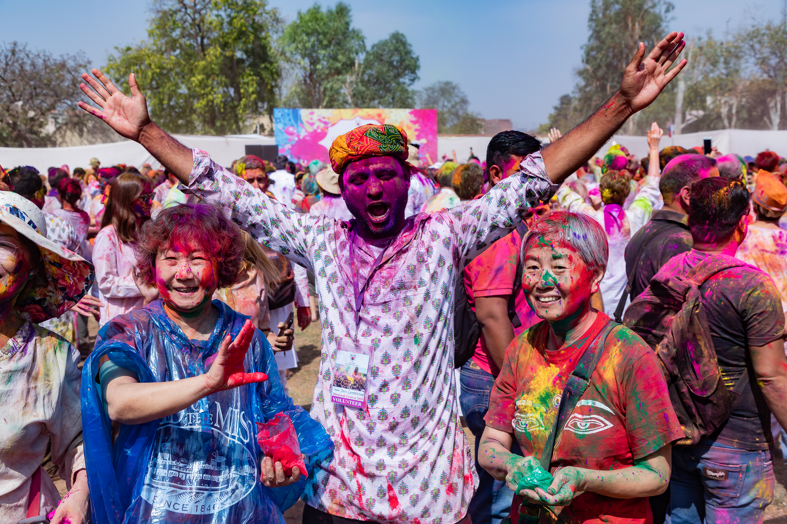
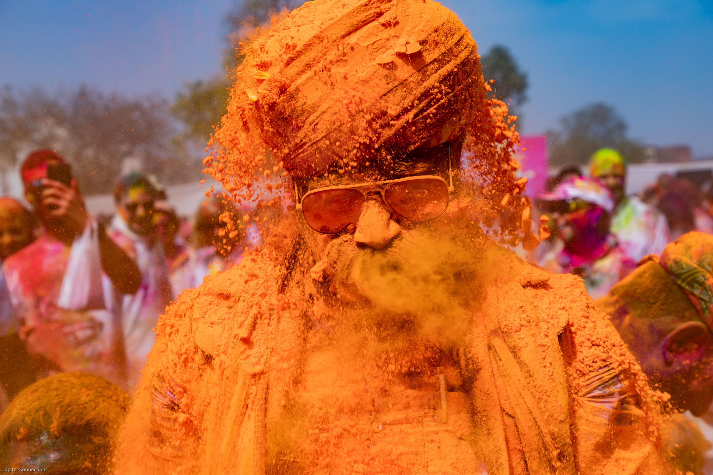
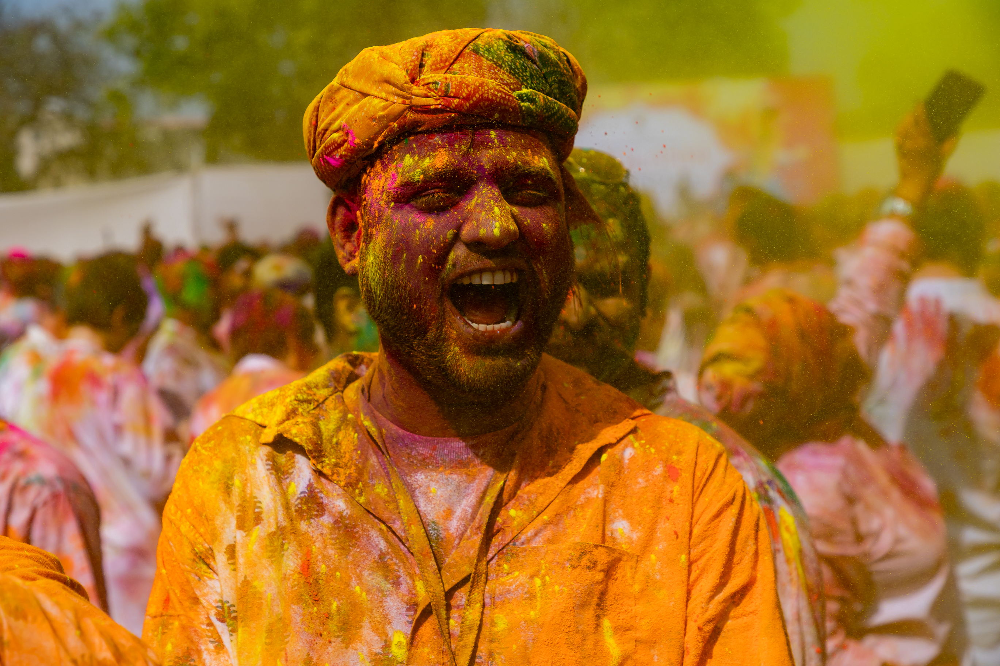
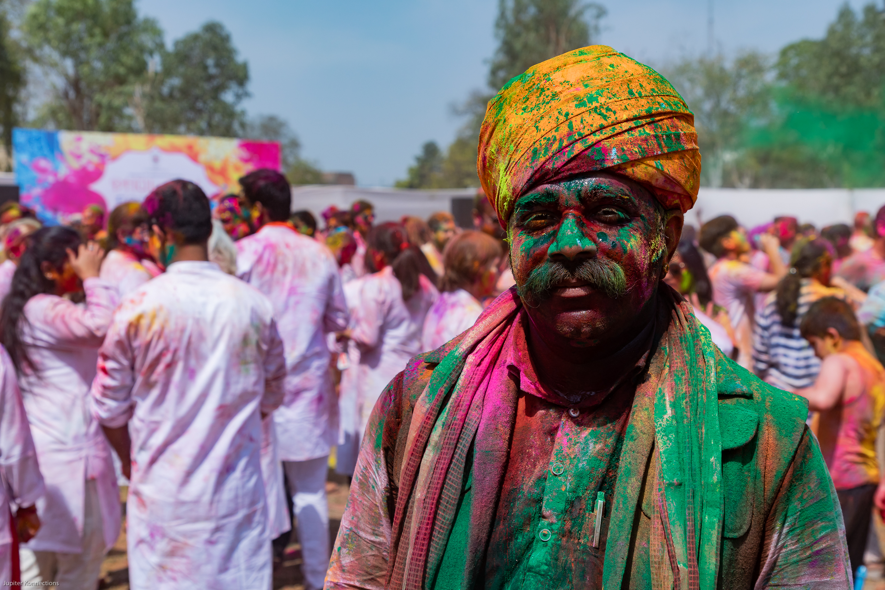

Rajasthan, India · Canon 5D Mark IV · Experiencing Holi

This series brings together photographs from my time in Rajasthan. Experiencing Holi with local people, taking part in their celebrations and sharing the occasion with other travellers was a unique opportunity.

From an evening gathering to streets filled with coloured powder, the photographs follow the people and moments that made the experience memorable.

<h2>The evening gathering</h2>

<h2>Into the colour</h2>

<h2>Faces of the celebration</h2>

Experiencing Holi · Rajasthan · Photographs by Jupiter Konnections

<h2>Continue exploring India</h2>

Read the wider story in <a href="/festivals-from-india-my-journey-in-traditions-and-celebrations/">Festivals from India</a>, discover more portraits in <a href="/portfolio/faces-of-india/">Faces of India</a>, or explore <a href="/destinations/india/">all India stories and photography</a>.

