
In this ultimate travel guide to Zanzibar, I am going to cover a  destination that has a lot to offer from a wide variety of activities, incredible culture and history and beautiful beaches. We will dive into what to do, where to go and what to expect. 

<strong><em>Karibu Zanzibar !!</em></strong>

Additionally, it is also the perfect destination for those looking to unwind after their safari expedition or hike up to <em><strong><a href="/climbing-mount-kilimanjaro/">Kilimanjaro</a></strong></em> in Tanzania with a beach holiday. And let’s face it, adventure travel can be tiring so a relaxing holiday to recover is always welcome. 

In Zanzibar, it is super easy to travel around and the people are incredibly friendly. For a day-by-day route, follow my <a href="/travel-to-zanzibar/">seven-day Zanzibar itinerary</a>. Here, I share the places and experiences that help you choose where to go.

There is an important note to consider in booking your holiday to Zanzibar. The island is 85km long and 35 km wide. Depending on which part of the island your hotel is and activities you will be engaging in, you will cover great distances. I recommend grouping your accommodation close to the activities that you plan to be doing to avoid long drives if you can.

<h2>How to get to Zanzibar
</h2>

Zanzibar is a semi-autonomous region of Tanzania in the Indian ocean. It is composed of the Zanzibar archipelago made up of two small islands and two main islands Pemba and Unguja, also known as Zanzibar.

To get to Zanzibar, you can travel either;
<ul><li>Via sea using a ferry from the mainland in Dar-ae-Salaam,</li><li>Via domestic flights – directly from Dar-ae-Salaam with Air Tanzania, Mango Airlines and Coastal Aviation,</li><li>Via International flights – the island is served by international operators such as Condor, Ethiopian Airlines, Kenya Airways, Oman Air, Qatar Airways, Turkish Airlines, and FlyDubai. </li></ul>
Flying into Zanzibar international airport; the Abeid Amani Karume International Airport (airport code ZNZ) you’re likely going to be making a connection either through Europe or the Middle East.

<h2>Best Time of Year to Visit Zanzibar
</h2>

Generally speaking, you can visit Zanzibar all year round thanks to it’s proximity to the equator. The island enjoys warm temperatures all year round influenced by the East Africa monsoon trade winds.

However, there are a few factors to consider. There are two rainy seasons in Zanzibar. The first, from mid-March to late May influenced by the Kusi (southern monsoon trade winds) and the second in November to early December influenced by the Kaskazi (northernly monsoon trade winds).For this reason, from mid-March to late May won’t be ideal for visiting the island and a majority of hotels shut down during this period.

The best time to visit Zanzibar is from mid-June to October during the cool, dry months and from December to February during the hot and dry months.

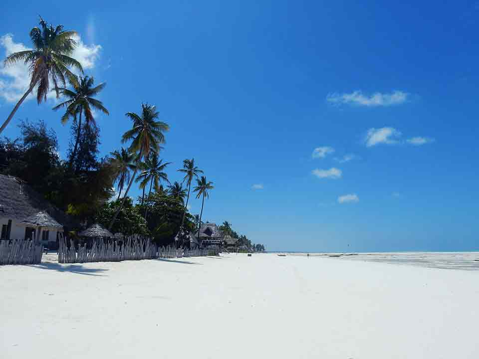
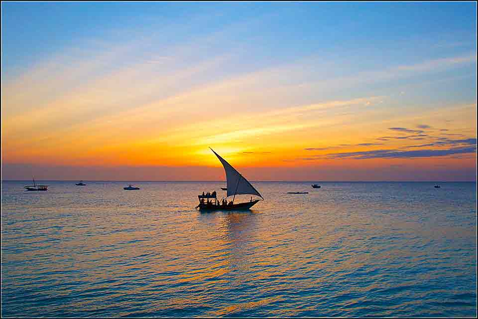

<h2>Explore Stone Town</h2>

Now, let’s begin your adventure. We start in Stone Town, a UNESCO world heritage site and the historical and cultural heart of the island. It is ideally located in Zanzibar City and close to the airport and the port if you arrive by ferry. Stone Town allows you to dive into the history and culture of Zanzibar. 

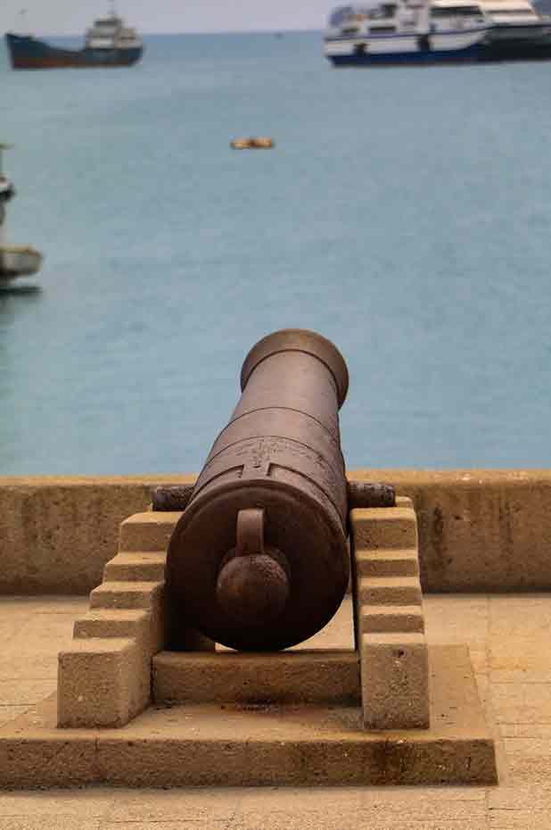
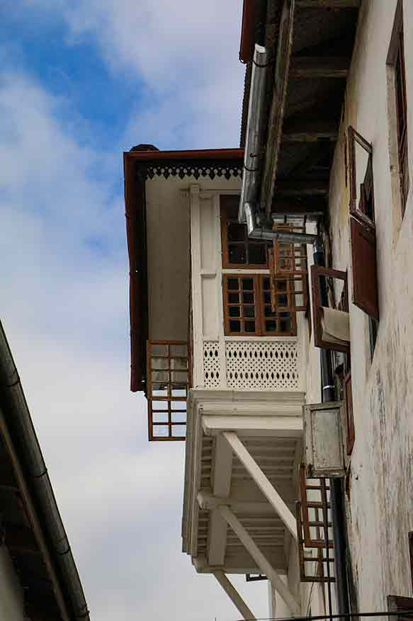
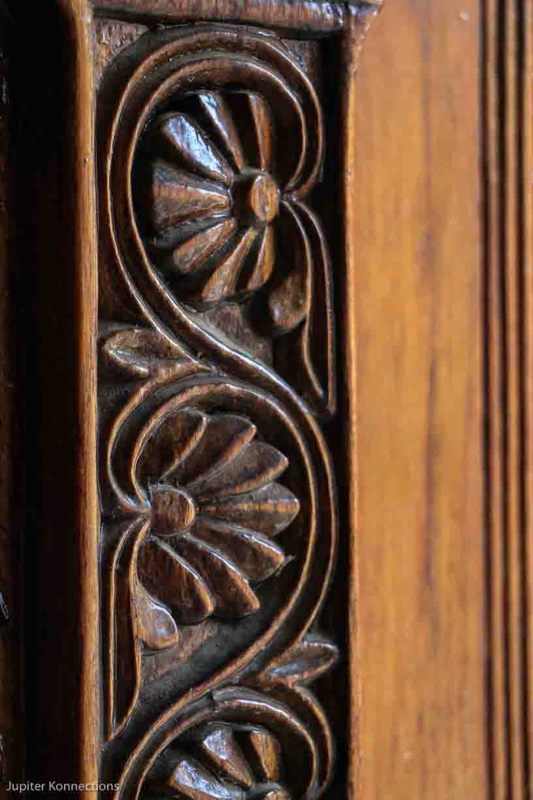
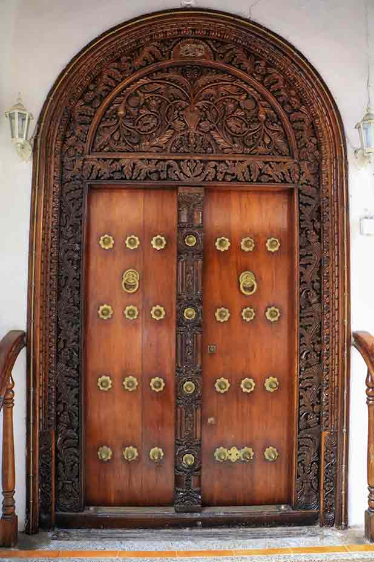

Begin your visit to the “Anglican Cathedral” built on the remains of the “Old Slave market. Here, you will learn the history and the role the island played as a major trade hub of slavery. The inhumane conditions under which they were kept, the chains and other elements portrayed this part of history and tells a heartbreaking story.

On the lighter side of things, proceed to visit the old town.

Travel down the narrow alleys, admiring the intricate facades of old merchant homes that attest to its colonial past and witness the fusion of colours and smells at the Darajani market. Here, you will find your treasures; from fruits &amp; vegetables to shops selling household items for the local families.

The markets here is also where you get your incense and spices (which Zanzibar is renowned for) and to share with your loved ones back home.

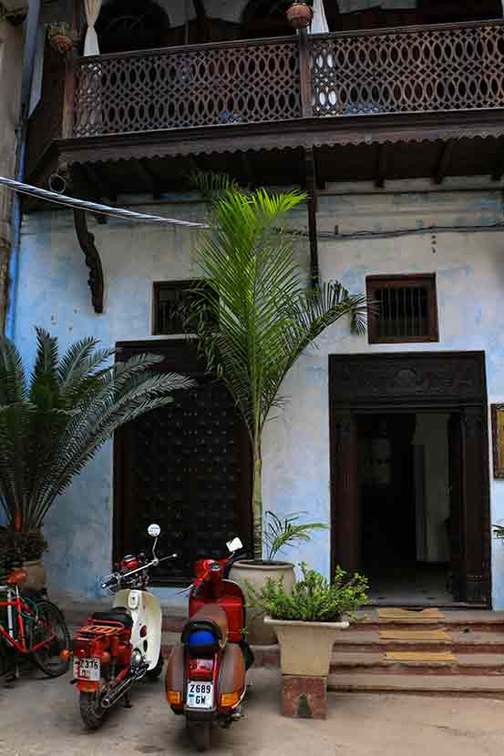

A few observations. Now short on time, I would recommend one night to two nights in Stone Town. Below, I would share a few things to do;
<ul><li>Stroll around the Old town, admire the architecture of the island influenced from the Arab/Persian traders and remnants from its colonial past. Admire the beautiful craftsmanship of the Zanzibar doors</li><li>Stroll by the house of Freddy Mercury (the lead singer of Queen who was born in Zanzibar)</li></ul>

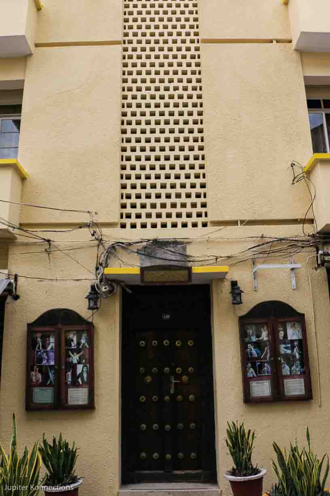
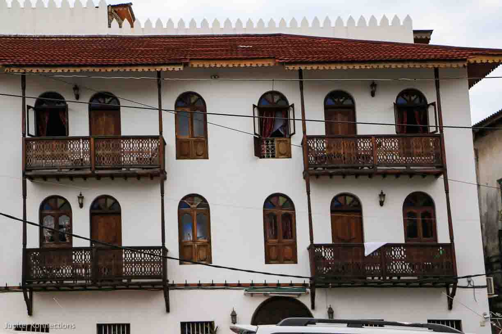
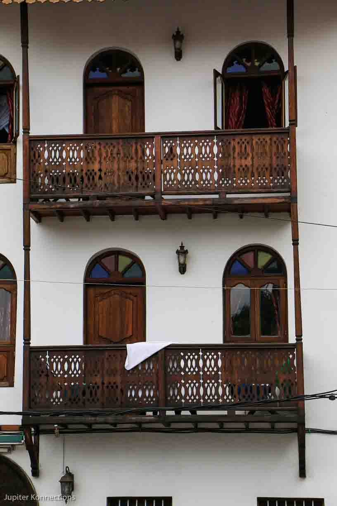
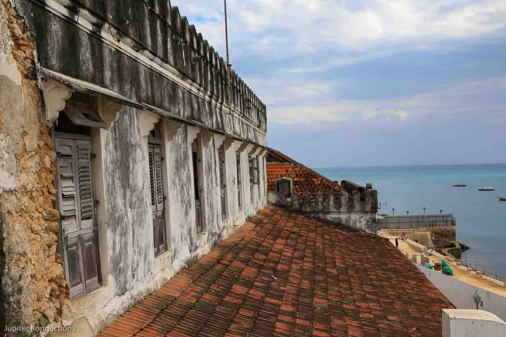

<ul><li>Take the Sunset Dhow Cruise</li><li>Visit Nakupenda Sandbank Picnic; a beach island located 25-minutes away by boat ride, it was also designated as one of the best eight secret beaches in the world. The beach island boasts crystal clear waters and a white sandy beach. A plus, it makes for a perfect spot to enjoy a picnic lunch, relax and capture a magnificent sunset. </li><li>Dine at the “Tea House” over at the Emerson Spice Hotel. One of the finest restaurants in Zanzibar. At the same time, admire the sunset over the copper rooftops over the call of prayer.</li></ul>

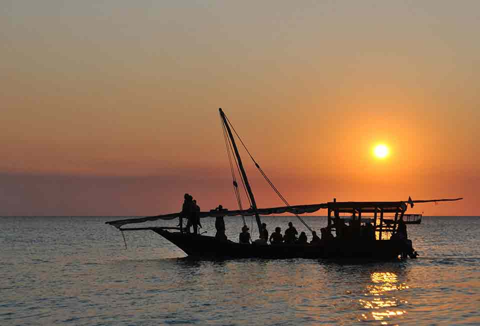
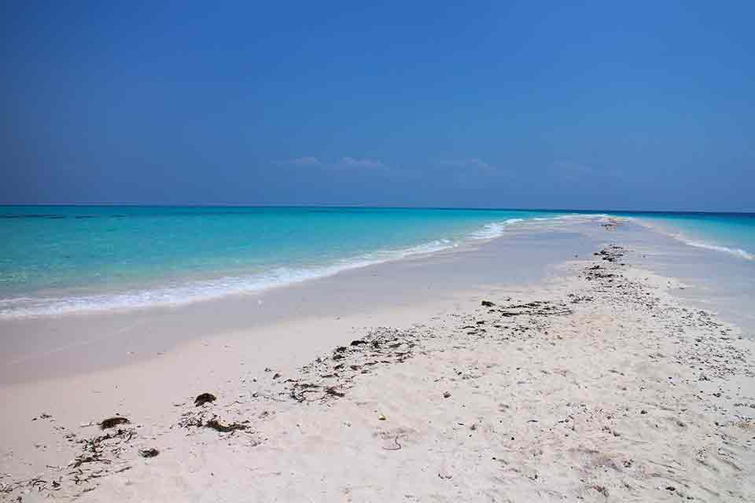

<h2>Explore the North of the Island </h2>

Driving inland toward the north of the island, you arrive at the fishing village of Nungwi. Here, you can appreciate the craftsmanship of the Dhows. The fishermen use these iconic boats for fishing. Additionally, sailing and snorkelling trips for the nearby Mnemba atoll depart from the northern beaches. The north beaches of Kendwa and Nungwi are ideal for admiring a sunset as they are both face a westerly direction.

After a day of water-sports activities, Nungwi comes alive at night. Nungwi is popular for its hotel resorts, restaurants and bars and entertainment venues. If you are looking for a more secluded place, I would recommend Nungwi as a day trip and then move on to a more secluded part like the beaches of Kendwa. 

Explore the fishing villages around the coast such Matemwe, Kiwengwa and Pwani Mchangani by strolling  around the beaches during low tides, or by go for a cycle tour around the villages.

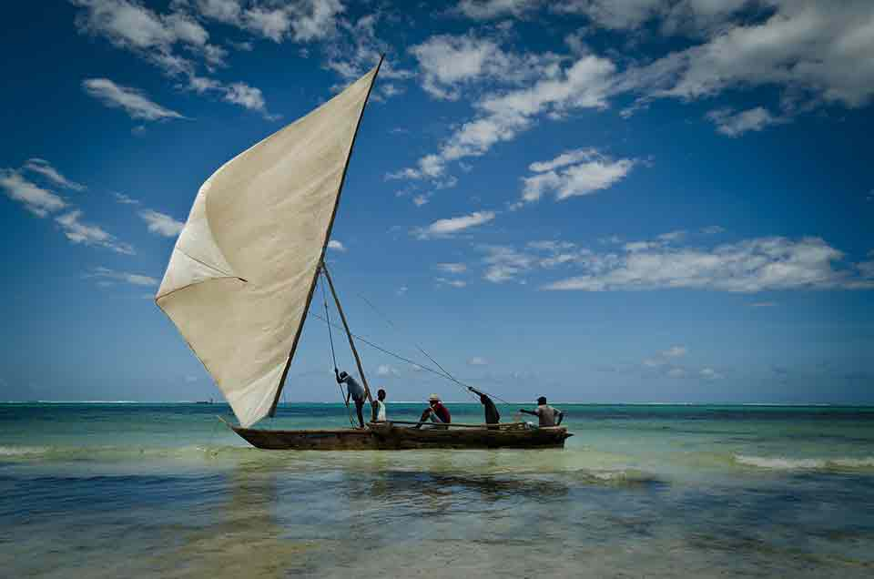
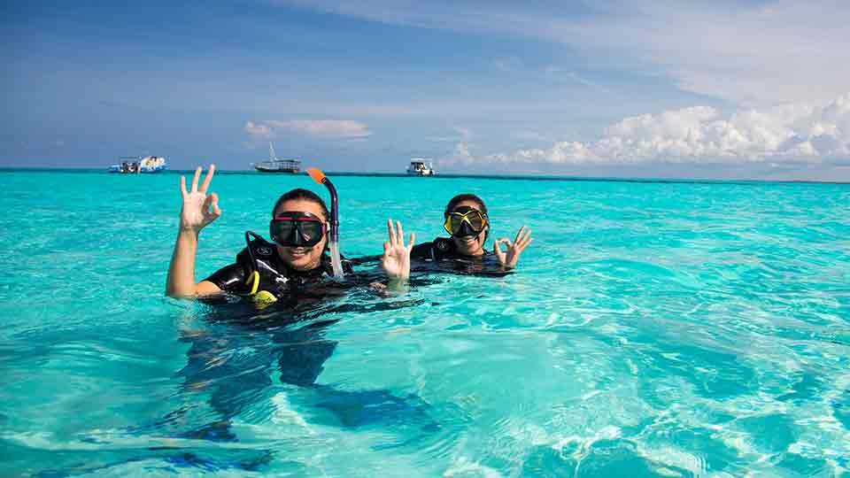

A few other activities you can do in Nungwi northern part of the island;
<ul><li>Watersports (Paragliding, snorkelling, scuba diving, Jet ski…)</li><li>Sailing (Dhow sailing, sunset cruises) </li><li>Spice Farm Tours</li></ul>

As I mentioned earlier, Zanzibar is famous for its spices. I recommend taking a spice tour to get a better understanding of the history of the spice trade here. Learn more about the spices found on the island by visiting a local spice plantation. There, you will be given an insight into the different spices grown.as well as the chance to taste and purchase them. Spices grown on the island include black pepper, cinnamon, cloves, nutmeg and vanilla. Many plantations are found along the route between Stone Town and the northern beaches. They are a good stopover point and to allow yourself 1-2 hours to visit the farms. Moreover, your visit contributes in helping the local farmers.

<h2>Explore the East &amp; South of Zanzibar</h2>

The island’s east coast boasts some of the most idyllic beaches and fishing villages, from Bwejuu, Paje,  Pongwe and Jambiani, to name a few. The coast is home to a wide range of lodges and hotels. However, the tidal cycle of the Indian Ocean means you will have to walk further out on the beach to go swimming or snorkelling.  

On this part of the island, you can expect to lay still, relax and take longs walks on the beach during the low tides. For those looking for an active holiday, you can partake in a popular sport here of kite surfing.

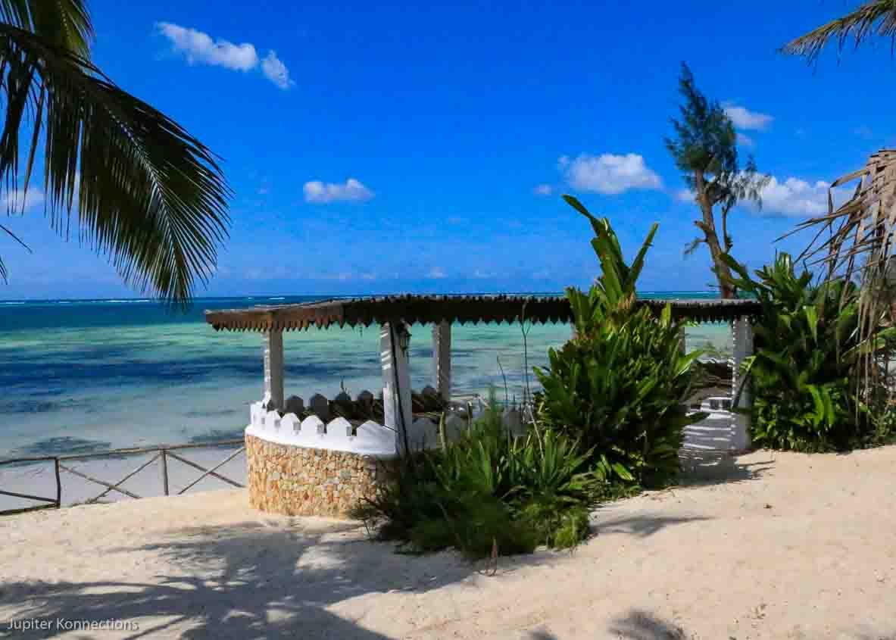
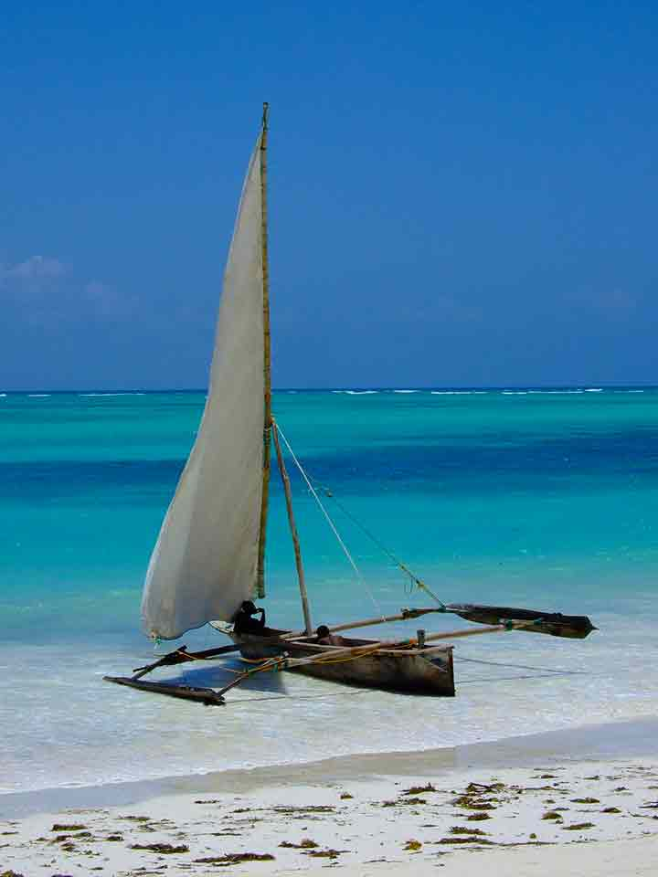

Zanzibar is considered to be as one of the best places to go kite surfing in the world due to the trade winds we discussed earlier.

There are numerous schools along the coastline offering a lot of activities. Paje and Jambiani are probably the most popular places to practice the sport and attracts a lot of kite enthusiast during the kite surfing season. Visit the <strong><em><a href="http://www.zanzibarkiteparadise.com/" rel="noopener noreferrer">Zanzibar Kite Paradise</a></em></strong> or <a href="http://www.kitecentrezanzibar.com/en/" rel="noopener noreferrer"><strong><em>Kite Centre Zanzibar</em></strong> </a>in Paje or <strong><em><a href="http://www.zanzibarkitecenter.com/en/" rel="noopener noreferrer">Jambiani Kite Centre</a></em></strong> if you’re staying in Jambiani.

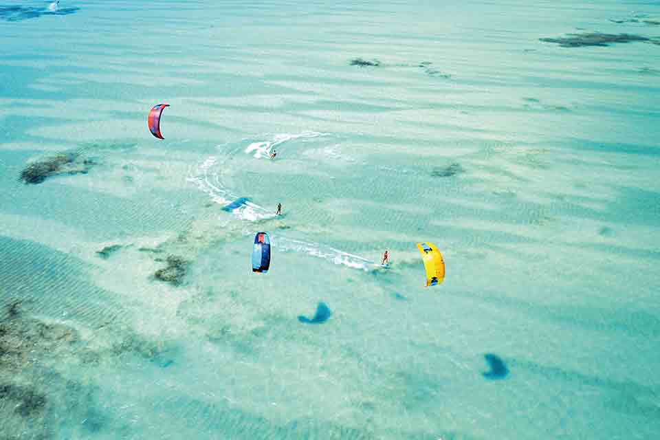

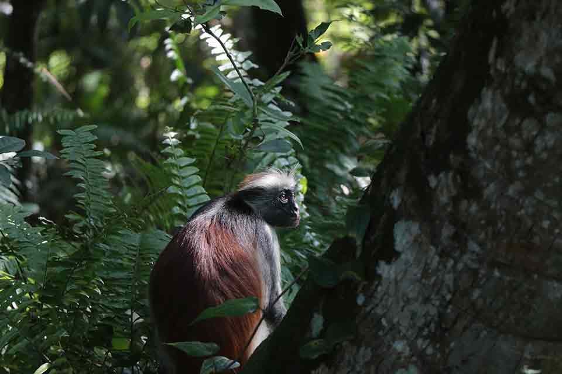

Red Colobus Monkey · Jozani Chwaka Bay National Park

For those into nature, why not visit the <em><strong><a href="https://www.tripadvisor.in/Attraction_Review-g482884-d4885862-Reviews-Jozani_Chwaka_Bay_National_Park-Zanzibar_Island_Zanzibar_Archipelago.html" rel="noopener noreferrer">Jozani Chwaka Bay National Park</a></strong></em>. It is situated in the middle of Zanzibar and close to the beaches of Pingwe, Paje and Jambiani. Visiting the park, one can see the endemic Red Colobus Monkey, Bush Babies, Sykes Monkey, and a variety of species of birds. Legend has it that the <strong>Zanzibar Leopard</strong> still lives in the Park.

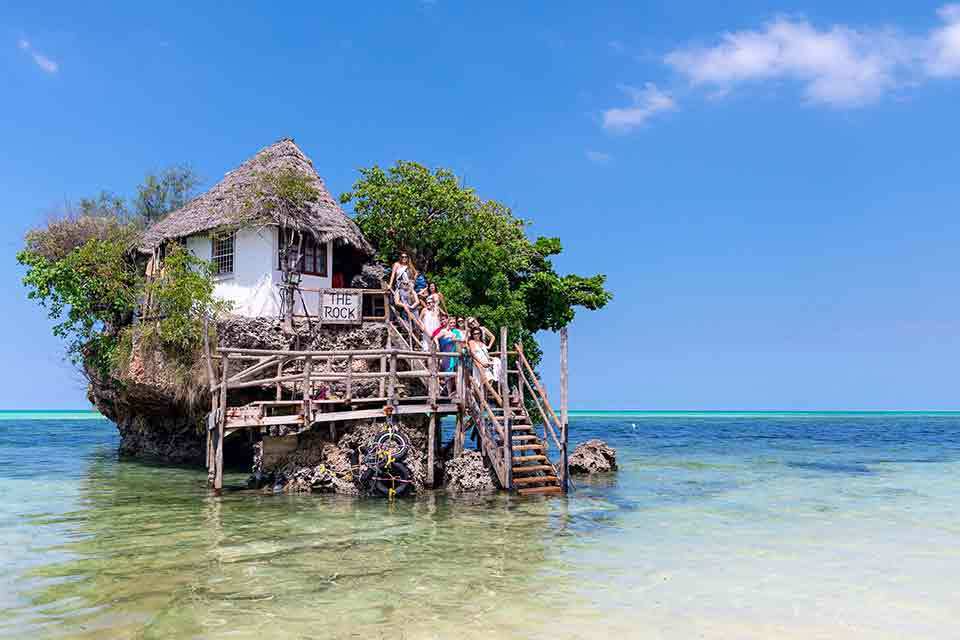

The Rock Restaurant · Pingwe

If you are lucky enough to stay in Michamvi, you will get to witness the spectacular sunset on the bay. On your stay on the east coast of Zanzibar, you will only get to see sunrises. Additionally, if you are looking to tick an item off your bucket list then have lunch at the famous restaurant, the Rock, ideally situated just off the beaches of Pingwe.

The beaches of Jambiani also offer a relaxing vibe and is close to the fishing villages. Here you can get to visit Zanzibar’s seaweed production farms.

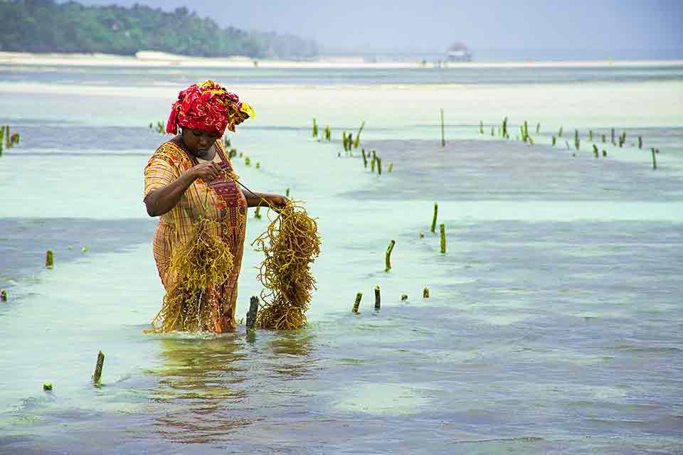

Seaweed farming · Jambiani

<h2>Bonus activities</h2>

Thank you for reading this far. As a sign of gratitude, here are a few bonus activities to do during your stay:
<ul><li><strong>Cycle Zanzibar</strong>: Something I want to do on my next visit is rent a bike and cycle the whole island. Sounds like something you would love to do? – then you should check this guy’s <strong><em><a href="http://bikezanzibar.com/" rel="noopener noreferrer">Bike Zanzibar</a></em></strong> led by Juma. Your one-stop-shop for cycling activities in Zanzibar. They offer day tours, cycling holidays (including women-only trips), bike rental and tailor-made trips.</li><li><strong>Learn how to make Zanzibar Cuisine</strong>: The cuisine of Zanzibar is a vibrant fusion of India, Omani and Persian cuisine. Add to that the rich culture spices of the island—an outstanding destination for a foodie lover. </li><li><strong>Ride a Dala dala</strong>: the local way of getting around.</li><li><strong>A spa massage</strong>: After a long drive, adventurous safaris, or a trek up to Kilimanjaro, your body needs some care. I recommend booking a massage treatment. Many of the hotels around the islands have spas with vanilla oils and all the other goodies.</li><li><strong>Deep-sea Fishing</strong>: If you love deep sea fishing, then Zanzibar is your paradise. The archipelago attracts all kinds of game- Barracuda, Marlin, Kingfish, Yellowfin Tuna, to name a few. The prime fishing months are around August. </li><li><strong>Scuba &amp; Snorkelling</strong>: With the abundance of marine life around the reef at Mnemba Atoll and Chumbe Island, I would recommend going snorkelling and scuba diving at these spots. If you are lucky, you might encounter some dolphins.</li><li><strong>Horse riding</strong>: Now this is truly something special I would love to do. Riding horses on the beaches of Nungwi (Morning or Evening sessions), swimming with the horses or riding with them in the plantation farms, or villages around Nungwi.</li></ul>
<h2>In Conclusion</h2>

As you can see, Zanzibar has a lot to offer, from cycling, kite surfing, snorkelling, horse riding, to relaxing on the beach and interacting with the local community through to activities such as a visit to the spice plantation or the seaweed farms. This place is a piece of heaven and I cannot wait to get back. 

It is essential when booking your trip to see how much time you have and what you want to do as activities. This will enable you to better plan  for your trip.

<strong> In my <em><a href="/travel-to-zanzibar/">seven-day Zanzibar itinerary</a></em>, I will share with you an ideal itinerary for seven days around Zanzibar. Thanks for stopping by. Feel free to share this article with someone planning a visit. </strong>

<strong>Asante Sana! Hakuna Matata!</strong>

<h2>Continue the journey</h2>

Pair your island escape with my <a href="/climbing-mount-kilimanjaro/">guide to climbing Mount Kilimanjaro</a>, or explore the <a href="/travel-to-zanzibar/">Zanzibar itinerary</a>.

