
Welcome to my guide on exploring the 9 wonders of the world. It’s a journey full of awe, mystery, and discovery. As a keen traveler, I’m drawn to these famous landmarks. They’ve amazed people like me for centuries.

Let’s dive into my adventures. Together, we’ll visit the world’s most amazing places. First, we’ll see Egypt’s Pyramids of Giza, standing in their ancient glory. Then, in Jordan, the hidden city of Petra reveals its timeless beauty. Lastly, in India, the Taj Mahal’s artistry will enchant us.

Join me as we uncover the wonders of the world, one marvel at a time.

This guide is perfect for anyone who loves history, craves adventure, or seeks cultural richness. I’ll share not just my adventures but also practical tips and insights to help you plan your own memorable trips.

Ready for an epic adventure? Let’s discover the world’s most extraordinary treasures and unlock the secrets of the 9 wonders together!

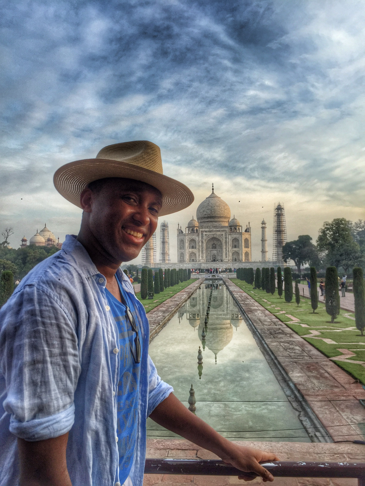

<h2>Visiting the 9 Wonders:
Travel Tips and Recommendations</h2>

I always dreamed of seeing the world’s wonders. Being a flight attendant made it possible.

At each place, I looked up the best times to go and learned about its history. I had to be smart with my money. Luckily, my job gave me cheaper flights. I still planned a lot to make sure everything went smooth.

I love learning from documentaries and books. So, I picked places to visit that fit with my work trips. This made my dream and job come together nicely.

Being flexible was important. I always planned ahead for visas and hotel stays.

Seeing these wonders changed me. It wasn’t just a trip. I really connected with each place’s story. This adventure made me love our world’s different cultures and histories more.

Ready to start our journey? Let’s go!

<h2>The Great Wall, China (2009)</h2>

My <a href="/destinations/china/">Beijing, Shanghai and Hong Kong visits</a> grew out of my years working as a flight attendant based in Dubai. The Great Wall outings were day trips during repeated visits to Beijing.

I started this journey early in my flying career with Emirates. Initially, our team had 30-hour layovers in Beijing. Together, we often planned group excursions. Once, we decided to hire a private driver for the Great Wall, returning to our hotel by afternoon. Remember, Beijing’s early morning traffic is notoriously heavy.
The Great Wall of China boasts diverse sections, each unique in features and history. Badaling showcases rugged beauty, while Jinshanling and Huanghuacheng are more remote and serene. This magnificent structure, steeped in rich history, offers breathtaking landscapes. As you traverse its ancient pathways, the architectural brilliance and vast scale captivate you. 

<strong>Tips:</strong>

Firstly, ensure you check whether the access to the Wall is open, particularly on special days. Secondly, always look at the weather forecast and dress accordingly, especially during the cold season (end of September till March) when it gets really cold out in the open. Additionally, consider arranging a private tour (chauffeur) or concierge service for transportation from your hotel to the Wall and back. Lastly, if you are transiting or on a 72-hour visit/transit visa, you have the option to go directly from the Beijing International Airport.

Bonus: Looking or more tips, and things to do in China, <strong><a href="https://www.chinahighlights.com/beijing/how-to-get-to-great-wall.htm" rel="noopener noreferrer">here</a></strong> is a site I would go to plan my activities and sights in Beijing.

<h2>The Ancient City of Petra, Jordan (2009) </h2>

Petra was part of my <a href="/destinations/jordan/">six-day trip to Jordan</a>.

Tucked away in Jordan’s rugged mountains is the old city of Petra, a UNESCO World Heritage site and a new world wonder. It’s carved into pinkish cliffs, showing the Nabateans’ great building skills. They were an old Arab group.

Walking through the narrow Siq, a cool canyon, feels like going back in time. You first see the Treasury, Petra’s famous part. It has lots of detailed carvings and columns. Past the Treasury, there’s a mix of tombs, temples, and houses. Each part tells a bit of the story of this once busy trading place.

Hidden within the rugged mountains of Jordan lies the ancient city of Petra, a UNESCO World Heritage site and one of the new seven wonders of the world. Carved into the rose-colored sandstone cliffs, this architectural marvel is a testament to the advanced engineering skills of the Nabateans, an ancient Arab civilization.

As you enter through the narrow Siq, a breathtaking canyon that leads to the city, you are transported back in time. The Treasury, Petra’s most iconic structure, greets you with its intricate façade adorned with intricate carvings and columns. Beyond the Treasury lies a labyrinth of tombs, temples, and dwellings, each revealing a glimpse into the vibrant history of this once-thriving trading center.

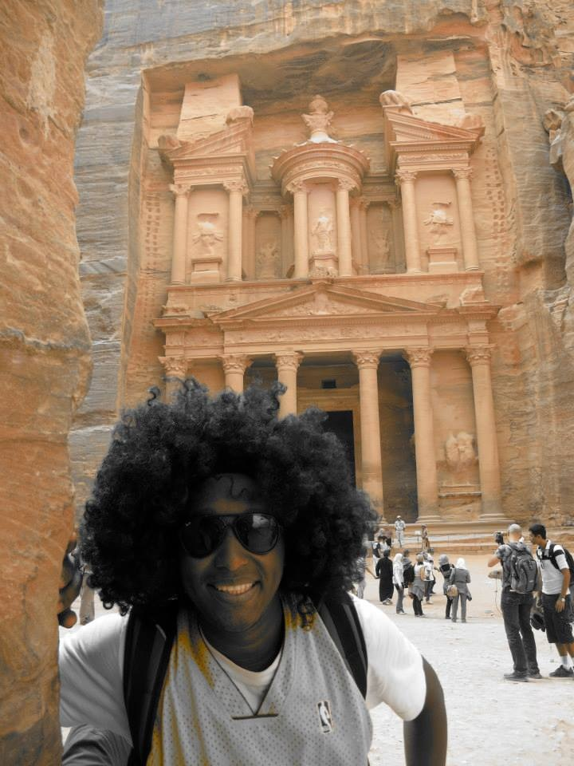
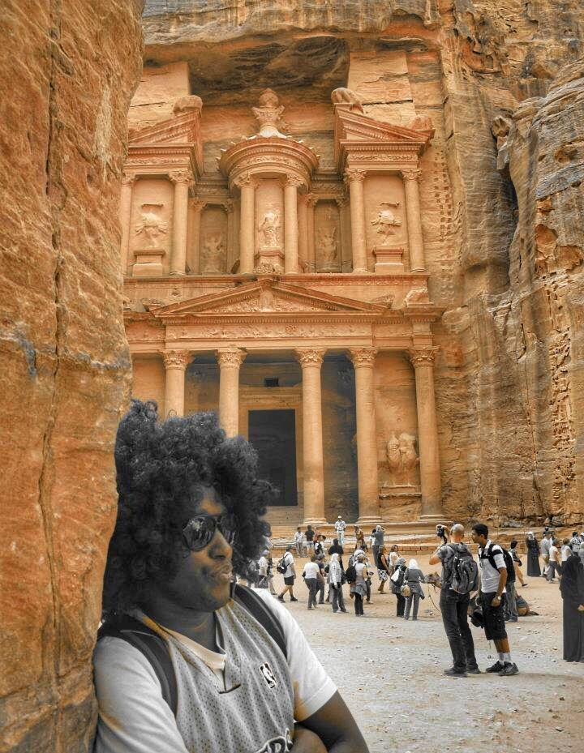

<h2>The Colosseum - Italy (2010 &amp; 2022)</h2>

I explored the Colosseum during <a href="/destinations/italy/">several trips to Rome</a>.

Step into the heart of ancient Rome as you explore the Colosseum, an architectural masterpiece that has withstood the test of time. Built in the first century AD, this elliptical amphitheater was a venue for gladiatorial contests, animal hunts, and other spectacles that entertained the citizens of Rome.

As you walk through the grand arches and ascend to the upper tiers, you can almost hear the roar of the crowd and feel the excitement that once filled this magnificent arena. The Colosseum’s ingenious design allowed for efficient crowd control and impressive spectacles, making it a symbol of the power and grandeur of the Roman Empire.

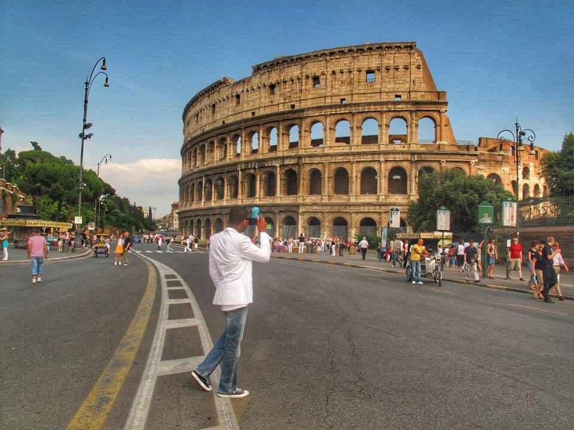

<h2>The Great Pyramid of Giza: Egypt's Ancient Wonder (2013)</h2>

The pyramids were part of my <a href="/destinations/egypt/">five-day visit to Egypt</a>.

The Great Pyramid of Giza, the oldest and largest of the three pyramids in the Giza complex, is a testament to the architectural brilliance of the ancient Egyptians. Built as tombs for the pharaohs, these pyramids were constructed with incredible precision and mathematical accuracy.

As you stand before the Great Pyramid, you can’t help but marvel at its sheer size and the intricate craftsmanship that went into its construction. The mysteries surrounding the pyramids, such as the method of construction and the purpose of the intricate passages and chambers within, continue to captivate the imagination of historians and explorers.

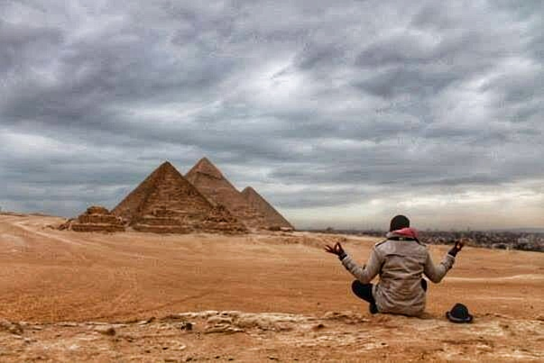

<h2>Machu Picchu: The Lost Inca City, Peru (2014)</h2>

High in the Andes Mountains of Peru, the ancient Inca city of Machu Picchu stands as a testament to the genius of Incan engineering and the splendor of their civilization. Built in the 15th century and hidden from the outside world for centuries, Machu Picchu is a marvel of stone construction and sophisticated urban planning.

As you wander through the intricate stone terraces, temples, and dwellings, you can’t help but feel a sense of awe and wonder at the sheer beauty and ingenuity of this lost city. The panoramic views of the surrounding mountains and the mist-shrouded ruins create an ethereal atmosphere that transports you back in time.

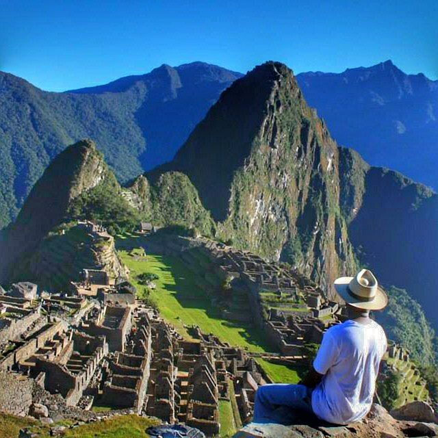
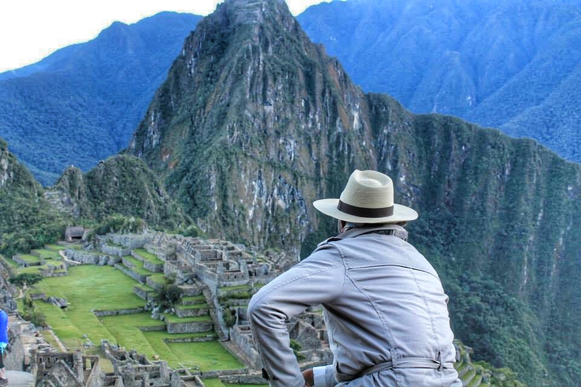

Explore the wider route of my <a href="/destinations/peru/">first South American trip through Peru</a>.

<h2>Angkor Wat: Khmer Temples, 
Cambodia (2014)</h2>

Angkor Wat was part of my <a href="/destinations/cambodia/">ten-day Cambodia trip</a>.

In the green jungles of Cambodia, you’ll find the old city of Angkor and its best part – Angkor Wat. This huge temple, made in the 12th century, is the biggest religious place in the world and shows the best of Khmer building style.

Walking around, you’ll see amazing carvings and tall towers. The detail and art in every part of this big temple are stunning. It mixes Hindu and Buddhist styles, and there are moats and water around it. This makes it a calm and magical place that’s really special.

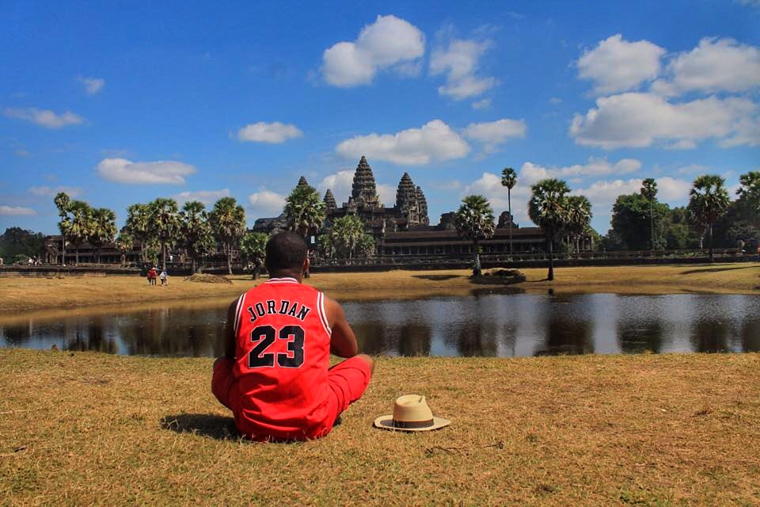
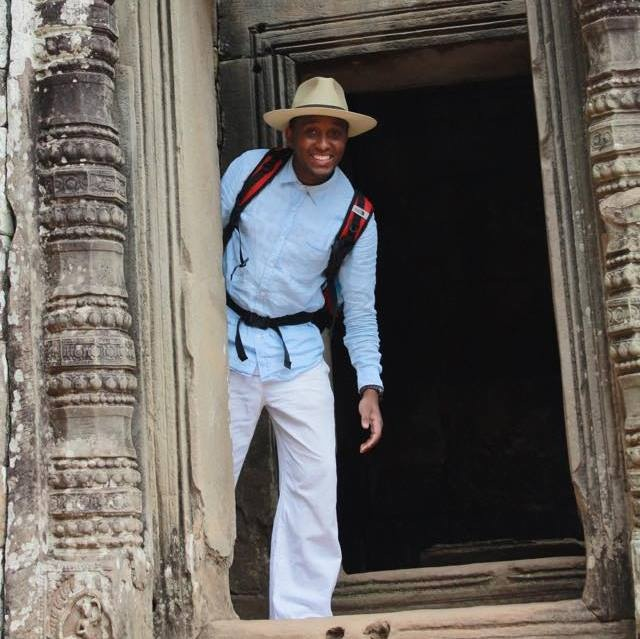

<h2>Chichén Itzá: Mayan Temple, 
Mexico (2010 &amp; 2017)</h2>

I visited Chichén Itzá on <a href="/destinations/mexico/">two trips to Mexico</a>. The first lasted eight days and included Cancún, Isla Mujeres and Tulum; the second included Mexico City, Playa del Carmen and Tulum.

Deep in the Yucatan Peninsula, you find the old Mayan city of Chichén Itzá in the jungle. It shows us a lot about the mysterious Mayan people. In the middle is the famous El Castillo, or the Temple of Kukulcan. This big pyramid shows how much the Mayans knew about stars and numbers.

On the first days of spring and autumn, something amazing happens here. The shadow on the pyramid looks like a snake going down the steps. This cool building shows how the Mayans were close to nature. They were really good at putting star events into their buildings.

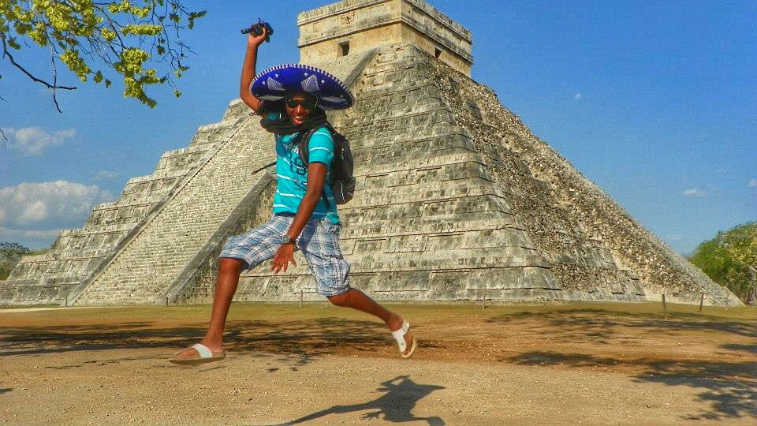

<h2>Christ the Redeemer, Brazil (2014)</h2>

Christ the Redeemer sits on top of a mountain in Rio de Janeiro. It’s a big statue that means faith, hope, and coming together. With arms wide open, it looks over the lively city and gives amazing views of the area around it.

They finished building Christ the Redeemer in 1931. It took a lot of careful planning and smart building skills. Made of strong concrete and soapstone, it has lasted a long time. Now, it’s a famous place that lots of people visit every year.

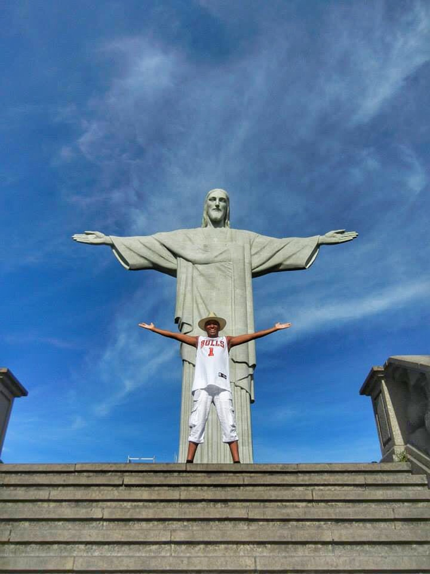

Continue beyond this landmark with my <a href="/destinations/brazil/">Brazil journey through Rio and Recife</a>.

<h2>Taj Mahal, India (2016 &amp; 2019)</h2>

My first India trip was a <a href="/destinations/india/">six-day Golden Triangle road trip</a>. I later returned to live in India and made further visits to Agra.

The Taj Mahal is a special building, a sign of love that lasts forever. It shows how grand and beautiful the Mughal Empire was. Emperor Shah Jahan built it in the 17th century for his wife Mumtaz Mahal. Made of white marble, it mixes styles from Persia, Islam, and India beautifully.

When you get near the Taj Mahal, the shining white marble against the blue sky is stunning. The detailed designs, the even gardens, and the water pool make you feel calm and peaceful. Its beauty has touched poets, artists, and travelers from all over, making it a real wonder of building and art.

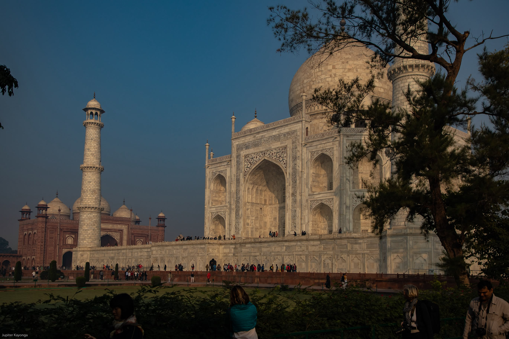
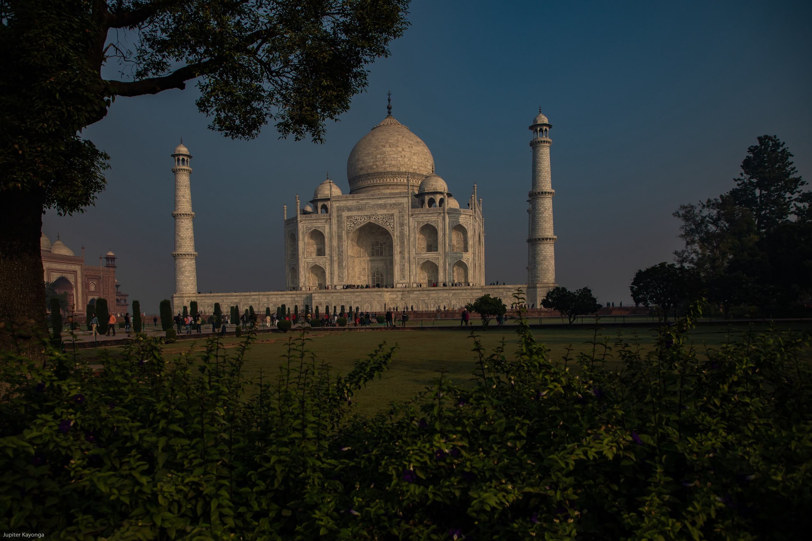
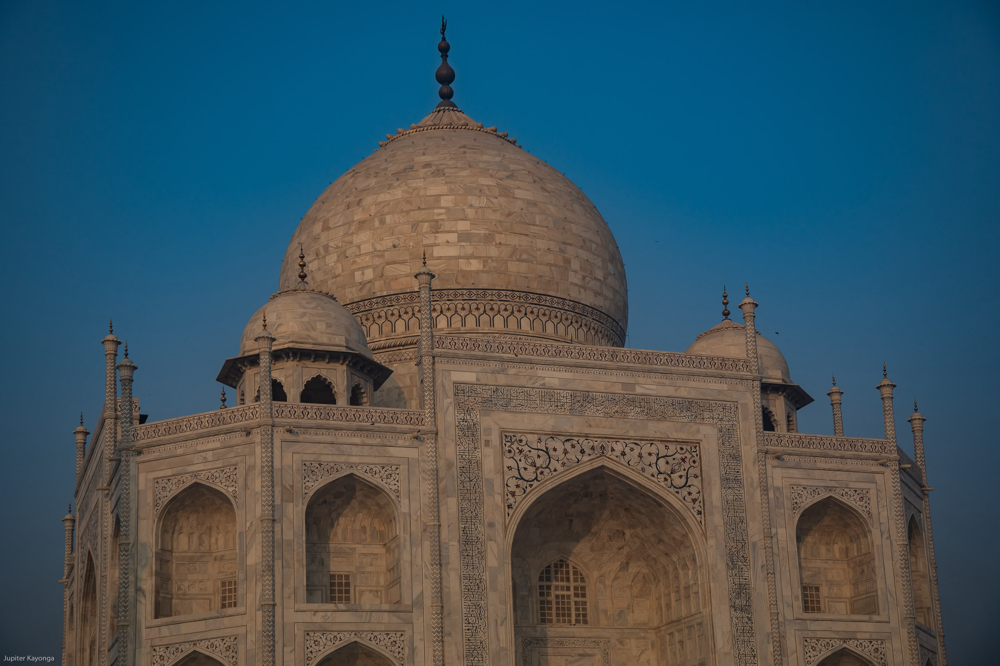

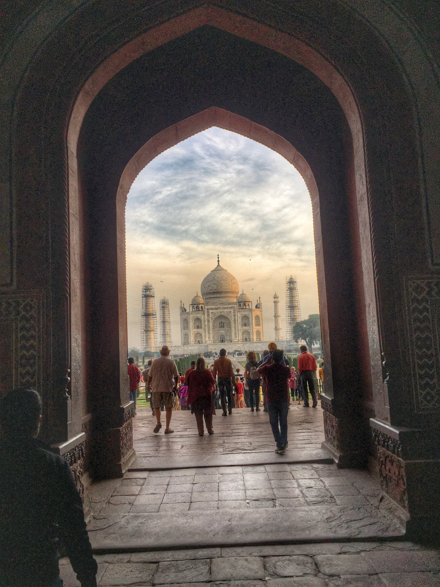
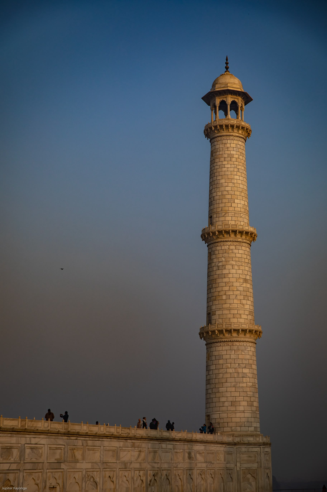
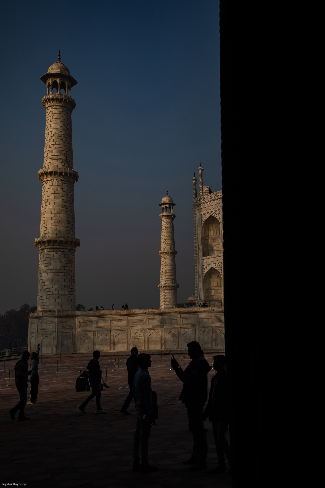

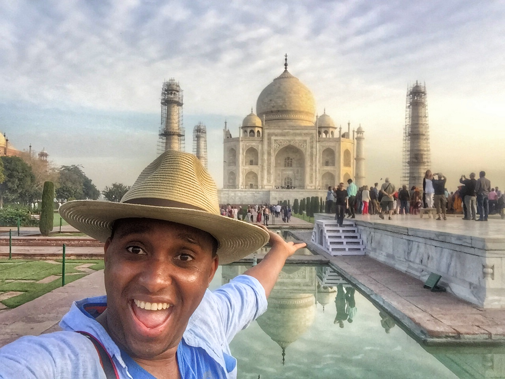
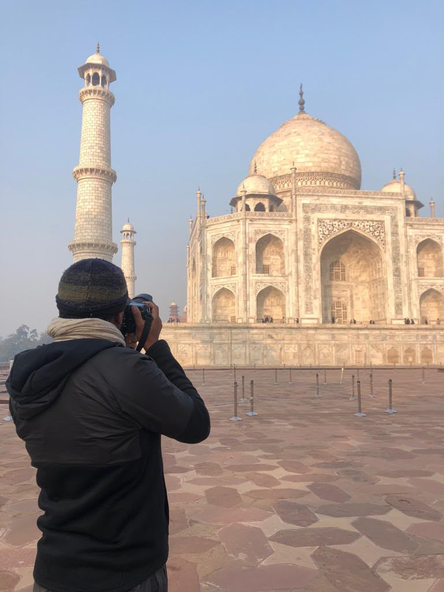

<h2>Conclusion: Unlocking the Magic of the 9 Wonders</h2>

As we conclude our journey through the nine world wonders, awe fills us. The human ingenuity, creativity, and dedication behind these structures are astounding. Each wonder narrates a story from a bygone era, showcasing our rich history and diverse cultures.

In one paragraph, we transition from ancient marvels to recent ones. These architectural wonders, standing for millennia or less, remind us of human potential. From the Great Wall’s grandeur to the Taj Mahal’s spirituality, they captivate universally, transcending time and borders.

In another paragraph, our focus shifts to preservation and appreciation. Let’s commit to safeguarding these wonders for posterity. They symbolize our shared heritage and inspire us, linking past to future.

Finally, we invite discovery and exploration. Embark on a journey to uncover the secrets of these wonders. Let their beauty, history, and cultural significance captivate you.

<h2>Continue the journey</h2>

For a different kind of wonder, follow my Iceland road trip through waterfalls, glaciers, volcanic landscapes and remote camping spots. <a href="/iceland-roadtrip-top-camping-and-adventure-routes/">Iceland Roadtrip: Top Camping and Adventure Routes →</a>

