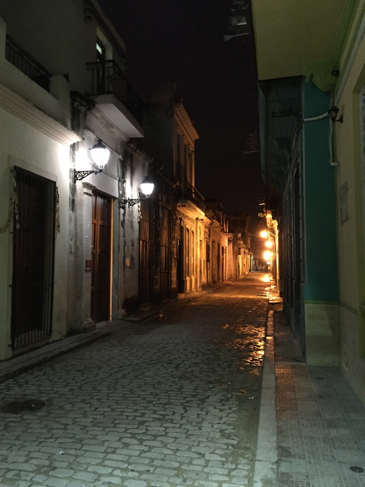
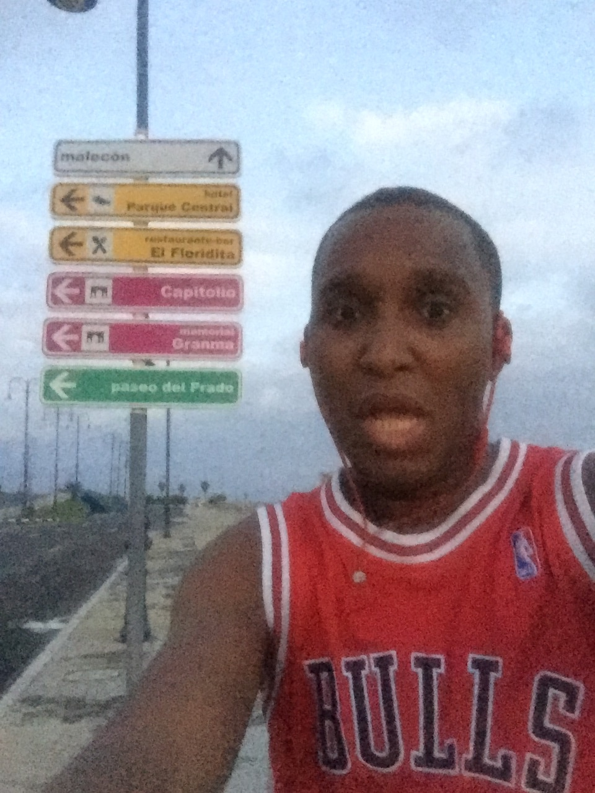
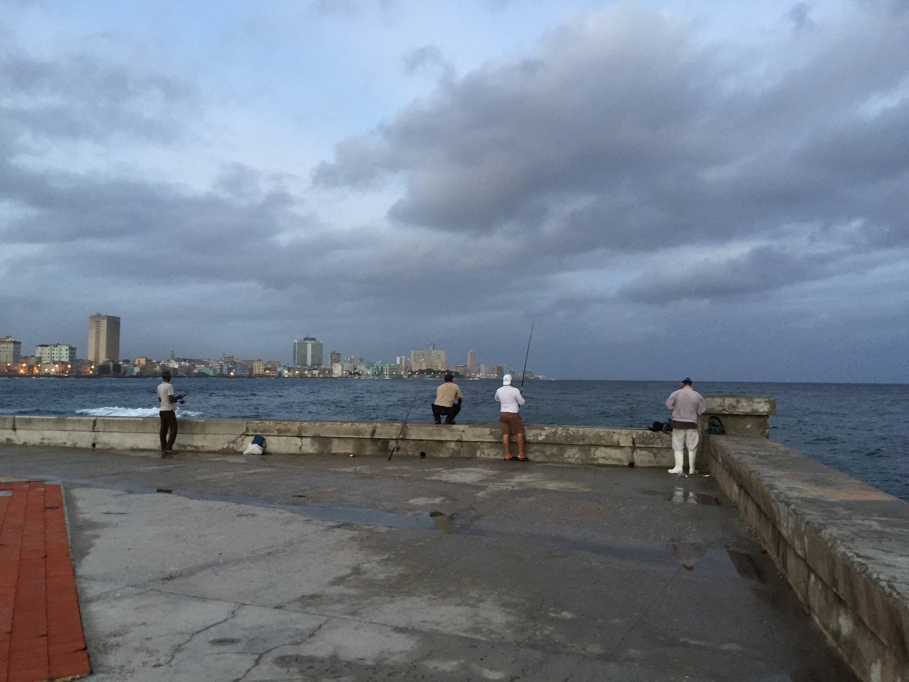
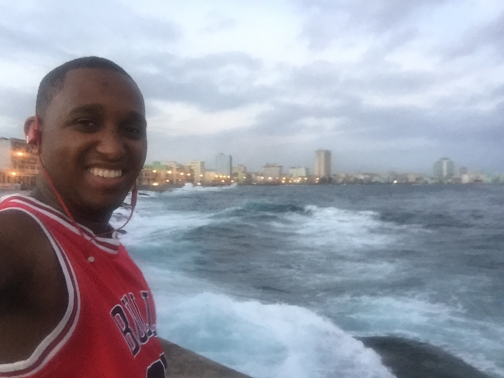
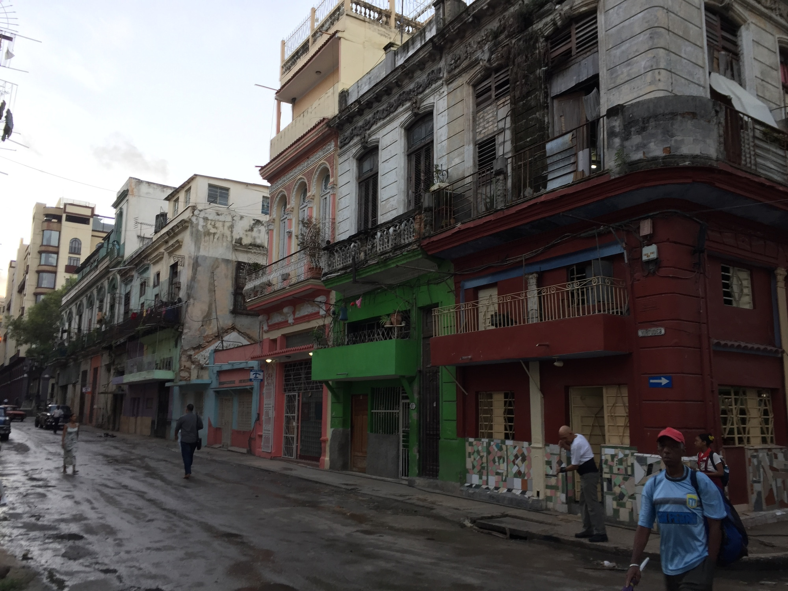
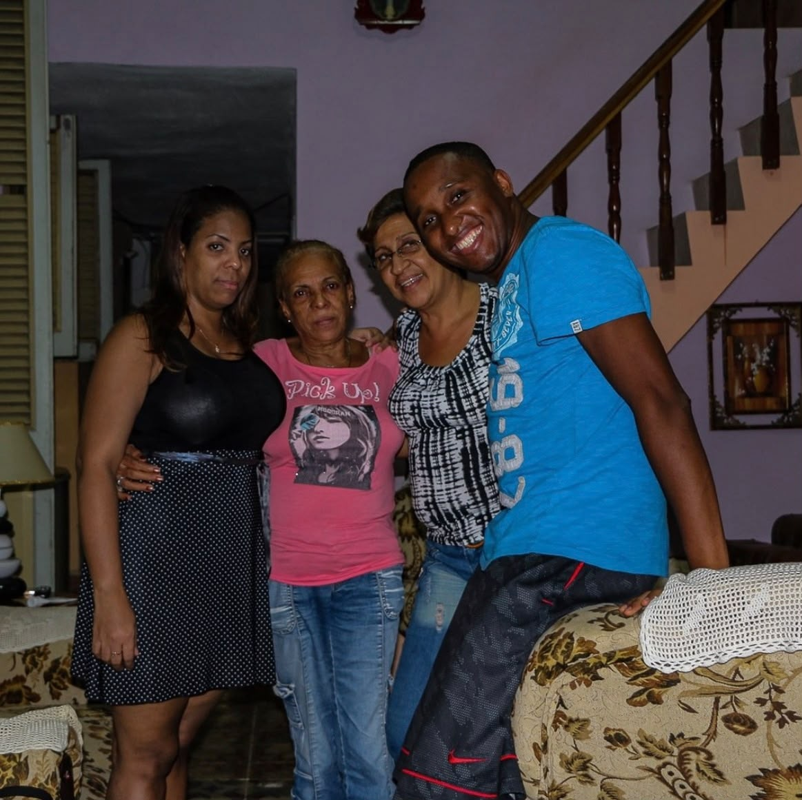
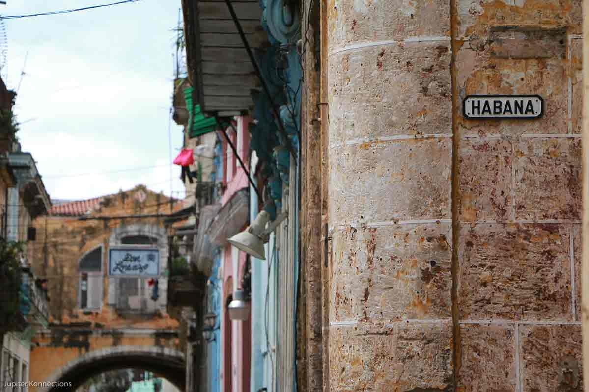
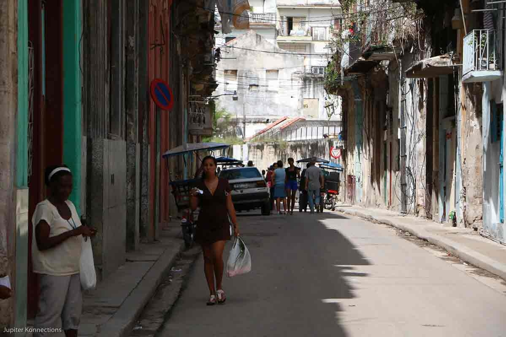
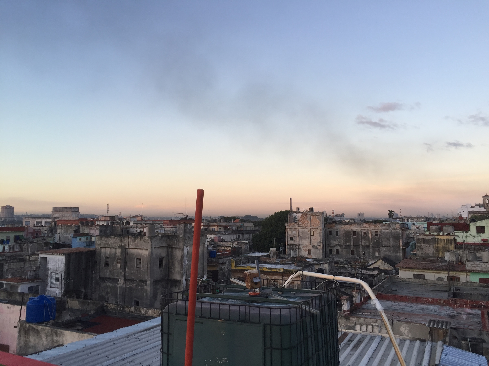

<strong>The great thing about making friends is it can happen in the most unexpected ways in the most unexpected places.</strong> <strong>Hooray, here I was heading to Havana Vieja in Alejandro’s taxi, an Almedron. The name of old American cars found in Cuba. We drove on pitch-black empty roads except for a few streetlights. The breeze from the sea broke away the humidity in the air. It carried the melody of the rumba music from the 50s playing on the radio. </strong>

We arrived just before midnight at my “casa particulares”; Cuban homestays. I was itching to explore the city but after 48 hours of travel, I decided to call it a night.

Waking up in Havana the next morning was exciting because it’s a place I had always wanted to visit having seen it in documentaries. I was excited to explore the old city.

I woke up quite early and, with much excitement, headed out for a run around my neighbourhood. The streets were busy with people getting ready for work and moms preparing kids for school. My run began as a light jog, weaving through the morning commuters along the walls of the old city -“Havana Vieja.”

The mixture of excitement, perhaps a boost to my ego of feeling I was getting a good workout, I broke into a sprint.

Boom! I bolted — no warm-ups, no stretching, whatsoever. I sprinted to what felt like the 100 meters finals. And then, midway through, it happened. A knife cutting sensation ripped through my left thigh. I lost my balance and crashed to the ground.

There I was in agony in the middle of the street, clenching my leg with all my strength. A few passersby would stop by to check on me and with an air of sympathy asked if I was okay, then proceeded on their way. Still in pain, an elderly lady, Eva, came towards me. She asked “todo bien Amigo?” – Are you all alright? With the little Spanish I spoke, I told her what happened.

Seeing that I could barely move, she called over another lady, Isabelle, whom I will later know was her eldest daughter. They helped me off the curb and onto the stairway leading into their home.

After offering me some water and pain-killers, we got talking and got to know each other. Despite the language barrier, it was remarkable how we navigated around and managed to understand each other.

Then they invited me over to their neighbour’s, Martha, a charming old lady in her late 80s with a magnetic smile and presence. She invited us into her home, while Isabelle and Eva helped me to move as I could not walk. The place was welcoming, decorated with white flowers “mariposa”, furnished with a few pictures of her family and a painting of Jesus Christ. They helped me get seated into one of Martha’s sofas while she offered me some balm that she uses to cure her back pain.

I noticed that her television was on and was showing an episode of what I presumed was a Mexican telenovela. Martha loved telenovelas. We struck up a conversation about it. We chatted about my visit to Cuba, where I came from, and what I did for a living. Martha’s family was in Miami. She lived by herself and would get regular visits from her neighbours. Eva worked and Isabelle at a nearby brewery.

As we continued to chat, Isabelle and Eva had to go to work. They suggested we meet in the evening to have dinner. I offered to go with them to buy some groceries. We agreed to meet later that afternoon, then I headed to my homestay. In the evening, we prepared a lovely dinner at Martha’s. I got to enjoy my first dinner with my new Cuban friends. I enjoyed this first encounter. It paved the path for the remainder of my journey. I stayed in touch with my new friends and paid a visit before leaving Cuba.

What struck me most was how getting injured in Havana led me to meet these three lovely ladies and experience incredible Cuban generosity in Havana. It’s a lesson I carry with me to this day. Always leave your heart open to adventure. You never know where it might take you and the people you might meet.

<h2>More from Cuba</h2>

Explore the classic cars that first welcomed me to Havana in <a href="/portfolio/almendrones/">Almendrones, my Cuban car photo essay</a>, or continue with <a href="/portfolio/cuban-sports/">Cuban passion</a>. Find the connected stories and photography in <a href="/destinations/cuba/">my Cuba collection</a>.

