
Following my <strong><em><a href="/the-ultimate-zanzibar-travel-guide/">Zanzibar travel guide</a></em></strong>, I was asked by people raving about Zanzibar and the ideal time to spend on the island. However, they don’t know where to start or get overwhelmed when planning. Let’s face it; Zanzibar has a lot to offer. From its history, rustic nature, stunning beaches, delicious food along with friendly people makes it a fantastic destination for holidays in Africa. And– it’s for a good reason.

<strong><em>Karibu Zanzibar !!</em></strong>

After visiting the island on two occasions, I have compiled a complete seven-day Zanzibar itinerary for you, inspired by my two visits to the island. Excluding your travel time to Tanzania, I think seven days is the perfect amount of time for a trip on Zanzibar. Enough to see the best of the island without being too overwhelmed. 

However, if you are looking to do a safari in Tanzania or a <em><strong><a href="/climbing-mount-kilimanjaro/">hike up Kilimanjaro</a></strong></em>; you will spend a short amount of days on the island. 

I have curated a short version of a stay on Zanzibar at the end of this article. An ideal for a combination with a safari or <a href="/kilimanjaro-full-moon-climb/"><em><strong>trek to Kilimanjaro</strong></em></a>.

For now, let’s review what a seven-day itinerary looks like but before we do, here are a few essential notes to remember when you book your holiday in Tanzania.
<ul><li><strong><em>Visa</em></strong>: Tanzania has an e-visa online program that you can apply for it <a href="https://eservices.immigration.go.tz/visa" rel="noopener noreferrer">here</a>.</li><li><strong><em>Malaria</em></strong>: Visiting low areas, you will be at risk of exposure to Malaria. You may need to take prescription medicine before, during, and after your trip to prevent malaria infection. </li></ul>
 * It’s always a good idea to consult with your doctor in advance to find out what vaccinations or medications might be required when travelling to certain countries.

<h2>Best Time of Year to Visit Zanzibar 
</h2>

The high season begins from June to October. Also, It marks the beginning of the dry season, meaning your chances of enjoying sunny days are exceptionally high. The downside is that this is a busy time to visit Zanzibar and prices for accommodation will be more expensive.

The period from November till March is considered the shoulder season. Demand is low during this time; nonetheless, temperatures are still pleasant with sunny days.

The period around Christmas and New Years marks a new peak and prices for the accommodation will increase again.

Finally, the months of March to May marks the beginning of the tropical rains. During these months, many hotels close down. You’ll likely still have sunny weather, but expect to get wet days during these months. Generally, it’s not the best time to visit Zanzibar.

<h2>How to get around Zanzibar </h2>

Unless you’re flying from the Middle East or Europe, you’ll be getting into Zanzibar from Dar-ae-Salaam. For the itinerary I’m giving you, I highly recommend you stay on two sides of the island to be able to enjoy the diversity the island has to offer.

Nonetheless, should you choose to stay on one part of the island and drive to all your activities I wouldn’t recommend it. Distances on the island are quite long and you will end up spending the majority of your time getting from one point to another which can be exhausting.

Another way to enjoy the beauty of the island would be to rent a car and move around more independently.

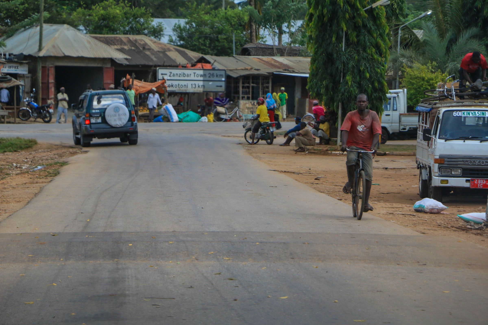
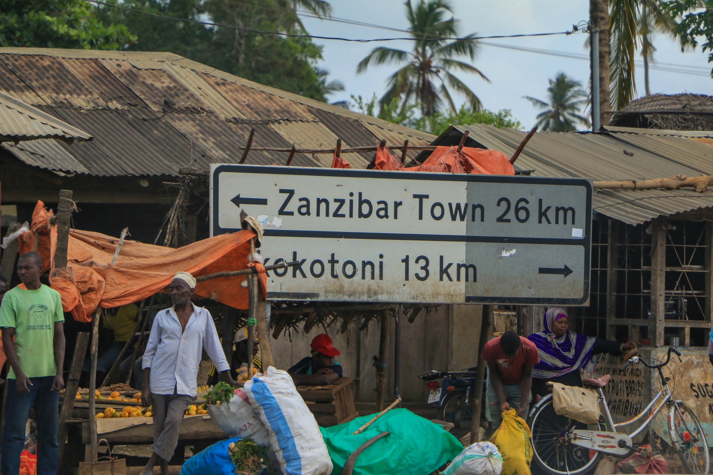

<h2>7 Days in Zanzibar: Where to Visit</h2>

Upon arriving in Zanzibar, drive to Stone Town, which is located 20 minutes from the airport. If you are arriving by ferry, you will dock at Malindi Port. 
<h3>Days 1-2: Stone Town </h3>
Explore Stone Town, a UNESCO world heritage site. Here, dive into the history and culture of Zanzibar and mingle with the locals as they go about their day. 

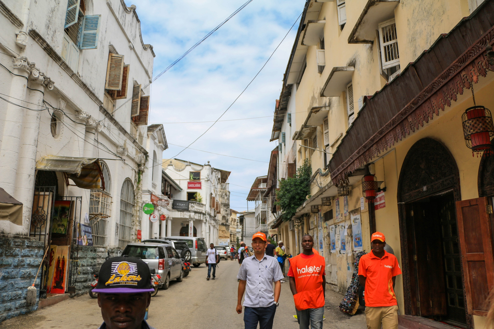

<strong><em>– Where to Stay in Stone Town –</em></strong>
+ <em><strong><a href="https://www.tkqlhce.com/click-100203683-13344203?url=https%3A%2F%2Fwww.hotels.com%2Fho1011249920%2Femerson-spice-hotel-zanzibar-town-tanzania%2F%3Fwapb1%3Dhotelcontentfeed&amp;cjsku=1011249920" rel="noopener noreferrer">Emerson Spice Hotel</a></strong></em>

+ <strong><em><a href="https://www.tkqlhce.com/click-100203683-13344203?url=https%3A%2F%2Fwww.hotels.com%2Fho175357%2Fzanzibar-serena-hotel-zanzibar-town-tanzania%2F%3Fwapb1%3Dhotelcontentfeed&amp;cjsku=175357" rel="noopener noreferrer">Zanzibar Serena Hotel </a></em></strong> 

+ <a href="https://www.dpbolvw.net/click-100203683-13344203?url=https%3A%2F%2Fwww.hotels.com%2Fho738944288%2Fhotel-verde-zanzibar-zanzibar-town-tanzania%2F%3Fwapb1%3Dhotelcontentfeed&amp;cjsku=738944288" rel="noopener noreferrer"><em><strong>Hotel Verde Zanzibar – Azam Luxury Resort and Spa</strong></em></a>

+ <em><strong><a href="https://www.kqzyfj.com/click-100203683-13344203?url=https%3A%2F%2Fwww.hotels.com%2Fho510214%2Fpark-hyatt-zanzibar-zanzibar-town-tanzania%2F%3Fwapb1%3Dhotelcontentfeed&amp;cjsku=510214" rel="noopener noreferrer">Park Hyatt Zanzibar</a></strong></em>

+ Double Tree By Hilton Zanzibar
<strong><em>– What to Do in Stone Town –</em></strong>
 + <em>The Old Slave Market / Anglican Cathedral</em>: Visit the “Anglican Cathedral” built on the remains of the “Old Slave market. Here, you will learn the history and role of the island played as a major trade hub of slavery. 

 + <em>The Darajani Market</em>: Explore the markets stalls filled with treasures; from fruits &amp; vegetables to incense, spices which Zanzibar is renowned for. 

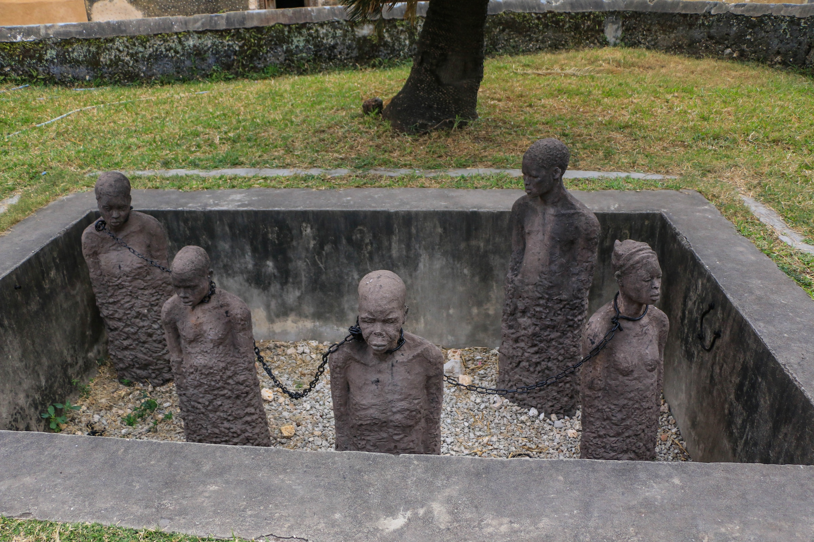
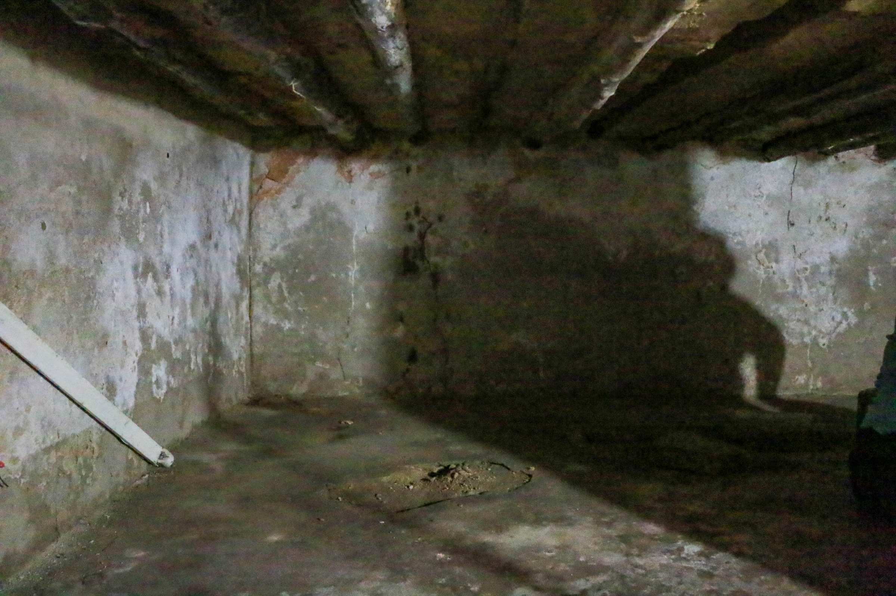
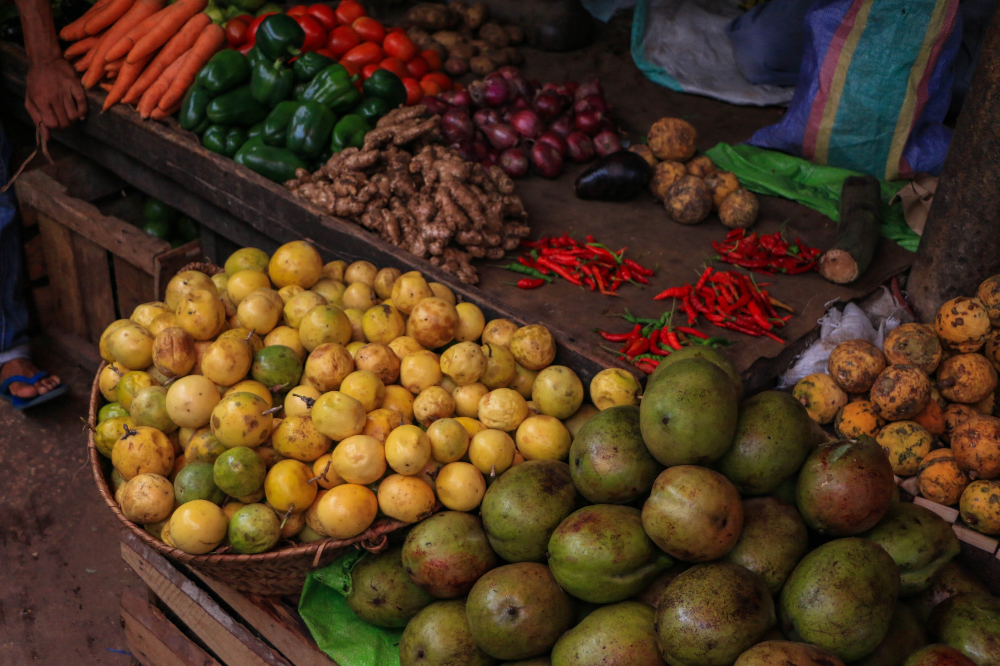
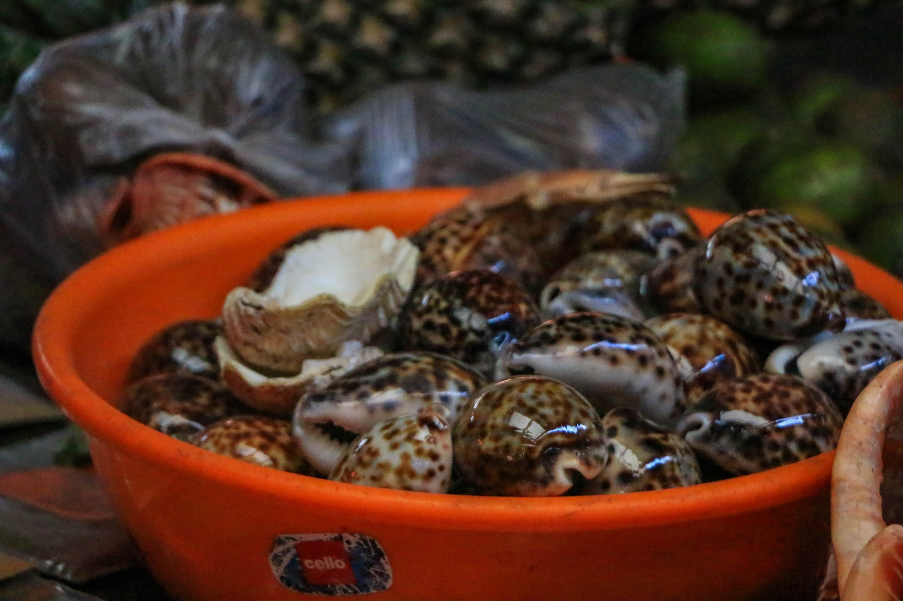

+ <em>Excursion to Prison Island:</em> Take a 30-minute boat ride to reach Prison Island or Changuu Island. The island is five km away from Stone Town. Additionally, visit the nearby tortoise sanctuary. It is home to some of the giant Aldabra tortoises that can also be found in Seychelles.

+ <em>Sunset and dinner at the “Tea House”</em>: Head over to the Emerson Spice Hotel, one of the best restaurants in Zanzibar. Admire a beautiful sunset over the copper rooftops of the old town. 

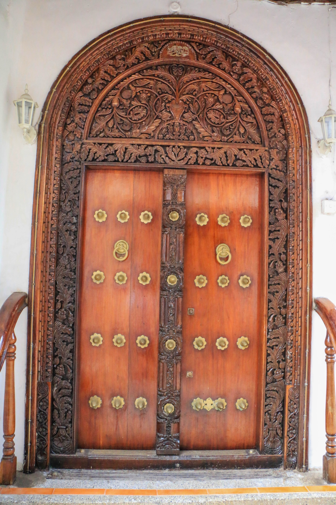
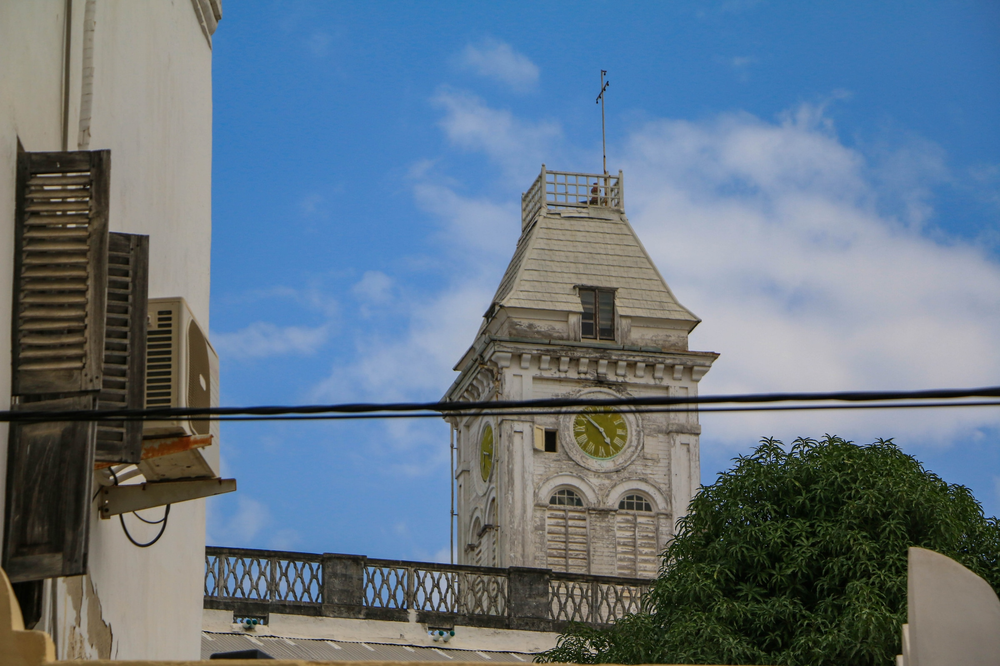

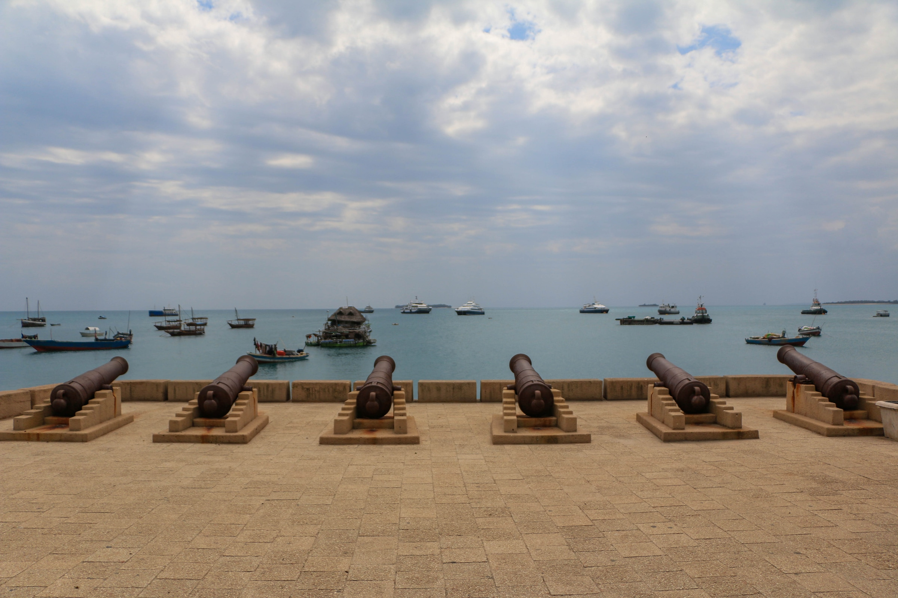

<h3>Days 3-5: North / East Island (Nungwi, Kendwa, Kigomani, Kiwengwa)</h3>
North of the Island, explore the fishing village of Nungwi. Dive into craftsmanship of Dhow boats. These ancients boats are famous on the East coast of Africa. This is also a great place to indulge in water-sports activities. 
<strong><em>– Where to Stay in North / East Island –</em></strong>
+ <em><strong><a href="https://www.kqzyfj.com/click-100203683-13344203?url=https%3A%2F%2Fwww.hotels.com%2Fho325745%2Fmatemwe-lodge-matemwe-tanzania%2F%3Fwapb1%3Dhotelcontentfeed&amp;cjsku=325745" rel="noopener noreferrer">Matemwe Lodge, Asilia Africa – Matemwe</a></strong></em>

+ <a href="https://www.tkqlhce.com/click-100203683-13344203?url=https%3A%2F%2Fwww.hotels.com%2Fho339476%2Fdoubletree-resort-by-hilton-zanzibar-nungwi-nungwi-tanzania%2F%3Fwapb1%3Dhotelcontentfeed&amp;cjsku=339476" rel="noopener noreferrer"><em><strong>DoubleTree by Hilton Resort Zanzibar – Nungwi</strong></em></a>

+ <em><strong><a href="https://www.dpbolvw.net/click-100203683-13344203?url=https%3A%2F%2Fwww.hotels.com%2Fho417314%2Friu-palace-zanzibar-all-inclusive-nungwi-tanzania%2F%3Fwapb1%3Dhotelcontentfeed&amp;cjsku=417314" rel="noopener noreferrer">Hotel Riu Palace Zanzibar – Nungwi</a></strong></em>

+ <em><strong><a href="https://www.anrdoezrs.net/click-100203683-13344203?url=https%3A%2F%2Fwww.hotels.com%2Fho378694%2Fessque-zalu-zanzibar-nungwi-tanzania%2F%3Fwapb1%3Dhotelcontentfeed&amp;cjsku=378694" rel="noopener noreferrer">Essque Zalu Zanzibar – Nungwi</a></strong></em>

+ <a href="https://www.anrdoezrs.net/click-100203683-13344203?url=https%3A%2F%2Fwww.hotels.com%2Fho647946880%2Fzuri-zanzibar-kendwa-tanzania%2F%3Fwapb1%3Dhotelcontentfeed&amp;cjsku=647946880" rel="noopener noreferrer"><strong><em>Zuri Zanzibar – Kendwa</em></strong></a>

+ <em><strong><a href="https://www.anrdoezrs.net/click-100203683-13344203?url=https%3A%2F%2Fwww.hotels.com%2Fho890966848%2Fsevi-boutique-hotel-matemwe-tanzania%2F%3Fwapb1%3Dhotelcontentfeed&amp;cjsku=890966848" rel="noopener noreferrer">SeVi Boutique Hotel Zanzibar – Kigomani</a></strong></em>

+ <em><strong><a href="https://www.jdoqocy.com/click-100203683-13344203?url=https%3A%2F%2Fwww.hotels.com%2Fho938992608%2Fahg-dream-s-bay-boutique-hotel-matemwe-tanzania%2F%3Fwapb1%3Dhotelcontentfeed&amp;cjsku=938992608" rel="noopener noreferrer">AHG Dream’s Bay Boutique Hotel – Kigomani</a></strong></em>

+ <a href="https://www.jdoqocy.com/click-100203683-13344203?url=https%3A%2F%2Fwww.hotels.com%2Fho234568%2Fmelia-zanzibar-kiwengwa-tanzania%2F%3Fwapb1%3Dhotelcontentfeed&amp;cjsku=234568" rel="noopener noreferrer"><em><strong>Melia Zanzibar – Kiwengwa</strong></em></a>

+ Kilindi Zanzibar – Nungwi

+ Andbeyond Mnemba Island 
<strong><em>– What to Do in the North / East Island –</em></strong>
+ Water-sports: Looking for an active holiday, you can practice parasailing, jetski, among other things. With the proximity to the Mnemba Atoll and a well-preserved reef, snorkelling and scuba diving is superb here.

+ <em>Sailing</em>: Drift along the spectacular coastline into the mangrove swamps in a local Swahili dhow. The mangrove swamps are typical of the island. Serene yet alive with birds, the mangroves are a source of food and timber for the traditional Swahili homes. While you’re there, you will also be invited to imitate the locals and carry out some traditional hand-line fishing. 

+ Horse-riding: On the beaches of Nungwi, you can ride horses during morning or evening sessions. Go swimming with the horses or ride them to nearby villages.

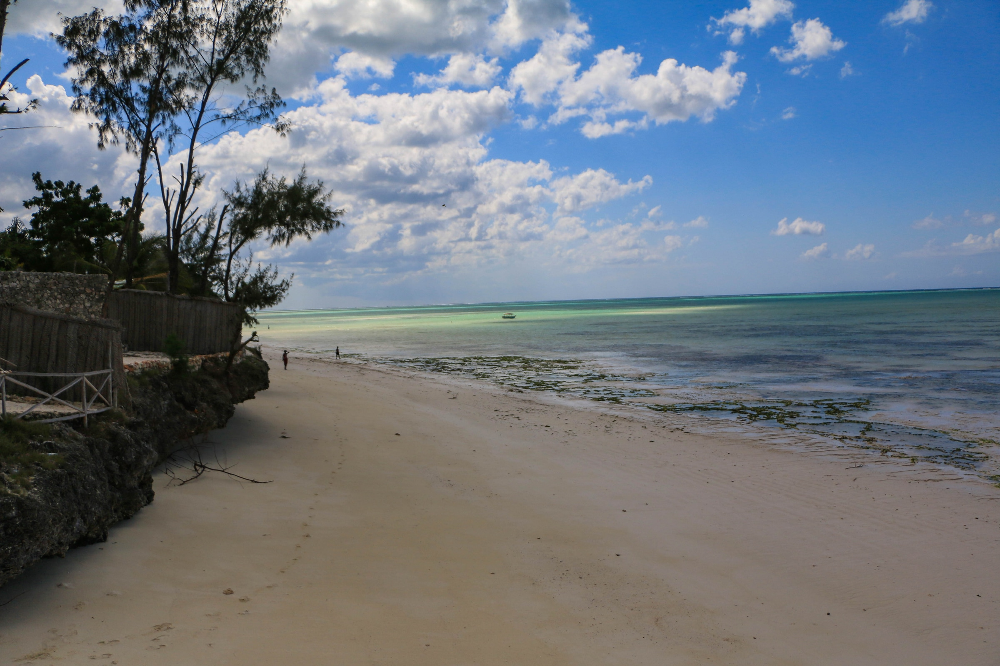
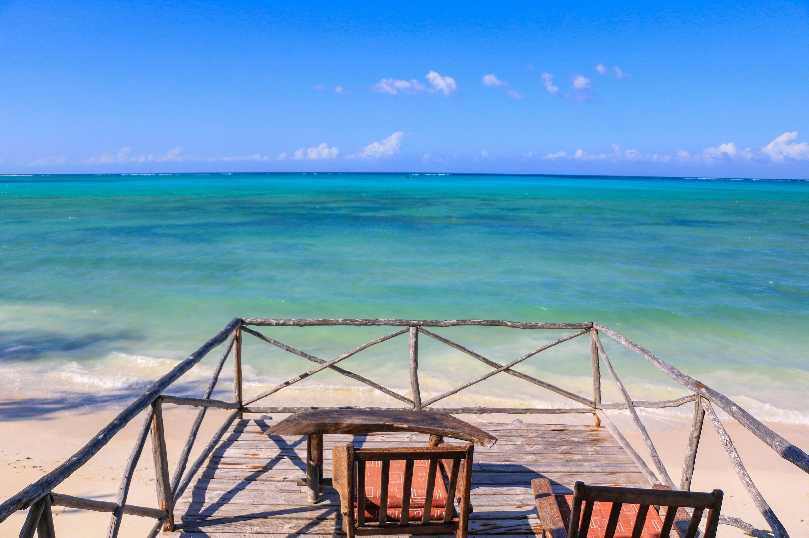

+ <em>Spice Farm Tours</em>: On your way to the North and Eastern parts of the island, you can make a 1-2hr stop and visit a Spice Farm plantation. You’ll learn all about the spices found on the island by visiting any of the local spice plantations. You’ll also get the opportunity to taste and purchase them. 

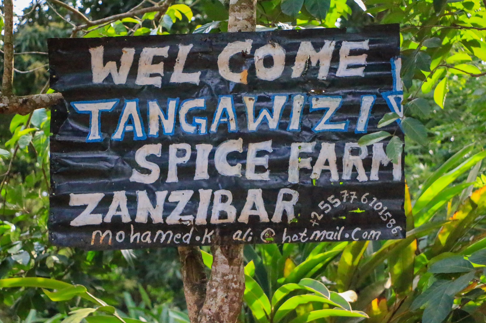
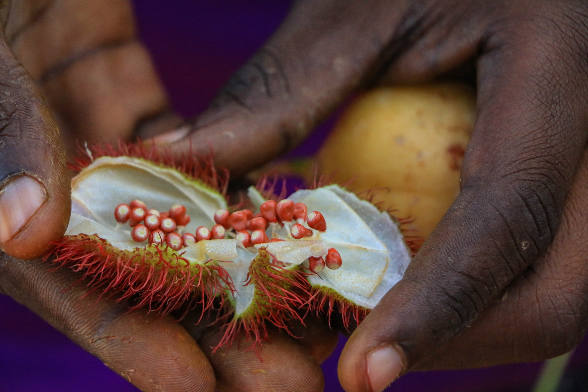
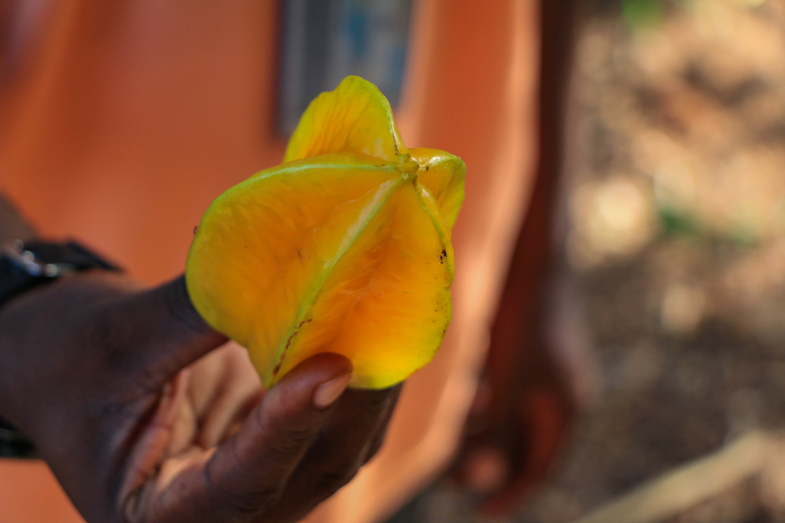
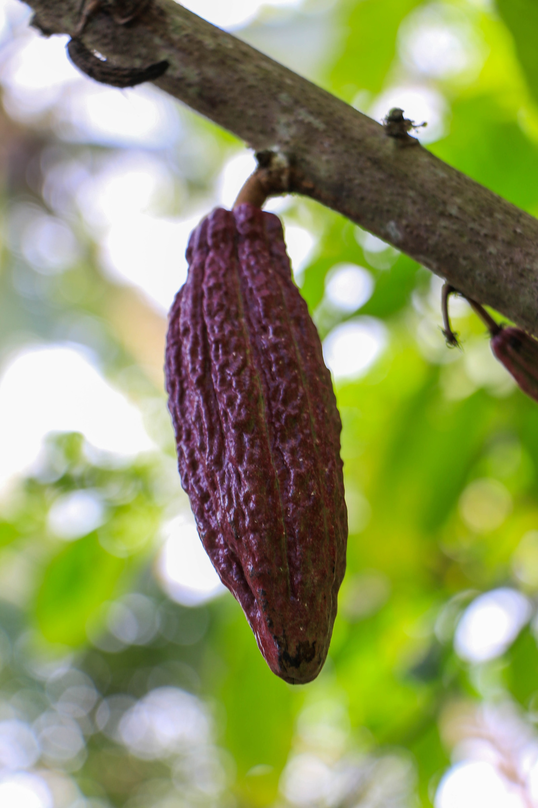

<h3>Days 6-7: East / South Island (Bwejuu, Paje, Pwani Mchangani, Pongwe and Jambiani)</h3><strong><em>– Where to Stay in East / South Island –</em></strong>
+ <em><strong><a href="https://www.kqzyfj.com/click-100203683-13344203?url=https%3A%2F%2Fwww.hotels.com%2Fho959823648%2Ftikitam-palms-boutique-hotel-pongwe-tanzania%2F%3Fwapb1%3Dhotelcontentfeed&amp;cjsku=959823648" rel="noopener noreferrer">Tikitam Palms Boutique Hotel – Pongwe</a></strong></em>

+ <em><strong><a href="https://www.kqzyfj.com/click-100203683-13344203?url=https%3A%2F%2Fwww.hotels.com%2Fho493076%2Fseasons-lodge-zanzibar-pongwe-tanzania%2F%3Fwapb1%3Dhotelcontentfeed&amp;cjsku=493076" rel="noopener noreferrer">Seasons Lodge Zanzibar – Pongwe</a></strong></em>

+ <strong><em><a href="https://www.tkqlhce.com/click-100203683-13344203?url=https%3A%2F%2Fwww.hotels.com%2Fho572918%2Ftulia-zanzibar-unique-beach-resort-pongwe-tanzania%2F%3Fwapb1%3Dhotelcontentfeed&amp;cjsku=572918" rel="noopener noreferrer">Tulia Zanzibar Unique Beach Resort – Pongwe</a></em></strong>

+ <em><strong><a href="https://www.kqzyfj.com/click-100203683-13344203?url=https%3A%2F%2Fwww.hotels.com%2Fho493910%2Fbaraza-resort-spa-zanzibar-all-inclusive-dongwe-tanzania%2F%3Fwapb1%3Dhotelcontentfeed&amp;cjsku=493910" rel="noopener noreferrer">Baraza Resort &amp; Spa Zanzibar – Bwejuu</a></strong></em>

+ <strong><em><a href="https://www.dpbolvw.net/click-100203683-13344203?url=https%3A%2F%2Fwww.hotels.com%2Fho579591%2Fzawadi-hotel-zanzibar-all-inclusive-dongwe-tanzania%2F%3Fwapb1%3Dhotelcontentfeed&amp;cjsku=579591" rel="noopener noreferrer">Zawadi Hotel Zanzibar – Dongwe</a></em></strong>

+ <strong><a href="https://www.anrdoezrs.net/click-100203683-13344203?url=https%3A%2F%2Fwww.hotels.com%2Fho449486%2Fzanzibar-white-sand-luxury-villas-spa-paje-tanzania%2F%3Fwapb1%3Dhotelcontentfeed&amp;cjsku=449486" rel="noopener noreferrer"><em>Zanzibar White Sand Luxury Villas &amp; Spa Experience</em></a></strong>
<strong><em>– What to Do in the East / South Island –</em></strong>
Due to the tidal movement of the ocean on the East coast, it creates opportunities to access the sea bed and practise certain activities. Below, I shared a sample of activities you can partake in during the ocean tides.

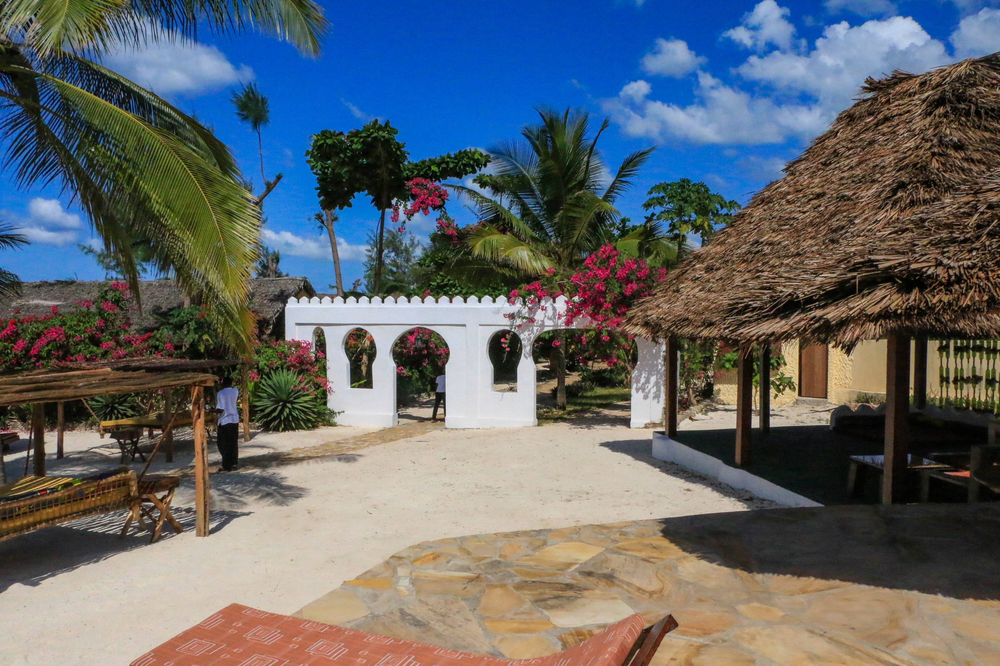
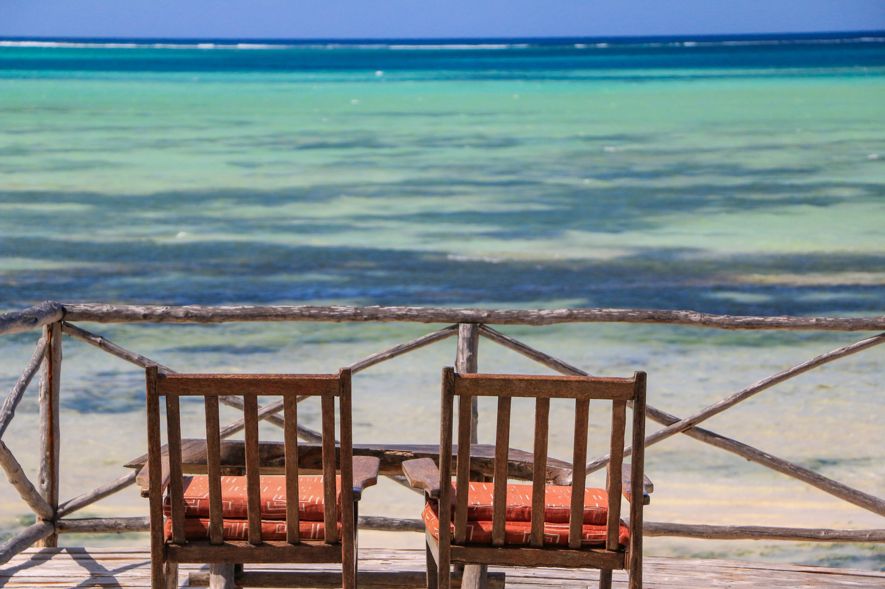

<strong><em>Low tide activities</em></strong>:

+ <em>Coral Reef Exploration</em>: Have a close encounter with the marine world by taking walks along the coral reef headed by a professional guide. Learn more about the pristine coral reef, the formations of corals and enjoy the spectacular views along the coast.

<strong><em>High tide activities</em></strong>:

+ <em>Kitesurfing</em>: Looking for some action? The beaches here provide ideal conditions for windsurfing. And if you don’t have your gear (no required generally), you can rent ones from your hotel or a nearby kitesurfing school. Additionally, you can partake in other sporting activities such as windsurfing, wind sailing and kayaking.

+ <em>Visits to the fishing villages</em>: For an authentic glimpse into the Zanzibari way of life, stroll around the local communities of Bwejuu, Pongwe, Jambiani or those close to your hotel. Here, visit a school and a mosque, both of which play a significant role in the Swahili culture of Zanzibar. Strike a chat with locals at the stalls while sampling their produce. Enjoy a warm welcome, learn about their way of life and more about the Swahili culture. 

+ <em>Visit the Jozani Chwaka Bay National Park</em>: Located in the middle of Zanzibar and close to the beaches of Pingwe, Paje and Jambiani. Explore the Park’s endemic Red Colobus Monkey, Bush Babies, Sykes Monkey, and a variety of species of birds.

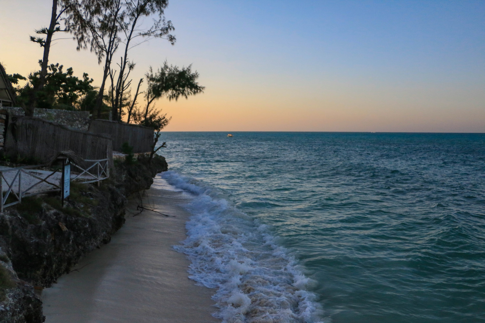

<h2> Zanzibar after a Safari &amp; Kilimanjaro trip </h2>

After your safari expedition or hike to Kilimanjaro, a great way to end your holiday in Tanzania is by taking a few days to unwind in Zanzibar. Below is a shorter itinerary I have come up with perfect for five days in Zanzibar.

<em>One variation of your stay would be to begin your visit in the Northern part of Zanzibar and finish your stay in Stone Town</em>. 

<h3>Days 1-4: Head North to Nungwi/East Coast</h3><ul><li>Stay in Nungwi, Kendwa, Mnemba, Matenwe, Pwani Mchangani, Kigomani, Kiwengwa and Pongwe. Find hotels and pricing <a href="https://fave.co/2V6Ule6" rel="noopener noreferrer">here</a>.</li><li>For a relaxing holiday, choose one of the more secluded beaches of Kendwa, or Matenwe, Kiwengwa…</li><li>Explore the fishing village of Mkokotoni</li><li>Learn more about the cultivation of spices by taking a visit to a spice plantation. </li><li>If you still have energy left after your safari or Kilimanjaro hike, you can go diving at the Mnemba Atoll or go horse riding on the beaches of Nungwi. </li></ul>

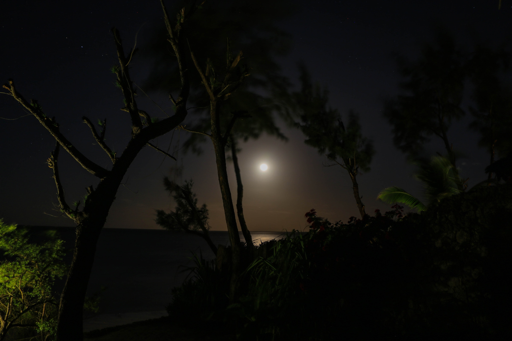
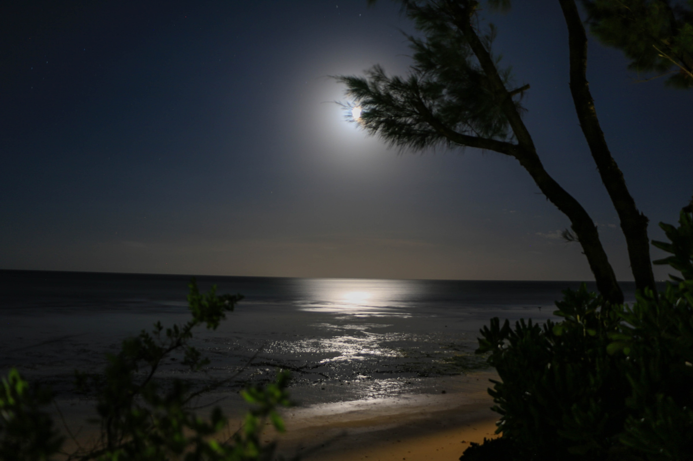

<h3>Day 5: Stone Town  </h3><ul><li>Stay in Stone Town since its close to the airport. Find hotels and pricing <a href="https://fave.co/2V6Ule6" rel="noopener noreferrer">here</a>.</li><li>Visit the Anglican Church /Slave market and a visit to the Darajani market. Consider taking a walking tour around the Old town close to the Malindi port with antique emporiums and ancient forts. </li><li>Take an excursion to Prison Island.</li><li>Enjoy an evening dinner at “<em>Tea House” </em>at the<em> Emerson Spice Hotel.</em></li></ul>
<em>And another variation would be to begin your stay in Stone Town and finishing in the southern part of Zanzibar. </em>

<h3>Day 1: Stone Town (see activities above)</h3><h3>Days 2-5: Heading South to Jambiani/East Coast</h3><ul><li>Stay in Bwejuu, Paje, Pingwe and Jambiani. Find hotels and pricing <a href="https://fave.co/2V6Ule6" rel="noopener noreferrer">here</a>.</li><li>Explore the forest trails of the Jozani Chwaka Bay National Park looking for Red Colobus Monkey, Bush Babies, Sykes Monkey and the elusive Zanzibar Leopard.  </li><li>Go on a bike tour exploring the communities on the south of the island. </li><li>Stay active by taking windsurfing, wind sailing and kitesurfing lessons on the shores of Pingwe and Jambiani. </li><li>Depart for a day adventure to the fishing village of Kizimkazi where you will embark on a Dolphin safari in the Menai Bay.</li></ul>
There you have it! An extensive look into what you can do during your next trip to Zanzibar. 

<h2>Continue the journey</h2>

For more background on the island, read my <a href="/the-ultimate-zanzibar-travel-guide/">Zanzibar travel guide</a>. If this is your recovery stop after the mountain, follow my <a href="/kilimanjaro-full-moon-climb/">seven-day Kilimanjaro full moon climb</a> or start with the <a href="/climbing-mount-kilimanjaro/">practical Kilimanjaro climbing guide</a>. You can find all four articles in <a href="/destinations/tanzania/">my Tanzania collection</a>.

